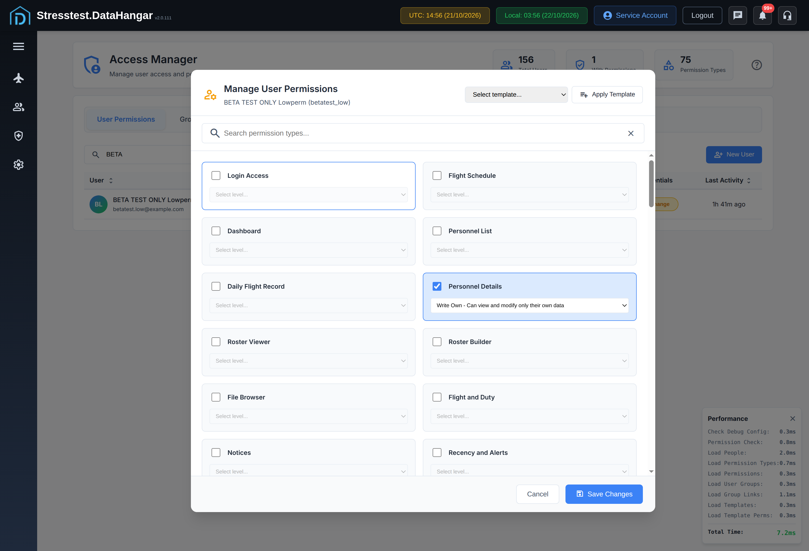
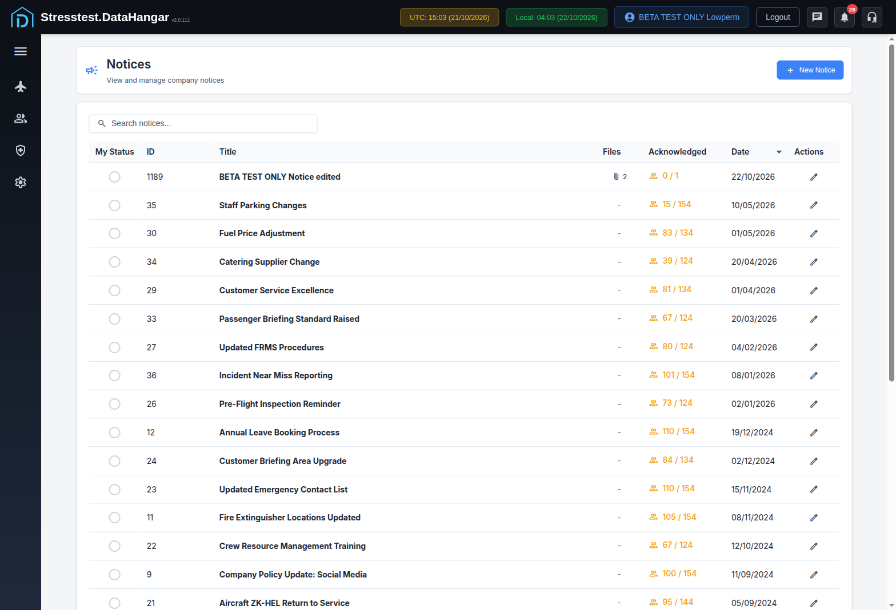
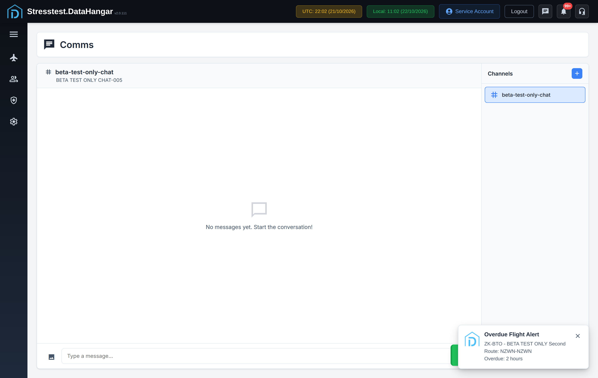
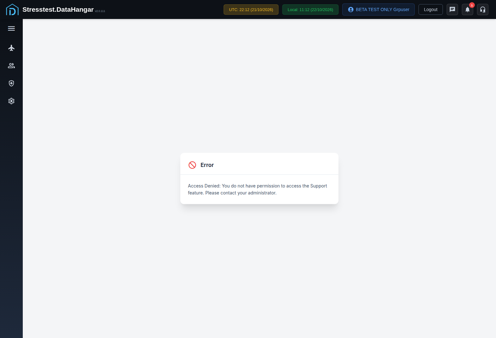
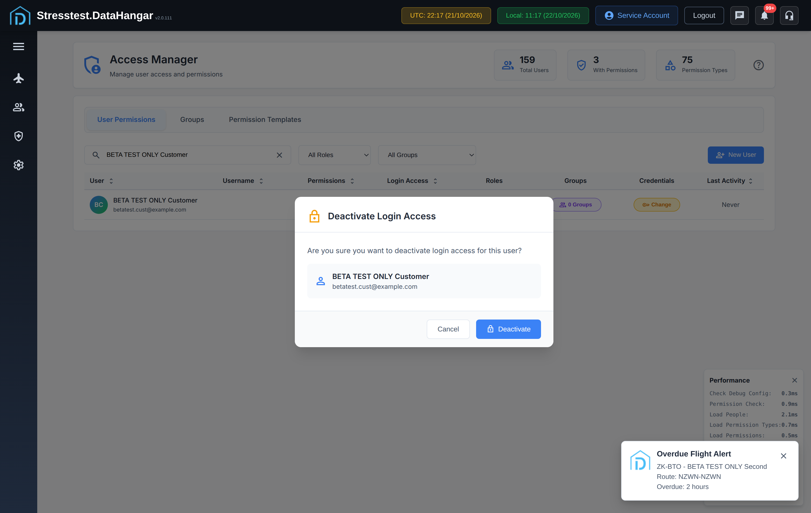
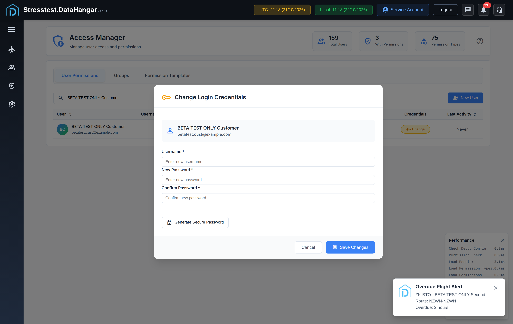

# Access Manager bugs (settings_accessmanager)

From the DataHangar staging audit (stresstest.datahangar.net, v2.0.111). 11 bugs. Full audit: https://github.com/defyent/devin/pull/2 (debugging/).

Related: BUG-PERM-001 (sidebar shows modules the user has no permission for). Checklist row AM-018 also fails: a non-admin with Access Manager WA gets "Access Denied: You need All Access permission to access the access manager", so they can never reach Roles. This is tracked under BUG-AM-005.

| Bug | Severity | Title |
|---|---|---|
| BUG-AM-001 | Medium | New User accepts a 6-character password (placeholder and Change Credentials require 10) |
| BUG-AM-005 | Medium | Access Manager: 16 permission types appear twice with the same name (e.g. two "Flight Schedule" cards with different levels) |
| BUG-AM-006 | Medium | Access Manager has no Chat permission, so you can't give Chat to a non-admin user |
| BUG-POP-003 | Medium | Access Manager Groups popup: Esc closes with unsaved changes and no warning; reopening shows the unsaved ticks as if saved |
| BUG-SUP-004 | Medium | Support: the only permission level is All Access, so regular staff can't raise or see their own tickets |
| BUG-AM-002 | Low | Last Activity hover date ignores Settings > Time Zone format |
| BUG-AM-003 | Low | Last Activity column sort does not change order |
| BUG-AM-004 | Low | Permission level dropdown shows bare codes 'WA' and 'G' next to full labels |
| BUG-AM-007 | Low | Access Manager: a customer created from Flight Details is Active with no login credentials |
| BUG-POP-001 | Low | Error modal ('Failed to Create User') does not close with Esc |
| BUG-POP-002 | Low | Manage User Permissions uses a native browser confirm() for unsaved changes |

## BUG-AM-001: New User accepts a 6-character password (placeholder and Change Credentials require 10)

- Severity: Medium
- Area: Access Manager
- Checklist row: AM-010 (04-access-manager)

Steps:
1. Settings and Tools > Access Manager > New User
2. Fill all fields, Password and Confirm = a 6-character value (e.g. 'short1')
3. Click Create User

Expected: Rejected: 'Password must be at least 10 characters' (placeholder says 'Minimum 10 characters'; Change Credentials needs 10).

Actual: Toast 'User BETA TEST ONLY Lowperm created successfully'; account created with the 6-char password.

Cause: No min-length check in the New User handler (client and server) for create; only Change Credentials enforces 10.

## BUG-AM-005: Access Manager: 16 permission types appear twice with the same name (e.g. two "Flight Schedule" cards with different levels)

- Severity: Medium
- Area: Access Manager
- Checklist row: PERM-001 (90-xc-permissions)

Steps:
1. Settings and Tools > Access Manager > User Permissions.
2. Click the Permissions badge on BETA TEST ONLY Lowperm.
3. Scroll through the permission cards.
4. Give the user the first "Notices" card at WO and Save, then log in as that user and open Notices.

Expected: Each permission type shows once, or the cards are named or grouped clearly enough to tell them apart.

Actual: 16 names are shown more than once, with no heading or hint to tell them apart: Flight Schedule (ids 2, 209), Dashboard (3, 208), Personnel List (4, 215), Daily Flight Record (5, 213), Personnel Details (6, 216), Roster Viewer (7, 217), Roster Builder (8, 223), File Browser (9, 225), Flight and Duty (10, 31, 218), Notices (11, 219), Safety Reports (13, 30, 221), Hazard Register (14, 222), System Settings (15, 211), Form Builder (16, 224), Exam Builder (18, 232), Access Manager (34, 210). The copies offer different levels: Flight Schedule id 2 offers RA/WA/G, id 209 offers A/RA/WG/RG. An admin can easily give the wrong one. This has a real effect: giving Lowperm the first "Notices" card (id 11) at WO still gives "Access Denied: You do not have permission to access Notices", so the module checks the other Notices card. The first "Flight Schedule" card (id 2) is the one that works for the schedule, so you cannot tell from the name which copy each page uses. Also, BETA TEST ONLY Second with Access Manager WA on one card and A on the other still gets 'You need All Access permission to access the access manager' (AM-018).

Cause: The permission types table has more than one row with the same display name (probably a second set added for a newer module version). The editor lists every row by name only, with no grouping or description.

## BUG-AM-006: Access Manager has no Chat permission, so you can't give Chat to a non-admin user

- Severity: Medium
- Area: Access Manager / Chat
- Checklist row: CHAT-005 (28-chat)

Steps:
1. Settings and Tools > Access Manager > BETA TEST ONLY Second > Permissions.
2. Look through all 76 permission cards for Chat (or Comms).
3. Log in as BETA TEST ONLY Grpuser and click the chat icon in the header.

Expected: There is a Chat card (the checklist says Chat = A), so an admin can let staff use Chat.

Actual: None of the 76 cards is Chat or Comms. Every non-admin test user sees the chat icon in the header but gets 'Access Denied: You do not have permission to access the Chat feature'. Only the admin can use Chat, so you can't test unread badges between two users.

## BUG-POP-003: Access Manager Groups popup: Esc closes with unsaved changes and no warning; reopening shows the unsaved ticks as if saved

- Severity: Medium
- Area: Access Manager
- Checklist row: AM-019 (04-access-manager)

Steps:
1. Settings and Tools > Access Manager, search betatest_low
2. Click the '0 Groups' badge
3. Tick 'Crew' (On Roster auto-ticks)
4. Press Esc
5. Note the row still says '0 Groups'
6. Click the Groups badge again

Expected: Esc with unsaved changes asks to confirm (app modal); if discarded, the popup reopens with the saved memberships.

Actual: Popup closes silently, nothing is saved, and on reopen 'Crew' is still ticked even though the user has 0 groups. Saving then would apply changes the user thought were thrown away.

Cause: Groups modal has no dirty check on Esc/close and doesn't reset its checkbox state from the server data when reopened.

## BUG-SUP-004: Support: the only permission level is All Access, so regular staff can't raise or see their own tickets

- Severity: Medium
- Area: Support / Access Manager
- Checklist row: SUP-008 (27-support)

Steps:
1. Access Manager > any user > Permissions > Support Tickets: the only level offered is A.
2. Log in as BETA TEST ONLY Grpuser (no Support permission) > Administration > Support.
3. Compare with BETA TEST ONLY Second (Support Tickets = A).

Expected: A regular user can open Support, raise tickets and see only their own. An admin sees all tickets.

Actual: Grpuser gets 'Access Denied: You do not have permission to access the Support feature', although Support is in their sidebar and the header headset icon. The only way to let staff raise a ticket is All Access, which shows every ticket. There's no 'own tickets' level.

## BUG-AM-002: Last Activity hover date ignores Settings > Time Zone format

- Severity: Low
- Area: Access Manager
- Checklist row: AM-007 (04-access-manager)

Steps:
1. Settings > Time Zone is DD/MM/YYYY, 24-hour
2. Access Manager: hover the Last Activity value of Service Account ('4 mins ago')

Expected: Exact date in org format, e.g. 21/10/2026 20:45 (local).

Actual: Tooltip '21 Oct 2026, 07:45 am': hard-coded format, 12-hour, and shows the UTC time (07:45) rather than local (20:45).

Cause: Tooltip built with toLocaleString / fixed format instead of formatDateWithConfig; timestamp not converted to org time zone.

## BUG-AM-003: Last Activity column sort does not change order

- Severity: Low
- Area: Access Manager
- Checklist row: AM-005 (04-access-manager)

Steps:
1. Access Manager > User Permissions
2. Click the Last Activity header, then click it again

Expected: Ascending then descending: Service Account (only user with activity) moves from top to bottom.

Actual: Same order both times: Service Account, Alex Richards, Zoe Mason, Curtis Porter... User and Username sort correctly.

Cause: Sort comparator for Last Activity ignores direction (or sorts on the relative text with 'Never' handled separately).

## BUG-AM-004: Permission level dropdown shows bare codes 'WA' and 'G' next to full labels

- Severity: Low
- Area: Access Manager > Manage User Permissions
- Checklist row: AM-020 (04-access-manager)

Steps:
1. Access Manager > a user's 'N Permissions' badge
2. Look at the level dropdown for Personnel Details (also Flight Schedule, Dashboard, DFR)

Expected: Every level has a readable label, e.g. 'Read/Write All - Can view and modify all data', 'Group - level defined by group membership' (as in the Help).

Actual: Options: 'Read Only All - ...', 'WA', 'Read Only Own - ...', 'Write Own - ...', 'G'.

Cause: Label map in accessmanager JS is missing WA and G (falls back to the code).

## BUG-AM-007: Access Manager: a customer created from Flight Details is Active with no login credentials

- Severity: Low
- Area: Access Manager
- Checklist row: AM-015 (90-xc-permissions)

Steps:
1. Open flight #42910 > Customer tab > New Customer.
2. Enter First Name, Last Name, Company and Email, then click Save Changes.
3. Settings and Tools > Access Manager > search for the new customer.

Expected: The new customer is Inactive until login credentials are set. The rule 'User must have login credentials before activation' also applies when the person is created.

Actual: BETA TEST ONLY Customer (#279) shows Login Access = Active, with no username and Last Login 'Never'. If you deactivate it and then click Inactive, Change Login Credentials opens as it should, so the check only runs when you activate from Access Manager.

## BUG-POP-001: Error modal ('Failed to Create User') does not close with Esc

- Severity: Low
- Area: Access Manager (shared errorModal)
- Checklist row: AM-S03 (04-access-manager)

Steps:
1. Access Manager > New User
2. Username 'root', fill the rest, Create User
3. Error modal 'Failed to Create User - That username is not allowed' opens; press Esc

Expected: Esc closes it (as Help does on the same page).

Actual: Modal stays open; only OK closes it. Same as the logout confirm (BUG-LOG-002).

Cause: #errorModal has no keydown Escape handler.

## BUG-POP-002: Manage User Permissions uses a native browser confirm() for unsaved changes

- Severity: Low
- Area: Access Manager > Manage User Permissions
- Checklist row: AM-023 (04-access-manager)

Steps:
1. Access Manager > a user's 'N Permissions' badge
2. Tick any permission type
3. Click Cancel

Expected: App-styled confirm modal (like Activate Login Access / Logout), Esc = stay.

Actual: Native Chrome confirm: 'You have unsaved changes. Are you sure you want to cancel?'. Looks out of place, cannot be styled, blocks the page.

Cause: accessmanager JS calls window.confirm() in the Cancel handler.

