# DataHangar test run report (stresstest, v2.0.111)

Generated from the checklist results and bug files on this branch. Testing is still in progress; see [TRACKER.md](TRACKER.md) for coverage.

## Summary

| Severity | Count |
|---|---|
| Medium | 18 |
| Low | 15 |

| Bug | Severity | Module | Title |
|---|---|---|---|
| [BUG-AM-001](bugs/BUG-AM-001.md) | Medium | Access Manager | New User accepts a 6-character password (placeholder and Change Credentials require 10) |
| [BUG-DSH-003](bugs/BUG-DSH-003.md) | Medium | Dashboard / Personnel Details | Dashboard recency item opens Personnel Details on the wrong tab (Personal Details instead of Recency and Renewals) |
| [BUG-FD-001](bugs/BUG-FD-001.md) | Medium | Flight Details | Flight Details Save Changes does not return to the Flight Schedule and gives no success message |
| [BUG-FD-002](bugs/BUG-FD-002.md) | Medium | Flight Details | Flight Details History misses edits saved in Flight Details and shows a false 'Aircraft: ZK-SIM > Unassigned' on schedule moves |
| [BUG-FD-004](bugs/BUG-FD-004.md) | Medium | Flight Details | Leg PIC / Secondary Flight Crew dropdowns offer passengers (e.g. a custom passenger can be chosen as leg PIC) |
| [BUG-FD-005](bugs/BUG-FD-005.md) | Medium | Flight Details | Leg with two unknown waypoints: only the first is offered for adding, the second is silently dropped on save |
| [BUG-FS-001](bugs/BUG-FS-001.md) | Medium | Flight Schedule > Flight Details (new) | New flight defaults to the current UTC time instead of local time (SAR TIME labelled LOCAL shows UTC+1h) |
| [BUG-FS-002](bugs/BUG-FS-002.md) | Medium | Flight Schedule | Esc does not end copy/paste mode on the Flight Schedule - the next click + Ctrl+V creates another flight |
| [BUG-FS-003](bugs/BUG-FS-003.md) | Medium | Flight Schedule | Flight Schedule header overlaps when Live Edit is on - title covered, location pill cut off and its 'Show All' button cannot be clicked |
| [BUG-FS-004](bugs/BUG-FS-004.md) | Medium | Flight Schedule > Location Planner | Planner Add Location replaces the New Booking popup - typed booking and location input is lost |
| [BUG-FS-006](bugs/BUG-FS-006.md) | Medium | Flight Schedule | Flight Schedule month view is slow: flightschedule_json takes ~1.6 s and rendering 2,500 events ~4.5 s |
| [BUG-FS-007](bugs/BUG-FS-007.md) | Medium | Flight Schedule | Edit-mode idle timeout switches Live Edit off silently, throws 'calendarEl is not defined' and leaves the schedule blank |
| [BUG-LOG-003](bugs/BUG-LOG-003.md) | Medium | Login / 2FA (main) | 'Trust this device for 30 days' is lost on Logout (logout deletes the trusted-device cookie) |
| [BUG-NAV-001](bugs/BUG-NAV-001.md) | Medium | Shell (main) / Personnel Details | Leaving a page with unsaved changes gives no warning; edits are lost |
| [BUG-PD-001](bugs/BUG-PD-001.md) | Medium | Personnel Details / My Account | personneldetails/index.js is truncated: ReferenceError getPickerMod on every load |
| [BUG-PD-003](bugs/BUG-PD-003.md) | Medium | Personnel Details > Security | 2FA setup: one wrong verification code closes the setup dialog and issues a new secret |
| [BUG-PERM-002](bugs/BUG-PERM-002.md) | Medium | Personnel Details / My Account | User with no permissions cannot open their own My Account (no self-service password / 2FA) |
| [BUG-POP-003](bugs/BUG-POP-003.md) | Medium | Access Manager | Access Manager Groups popup: Esc closes with unsaved changes and no warning; reopening shows the unsaved ticks as if saved |
| [BUG-AM-002](bugs/BUG-AM-002.md) | Low | Access Manager | Last Activity hover date ignores Settings > Time Zone format |
| [BUG-AM-003](bugs/BUG-AM-003.md) | Low | Access Manager | Last Activity column sort does not change order |
| [BUG-AM-004](bugs/BUG-AM-004.md) | Low | Access Manager > Manage User Permissions | Permission level dropdown shows bare codes 'WA' and 'G' next to full labels |
| [BUG-DSH-001](bugs/BUG-DSH-001.md) | Low | Dashboard | Dashboard side tabs are icon-only with no tooltip or label |
| [BUG-FD-003](bugs/BUG-FD-003.md) | Low | Flight Details | Times and Meters: no link to the previous flight next to 'Previous' meter readings |
| [BUG-FS-005](bugs/BUG-FS-005.md) | Low | Flight Schedule | JS error on every Live Edit toggle: Cannot read properties of null (reading 'scrollTop') |
| [BUG-LOG-001](bugs/BUG-LOG-001.md) | Low | Shell (main) | Login Message popup reappears on every browser reload |
| [BUG-LOG-002](bugs/BUG-LOG-002.md) | Low | Shell (main) | Logout throws JS error removeChild; Esc doesn't close the Log Out confirm |
| [BUG-PD-002](bugs/BUG-PD-002.md) | Low | Personnel Details > Security | Personnel Details modals (Enable 2FA, Setup Error alert): title right-aligned, away from its icon |
| [BUG-PD-004](bugs/BUG-PD-004.md) | Low | Personnel Details > Security | Security tab 'Enabled on' date ignores Settings > Time Zone format |
| [BUG-PERF-001](bugs/BUG-PERF-001.md) | Low | All modules (debug panel) | 'Performance' debug timing panel shown on every page, including to non-admin users |
| [BUG-PERM-001](bugs/BUG-PERM-001.md) | Low | Shell (main) sidebar | Sidebar lists modules the user has no permission for (all lead to Access Denied) |
| [BUG-POP-001](bugs/BUG-POP-001.md) | Low | Access Manager (shared errorModal) | Error modal ('Failed to Create User') does not close with Esc |
| [BUG-POP-002](bugs/BUG-POP-002.md) | Low | Access Manager > Manage User Permissions | Manage User Permissions uses a native browser confirm() for unsaved changes |
| [BUG-POP-004](bugs/BUG-POP-004.md) | Low | Flight Schedule | Flight Schedule popups (View Details, Double Booking alert, note modals) do not close with Esc |

## Bugs

### BUG-AM-001: New User accepts a 6-character password (placeholder and Change Credentials require 10)

Severity: Medium | Module: Access Manager | Check: AM-010 ([04-access-manager](checklists/04-access-manager.md))

Steps:
1. Settings and Tools > Access Manager > New User
2. Fill all fields, Password and Confirm = a 6-character value (e.g. 'short1')
3. Click Create User

Expected: Rejected: 'Password must be at least 10 characters' (placeholder says 'Minimum 10 characters'; Change Credentials needs 10).

Actual: Toast 'User BETA TEST ONLY Lowperm created successfully'; account created with the 6-char password.

Suspected cause: No min-length check in the New User handler (client and server) for create; only Change Credentials enforces 10.

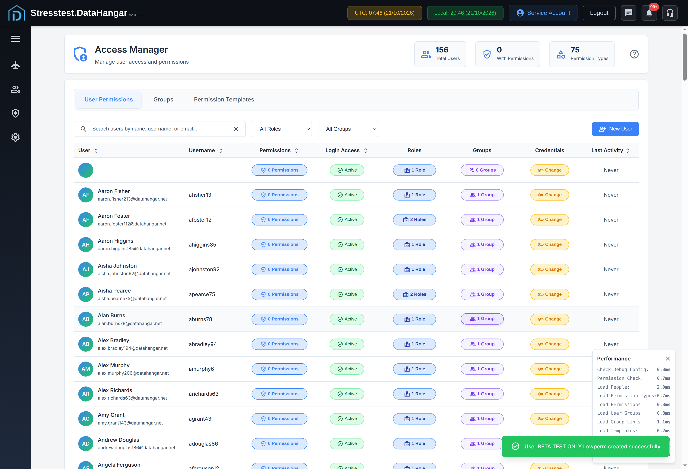

### BUG-DSH-003: Dashboard recency item opens Personnel Details on the wrong tab (Personal Details instead of Recency and Renewals)

Severity: Medium | Module: Dashboard / Personnel Details | Check: DSH-006 ([05-dashboard](checklists/05-dashboard.md))

Steps:
1. Open Dashboard from the sidebar
2. Recency and Renewals tab (first tab) is shown
3. Click 'Flight Review'

Expected: Own Personnel Details opens on the Recency and Renewals tab with Flight Review highlighted.

Actual: Personnel Details opens (URL has alertname_id=3) but the Personal Details tab is active; user has to find the Recency tab manually. Page also throws 'getPickerMod is not defined' (BUG-PD-001), which may be what stops the tab switch.

Suspected cause: alertname_id param not used to select the Recency tab, or the tab-switch code never runs because index.js is truncated (BUG-PD-001). Retest after BUG-PD-001 is fixed.

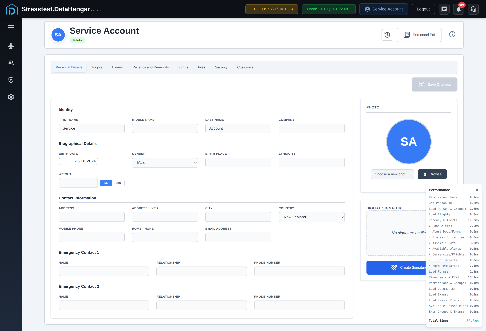

### BUG-FD-001: Flight Details Save Changes does not return to the Flight Schedule and gives no success message

Severity: Medium | Module: Flight Details | Check: FD-034 ([07-flight-details](checklists/07-flight-details.md))

Steps:
1. Flight Schedule > Schedule Only > week
2. Double-click flight #42903 > Flight Details
3. Add a passenger or comment
4. Click Save Changes

Expected: Flight is saved and you return to where you came from (the Flight Schedule week you were on), as described in the guide.

Actual: The page reloads in place (URL now has return_url=/index.pl?action=flightschedule) and stays on Flight Details. No toast or message says it was saved; only the greyed-out Save Changes button hints at it. The user has to click Back.

Suspected cause: Save handler reloads the details page with return_url instead of navigating to return_url after a successful save.

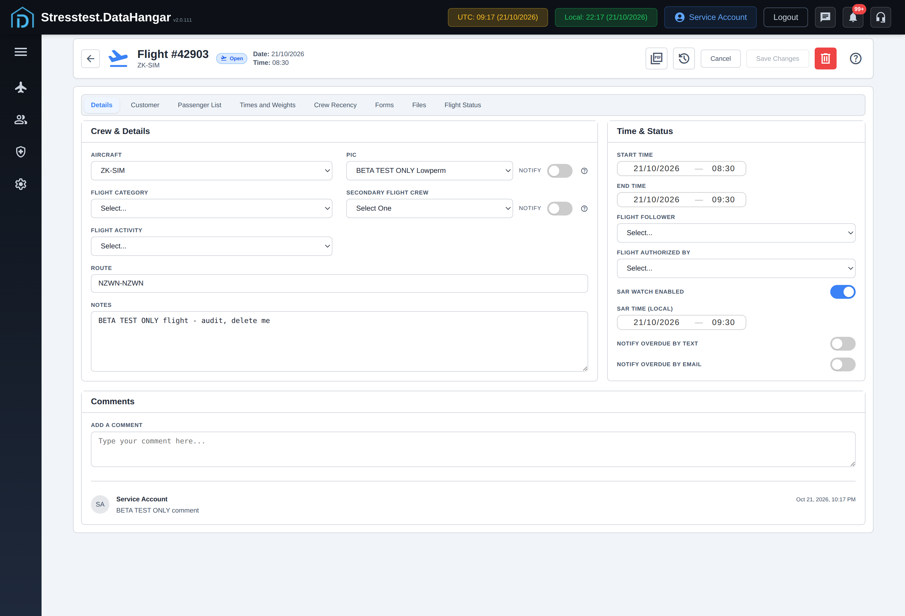

### BUG-FD-002: Flight Details History misses edits saved in Flight Details and shows a false 'Aircraft: ZK-SIM > Unassigned' on schedule moves

Severity: Medium | Module: Flight Details | Check: FD-037 ([07-flight-details](checklists/07-flight-details.md))

Steps:
1. Flight Schedule > Enable Live Edit > move/resize flight #42903 (ZK-SIM)
2. Double-click it > Flight Details > add a custom passenger and a comment > Save Changes
3. Click History

Expected: History shows every change including the Flight Details save (passenger added, comment added), and only fields that really changed.

Actual: The Flight Details save at 10:17 pm is not listed; newest entry is the 09:31 pm schedule move. Each schedule move/resize entry lists 'Aircraft: ZK-SIM > Unassigned' (the aircraft stayed ZK-SIM) and 'Source: (blank) > Flight Schedule'. Values are shown as raw '2026-10-21 09:30:00' instead of DD/MM/YYYY HH:MM.

Suspected cause: Schedule drag/resize audit compares against a payload without aircraft (null > 'Unassigned'); Flight Details save path either does not write to the audit log or only logs main-table fields (passengers/comments not tracked).

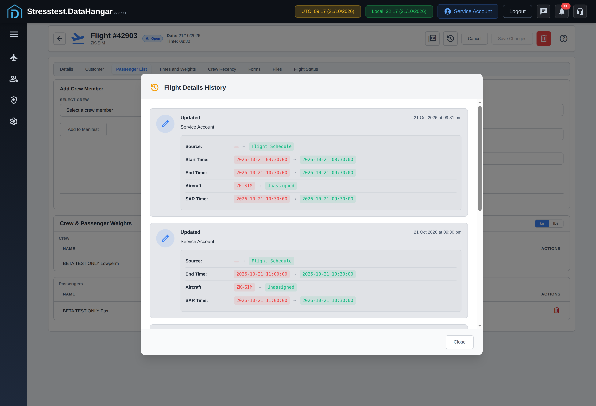

### BUG-FD-004: Leg PIC / Secondary Flight Crew dropdowns offer passengers (e.g. a custom passenger can be chosen as leg PIC)

Severity: Medium | Module: Flight Details | Check: FD-005 ([07-flight-details](checklists/07-flight-details.md))

Steps:
1. Open flight #42903 > Passenger List > Add Custom Passenger 'BETA TEST ONLY Pax'
2. Times and Weights > Add Leg
3. Open the leg PIC or Secondary Flight Crew dropdown

Expected: Only Crew or Student role people (like the flight-level PIC list).

Actual: Leg PIC and Secondary Flight Crew list 'BETA TEST ONLY Lowperm' and 'BETA TEST ONLY Pax' - the custom passenger can be picked as the leg's pilot, which would put a passenger's hours into crew/FRMS records.

Suspected cause: Leg crew dropdowns are filled from the whole manifest (crew + passengers) instead of crew only.

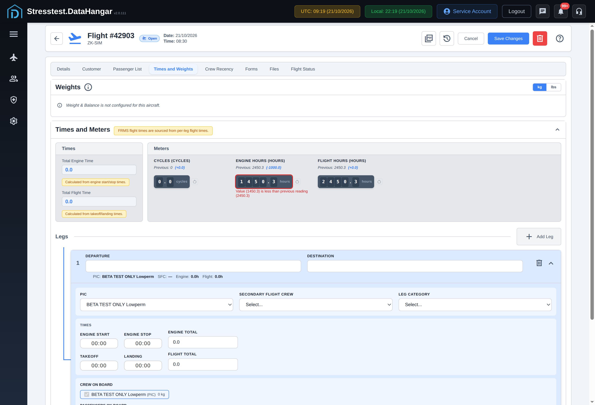

### BUG-FD-005: Leg with two unknown waypoints: only the first is offered for adding, the second is silently dropped on save

Severity: Medium | Module: Flight Details | Check: FD-022 ([07-flight-details](checklists/07-flight-details.md))

Steps:
1. Open flight #42903 > Times and Weights > Add Leg
2. Departure 'ZZZQ', Destination 'NZWN' (neither in Settings > Waypoints)
3. Save Changes > 'Add New Waypoint' for ZZZQ > Add Waypoint
4. Back, reopen the flight > Times and Weights

Expected: You are asked about each unknown waypoint (ZZZQ, then NZWN) before the flight is saved; nothing you typed is lost.

Actual: Only ZZZQ is prompted ('Waypoint "ZZZQ" added successfully'), then the flight saves straight away and the leg Destination is stored empty - NZWN is lost without a warning. Typing NZWN again and saving does prompt for it.

Suspected cause: After 'Add Waypoint' the save continues without re-validating the remaining unknown waypoints, and unknown codes are blanked instead of blocking the save.

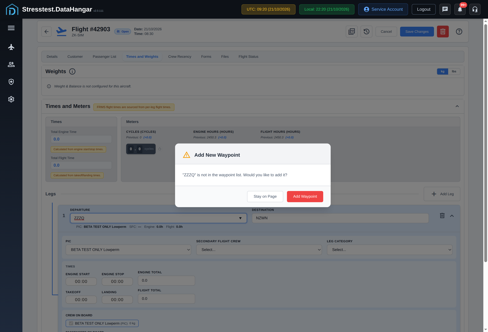
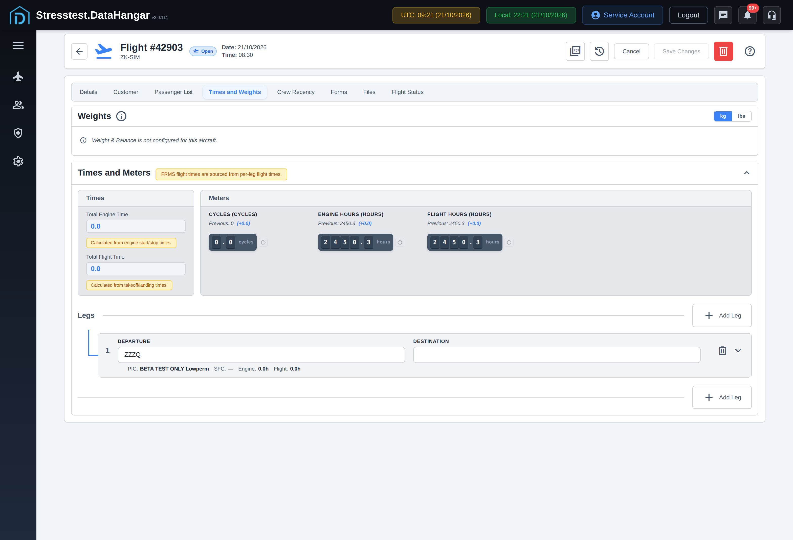

### BUG-FS-001: New flight defaults to the current UTC time instead of local time (SAR TIME labelled LOCAL shows UTC+1h)

Severity: Medium | Module: Flight Schedule > Flight Details (new) | Check: FS-011 ([06-flight-schedule](checklists/06-flight-schedule.md))

Steps:
1. Settings > Time Zone is Pacific/Auckland (header shows UTC 08:25, Local 21:25)
2. Flight Schedule > Enable Live Edit > Add Flight
3. Look at Start Time, End Time and SAR TIME (LOCAL)

Expected: Start defaults to local now (21:25), end +1h (22:25), SAR time in local time.

Actual: Start 21/10/2026 08:25, End 09:25, SAR TIME (LOCAL) 09:25 - all UTC values. Near midnight the date would also be wrong. Also Cancel with no changes does nothing (only the back arrow leaves).

Suspected cause: New-flight defaults built from server/UTC now() rather than the org time zone. Confirm whether flights are stored in UTC and shown in local everywhere else (see 92-xc-dates).

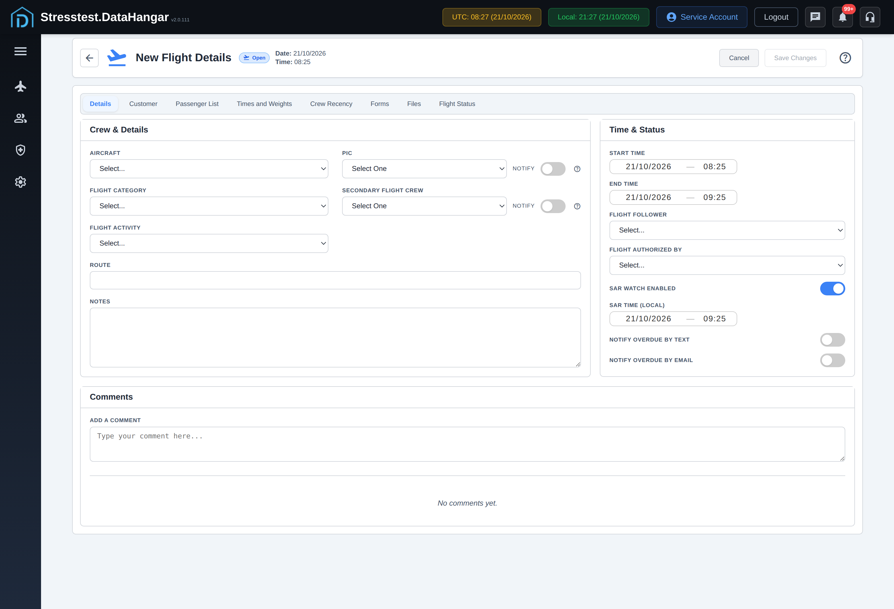

### BUG-FS-002: Esc does not end copy/paste mode on the Flight Schedule - the next click + Ctrl+V creates another flight

Severity: Medium | Module: Flight Schedule | Check: FS-021 ([06-flight-schedule](checklists/06-flight-schedule.md))

Steps:
1. Flight Schedule > Enable Live Edit
2. Select a flight, Ctrl+C, click an empty slot, Ctrl+V, Paste
3. Toast: '... press Escape to finish.' Press Esc
4. Click another empty slot, press Ctrl+V

Expected: Esc ends paste mode; Ctrl+V afterwards does nothing.

Actual: No feedback on Esc; the click shows 'Press Ctrl+V to paste the flight here' and Ctrl+V creates another flight (created #42906). Users can create unwanted live flights.

Suspected cause: Escape keydown handler does not clear the copied-flight clipboard state (or is not bound inside the schedule iframe).

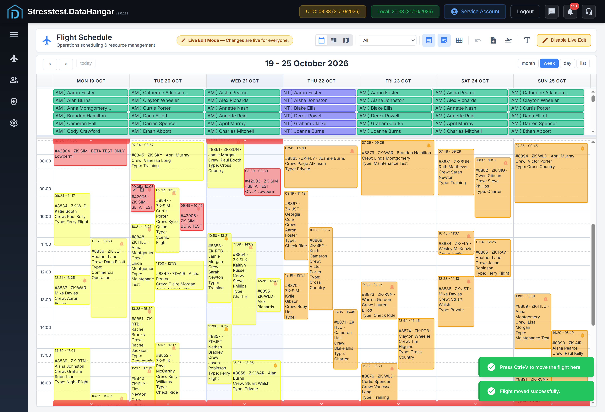

### BUG-FS-003: Flight Schedule header overlaps when Live Edit is on - title covered, location pill cut off and its 'Show All' button cannot be clicked

Severity: Medium | Module: Flight Schedule | Check: FS-008 ([06-flight-schedule](checklists/06-flight-schedule.md))

Steps:
1. Flight Schedule at 1568 px wide
2. Pick a location in Locations (pill 'Viewing location: Auckland Base')
3. Go to a past week and click Enable Live Edit

Expected: Title, Live Edit banner, past-date banner and location pill all readable (wrap to a second line if needed).

Actual: 'Live Edit Mode' banner is drawn over the 'Flight Schedule' title and subtitle; 'Viewing location: Auckland Base' is cut to 'Viewing' and hidden behind the view buttons. The pill's 'Show All' button sits under the view-mode buttons, so a click lands on 'Schedule & Planner' instead (the location filter can only be cleared after turning Live Edit off or via Locations > All Locations).

Suspected cause: Header banners are absolutely positioned / flex row with no wrap; no room left when 3 banners show.

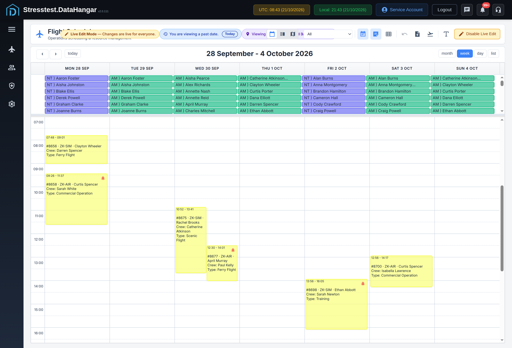

### BUG-FS-004: Planner Add Location replaces the New Booking popup - typed booking and location input is lost

Severity: Medium | Module: Flight Schedule > Location Planner | Check: FS-029 ([06-flight-schedule](checklists/06-flight-schedule.md))

Steps:
1. Flight Schedule > Planner Only > Rows by Location > Enable Live Edit
2. Drag across empty days in a location row > New Booking opens; type a note
3. Click 'Add Location' in New Booking
4. Leave Name and Code empty, click Save, then OK on the Error popup

Expected: Add Location opens on top of New Booking; after the error you are back in Add Location with your input; after saving you return to New Booking with the new location selected and your note kept.

Actual: Add Location replaces New Booking (the note is gone). OK on 'Name and Code are required.' closes all popups, so the user has to start again. After a successful Save ('Location created') New Booking does not come back either.

Suspected cause: Planner popups use one shared modal slot: opening a modal closes the current one and closing the error closes everything instead of returning to the parent modal.

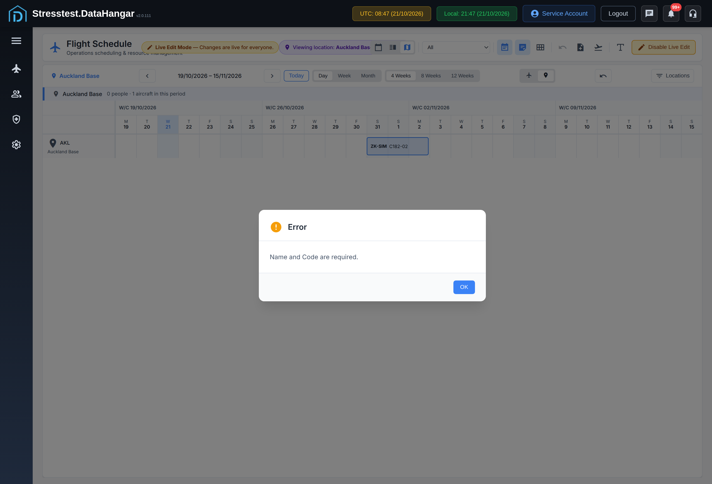
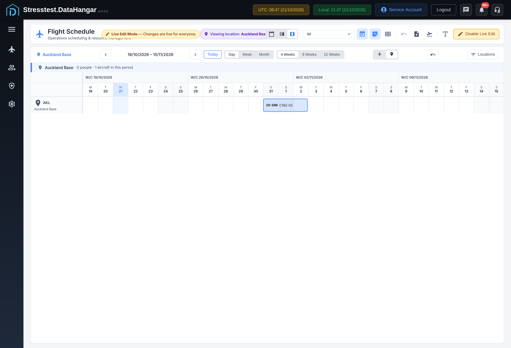

### BUG-FS-006: Flight Schedule month view is slow: flightschedule_json takes ~1.6 s and rendering 2,500 events ~4.5 s

Severity: Medium | Module: Flight Schedule | Check: FS-034 ([06-flight-schedule](checklists/06-flight-schedule.md))

Steps:
1. Flight Schedule > Schedule Only
2. Click Month (October 2026, range 28/09-08/11)
3. Measure in DevTools Network: index.pl?action=flightschedule_json&start=2026-09-28&end=2026-11-09

Expected: Server response < 500 ms; month view usable in about 1-2 s.

Actual: Request 1,590 ms (first byte 844 ms); 2,493 events take 4.5 s from click to render. Page freezes while rendering.

Suspected cause: Whole 6-week range returned with full event details in one JSON call and every event rendered; consider a summary per day for month view, indexes on flight start/end, or lazy loading of 'more' events.

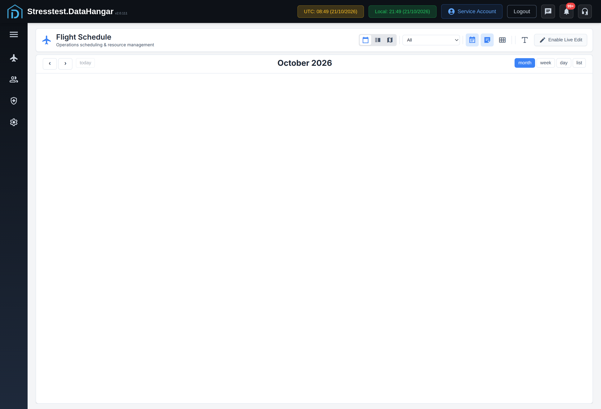

### BUG-FS-007: Edit-mode idle timeout switches Live Edit off silently, throws 'calendarEl is not defined' and leaves the schedule blank

Severity: Medium | Module: Flight Schedule | Check: FS-025 ([06-flight-schedule](checklists/06-flight-schedule.md))

Steps:
1. Flight Schedule > Planner Only (or any view) > Enable Live Edit
2. Do not touch the page for 20 minutes

Expected: Edit mode turns off with the message 'Edit mode has been disabled due to inactivity.'

Actual: At 20 min the button silently returns to 'Enable Live Edit'; no popup or toast, and the console shows uncaught ReferenceError 'calendarEl is not defined', so the rest of the timeout handler (probably the message and the calendar refresh) does not run. A user who comes back can think they are still editing. Afterwards the schedule is left blank (month view 'October 2026' with no flights) until the page is reloaded.

Suspected cause: Inactivity handler references a variable calendarEl that is not in scope (renamed or local to another function).

### BUG-LOG-003: 'Trust this device for 30 days' is lost on Logout (logout deletes the trusted-device cookie)

Severity: Medium | Module: Login / 2FA (main) | Check: LOG-010 ([01-login-auth](checklists/01-login-auth.md))

Steps:
1. Log in as a 2FA user, tick 'Trust this device for 30 days', enter a valid code
2. Check cookies: dhkey_trusted_<user> set, expires in 29-30 days
3. Click Logout > Log Out
4. Log in again with username + password

Expected: 2FA page skipped on this browser for 30 days.

Actual: Logout deletes all cookies (dhkey_<user>, dhkey_trusted_<user>, dhkey_username); the next login asks for the 2FA code again. Trust only survives if the user never logs out.

Suspected cause: Logout handler expires every dhkey_* cookie; should keep dhkey_trusted_*.

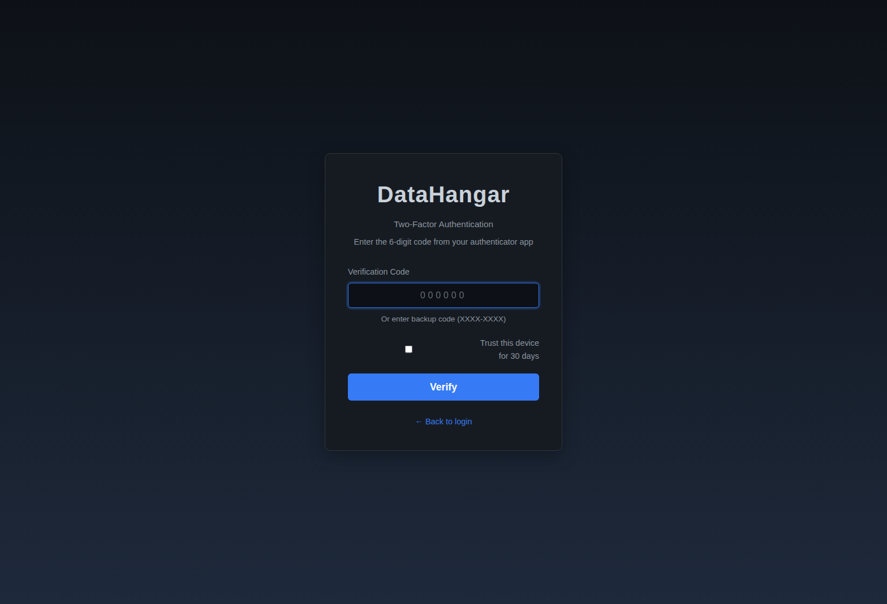

### BUG-NAV-001: Leaving a page with unsaved changes gives no warning; edits are lost

Severity: Medium | Module: Shell (main) / Personnel Details | Check: NAV-015 ([02-shell-navigation](checklists/02-shell-navigation.md))

Steps:
1. Click Service Account (top bar) to open My Personnel Details
2. Type in Middle Name: Save Changes becomes enabled
3. Hover Flight Operations in the sidebar and click Dashboard

Expected: Guide §3: 'The current page has unsaved changes...' modal with Cancel (stay) and Continue (leave).

Actual: Dashboard opens immediately, no modal; the typed change is discarded.

Suspected cause: Dirty-state check in `main/index.js` menu click handler is not wired to Personnel Details (or not at all).

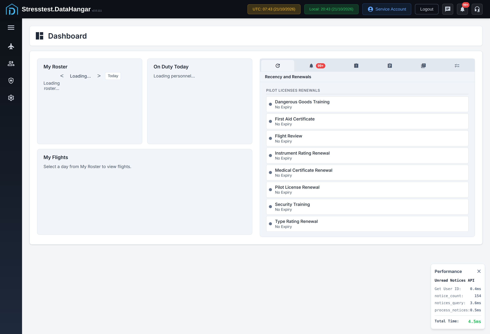

### BUG-PD-001: personneldetails/index.js is truncated: ReferenceError getPickerMod on every load

Severity: Medium | Module: Personnel Details / My Account | Check: PD-S01 ([12-personnel-details](checklists/12-personnel-details.md))

Steps:
1. Click Service Account (top bar) or open any person from All Personnel
2. Watch the console

Expected: No console errors.

Actual: `ReferenceError: getPickerMod is not defined` at `templates2/personneldetails/index.js?v=2.0.111:13734`. The file's last line is `window.getPickerMode = getPickerMod` (cut off; should be `getPickerMode;`), so `window.getPickerMode` is never set and anything after it never runs.

Suspected cause: `personneldetails/index.js` last line truncated during build/deploy; restore `window.getPickerMode = getPickerMode;` and check nothing else is missing from the end of the file.

### BUG-PD-003: 2FA setup: one wrong verification code closes the setup dialog and issues a new secret

Severity: Medium | Module: Personnel Details > Security | Check: PD-027 ([12-personnel-details](checklists/12-personnel-details.md))

Steps:
1. My Account > Security > Enable 2FA, enter password, Confirm
2. Scan the QR code / note the key
3. Enter a wrong 6-digit code, click Verify and Enable
4. Click OK on '2FA Setup Failed - Error: Invalid verification code'

Expected: Setup dialog stays open with the same QR/key so the user can retry the code.

Actual: Setup dialog closes. Clicking Enable 2FA again generates a new key and new backup codes, so the entry already added to the authenticator app is useless and must be deleted and re-scanned.

Suspected cause: Verify failure handler closes #2fa-setup-modal and discards the pending secret.

### BUG-PERM-002: User with no permissions cannot open their own My Account (no self-service password / 2FA)

Severity: Medium | Module: Personnel Details / My Account | Check: PERM-007 ([90-permissions](checklists/90-permissions.md))

Steps:
1. Log in as a user with 0 permissions (BETA TEST ONLY Lowperm)
2. Click your name in the top bar

Expected: Own My Account opens (at least Security and Customize tabs) so the user can change password and set up 2FA.

Actual: 'Access Denied: You do not have permission to access the Personnel Details' for person_id=276 (own record).

Suspected cause: Personnel Details access check does not allow self (person_id == logged-in person) when no Personnel permission row exists.

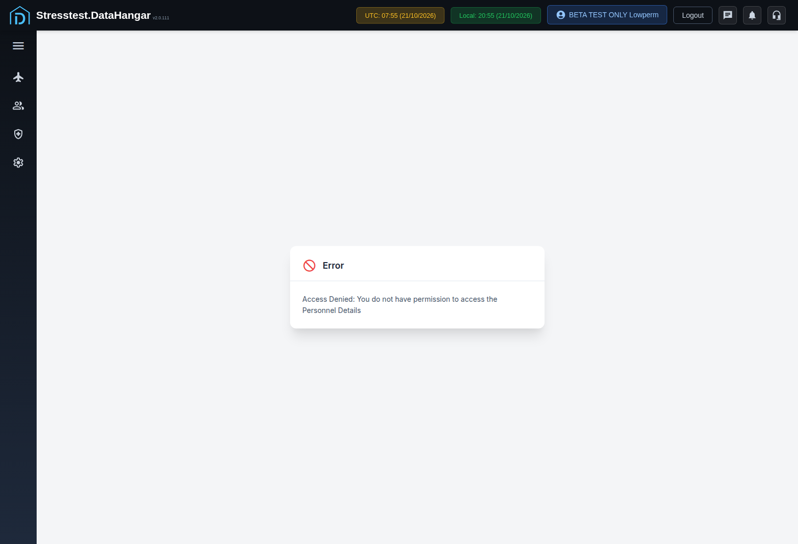

### BUG-POP-003: Access Manager Groups popup: Esc closes with unsaved changes and no warning; reopening shows the unsaved ticks as if saved

Severity: Medium | Module: Access Manager | Check: AM-019 ([04-access-manager](checklists/04-access-manager.md))

Steps:
1. Settings and Tools > Access Manager, search betatest_low
2. Click the '0 Groups' badge
3. Tick 'Crew' (On Roster auto-ticks)
4. Press Esc
5. Note the row still says '0 Groups'
6. Click the Groups badge again

Expected: Esc with unsaved changes asks to confirm (app modal); if discarded, the popup reopens with the saved memberships.

Actual: Popup closes silently, nothing is saved, and on reopen 'Crew' is still ticked even though the user has 0 groups. Saving then would apply changes the user thought were thrown away.

Suspected cause: Groups modal has no dirty check on Esc/close and doesn't reset its checkbox state from the server data when reopened.

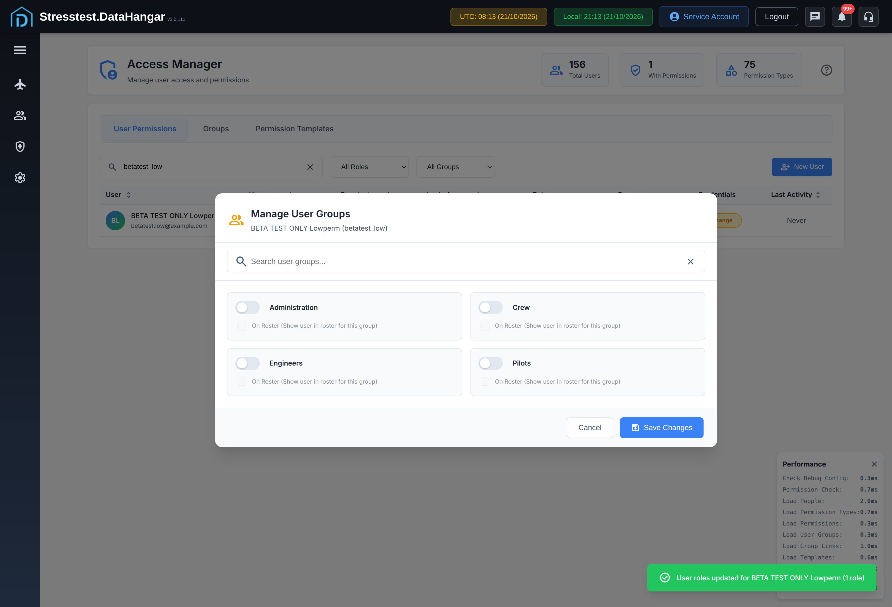

### BUG-AM-002: Last Activity hover date ignores Settings > Time Zone format

Severity: Low | Module: Access Manager | Check: AM-007 ([04-access-manager](checklists/04-access-manager.md))

Steps:
1. Settings > Time Zone is DD/MM/YYYY, 24-hour
2. Access Manager: hover the Last Activity value of Service Account ('4 mins ago')

Expected: Exact date in org format, e.g. 21/10/2026 20:45 (local).

Actual: Tooltip '21 Oct 2026, 07:45 am': hard-coded format, 12-hour, and shows the UTC time (07:45) rather than local (20:45).

Suspected cause: Tooltip built with toLocaleString / fixed format instead of formatDateWithConfig; timestamp not converted to org time zone.

### BUG-AM-003: Last Activity column sort does not change order

Severity: Low | Module: Access Manager | Check: AM-005 ([04-access-manager](checklists/04-access-manager.md))

Steps:
1. Access Manager > User Permissions
2. Click the Last Activity header, then click it again

Expected: Ascending then descending: Service Account (only user with activity) moves from top to bottom.

Actual: Same order both times: Service Account, Alex Richards, Zoe Mason, Curtis Porter... User and Username sort correctly.

Suspected cause: Sort comparator for Last Activity ignores direction (or sorts on the relative text with 'Never' handled separately).

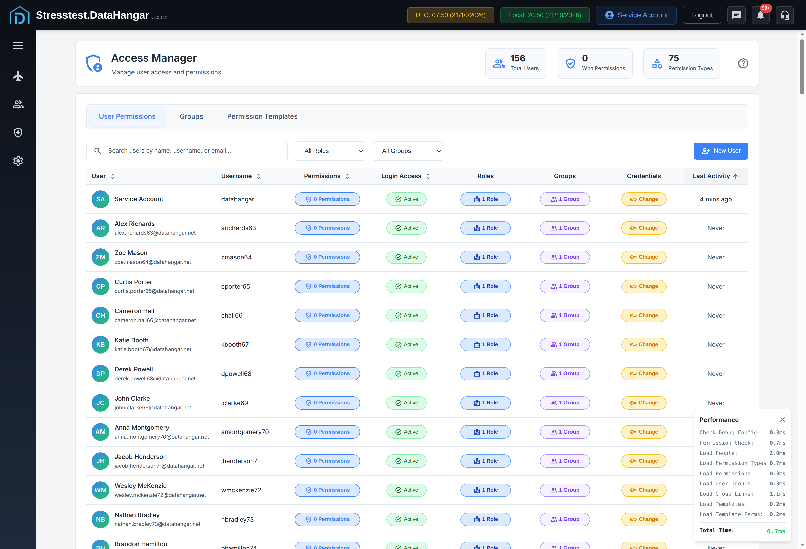

### BUG-AM-004: Permission level dropdown shows bare codes 'WA' and 'G' next to full labels

Severity: Low | Module: Access Manager > Manage User Permissions | Check: AM-020 ([04-access-manager](checklists/04-access-manager.md))

Steps:
1. Access Manager > a user's 'N Permissions' badge
2. Look at the level dropdown for Personnel Details (also Flight Schedule, Dashboard, DFR)

Expected: Every level has a readable label, e.g. 'Read/Write All - Can view and modify all data', 'Group - level defined by group membership' (as in the Help).

Actual: Options: 'Read Only All - ...', 'WA', 'Read Only Own - ...', 'Write Own - ...', 'G'.

Suspected cause: Label map in accessmanager JS is missing WA and G (falls back to the code).

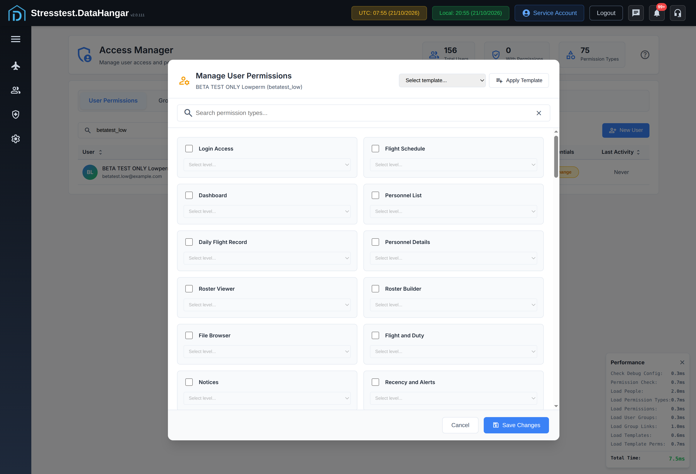

### BUG-DSH-001: Dashboard side tabs are icon-only with no tooltip or label

Severity: Low | Module: Dashboard | Check: DSH-012 ([05-dashboard](checklists/05-dashboard.md))

Steps:
1. Open Dashboard from the sidebar
2. Hover each of the 6 tabs above the right-hand panel

Expected: Each tab has a tooltip/label (Recency and Renewals, Unread Notices, Unsigned Timesheets, Safety Actions, Exams, Project Tasks).

Actual: Tabs show only Material icons (update, notifications, assignment_late, assignment, quiz, checklist); no title, aria-label or tooltip. Users must click each to find out what it is; screen readers read the icon ligature names.

Suspected cause: Tab buttons render the icon only; add title + aria-label (or a short text label).

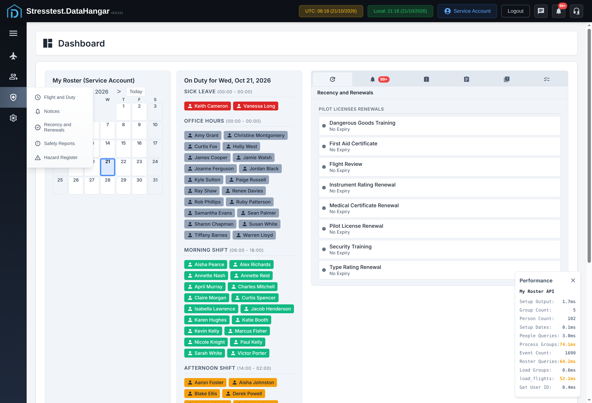

### BUG-FD-003: Times and Meters: no link to the previous flight next to 'Previous' meter readings

Severity: Low | Module: Flight Details | Check: FD-019 ([07-flight-details](checklists/07-flight-details.md))

Steps:
1. Open flight #42903 (ZK-SIM) > Times and Weights
2. Look at Meters (Engine Hours, Flight Hours)

Expected: Each meter shows the previous reading and a link to the flight it came from (guide).

Actual: 'Previous: 2450.3 (+0.0)' is shown but there is no link; the only link in the panel is an info icon (href '#'). The user cannot check which flight set the previous reading.

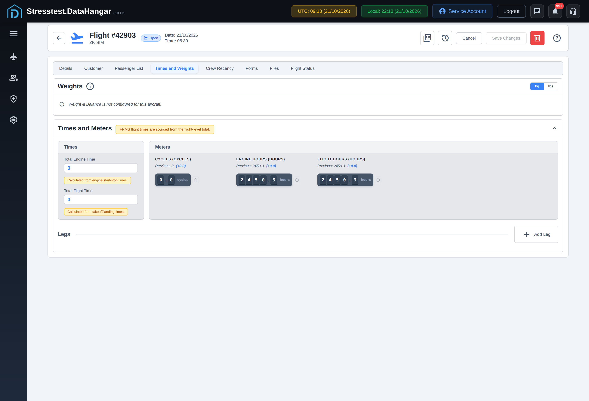

### BUG-FS-005: JS error on every Live Edit toggle: Cannot read properties of null (reading 'scrollTop')

Severity: Low | Module: Flight Schedule | Check: FS-008 ([06-flight-schedule](checklists/06-flight-schedule.md))

Steps:
1. Flight Schedule (Planner Only or Schedule view), DevTools console open
2. Click Enable Live Edit
3. Click Disable Live Edit

Expected: No console errors.

Actual: Each click logs uncaught TypeError "Cannot read properties of null (reading 'scrollTop')". The toggle still works, but later code in the same handler does not run.

Suspected cause: Edit-mode toggle handler saves/restores the scroll position of an element that does not exist in the current view mode (e.g. the time-grid scroller while the planner is shown); needs a null check.

### BUG-LOG-001: Login Message popup reappears on every browser reload

Severity: Low | Module: Shell (main) | Check: LOG-013 ([01-login-auth](checklists/01-login-auth.md))

Steps:
1. Log in and close the Login Message with OK
2. Press F5 / reload on any page

Expected: Guide: Login Message is shown after login (once per login).

Actual: The Login Message opens again after every reload. Guide or app?

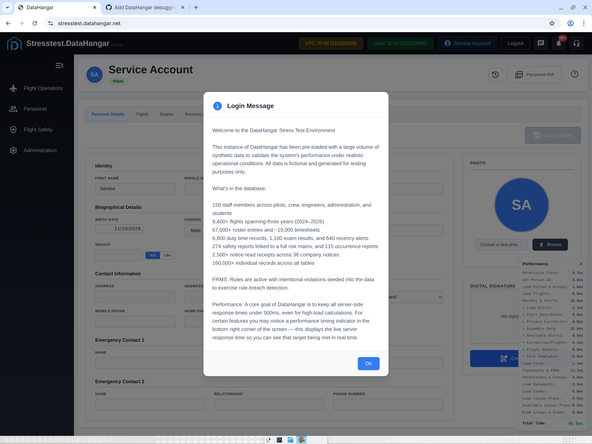

### BUG-LOG-002: Logout throws JS error removeChild; Esc doesn't close the Log Out confirm

Severity: Low | Module: Shell (main) | Check: LOG-016 ([01-login-auth](checklists/01-login-auth.md))

Steps:
1. Click Logout in the top bar
2. Press Esc (nothing happens)
3. Click Log Out

Expected: Esc closes the confirm (CON-015); no console errors.

Actual: Esc ignored (see POP-02). On Log Out the console logs `Failed to execute 'removeChild' on 'Node': The node to be removed is not a child of this node.` Logout itself works.

### BUG-PD-002: Personnel Details modals (Enable 2FA, Setup Error alert): title right-aligned, away from its icon

Severity: Low | Module: Personnel Details > Security | Check: PD-027 ([12-personnel-details](checklists/12-personnel-details.md))

Steps:
1. My Account > Security
2. Click Enable 2FA

Expected: Header like other modals: icon then title, left-aligned (e.g. 'Activate Login Access').

Actual: Lock icon on the far left, 'Enable 2FA' title pushed to the far right of the header. Same on the shared #alert-modal ('Setup Error / Invalid password').

Suspected cause: Header uses justify-content: space-between without the title wrapper used by other modals.

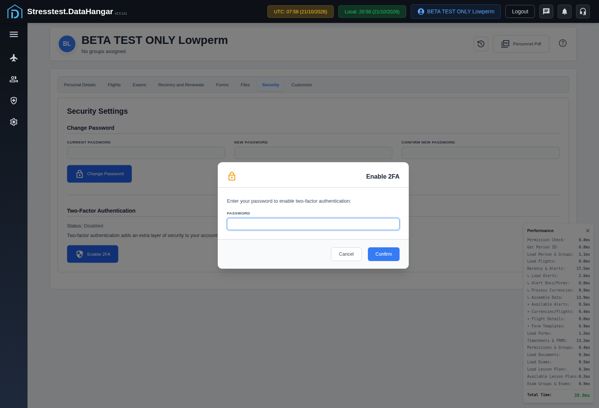

### BUG-PD-004: Security tab 'Enabled on' date ignores Settings > Time Zone format

Severity: Low | Module: Personnel Details > Security | Check: PD-S04 ([12-personnel-details](checklists/12-personnel-details.md))

Steps:
1. Settings > Time Zone is DD/MM/YYYY, 24-hour HH:mm
2. Enable 2FA on an account, view My Account > Security

Expected: 'Enabled on: 21/10/2026 21:03'.

Actual: 'Enabled on: 2026-10-21 21:03:55' (raw database format).

Suspected cause: Value printed as-is; not passed through formatDateWithConfig/formatTimeWithConfig.

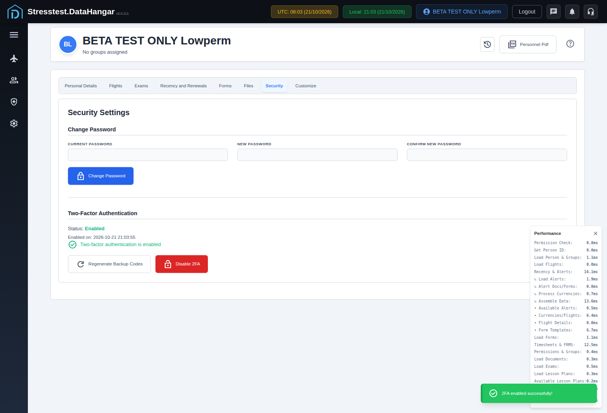

### BUG-PERF-001: 'Performance' debug timing panel shown on every page, including to non-admin users

Severity: Low | Module: All modules (debug panel) | Check: PERF-001 ([95-performance](checklists/95-performance.md))

Steps:
1. Log in as any user (also BETA TEST ONLY Lowperm with one permission)
2. Open My Account or Access Manager

Expected: Debug timing panel hidden for normal users (only when debug is switched on for an admin), or at least off by default.

Actual: Bottom-right 'Performance' panel lists internal step timings (Permission Check, Load People, Load Permissions, Total Time...). Covers content and toasts, exposes internals.

Suspected cause: Debug config ('Check Debug Config') is enabled site-wide on stresstest, or the check does not consider the user's role. Confirm with Jon whether this is intentional on staging.

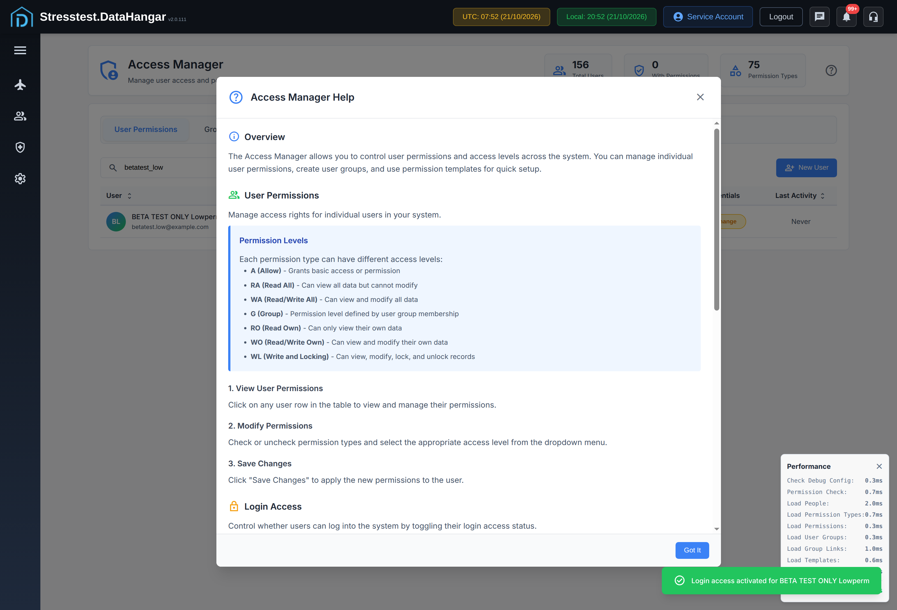
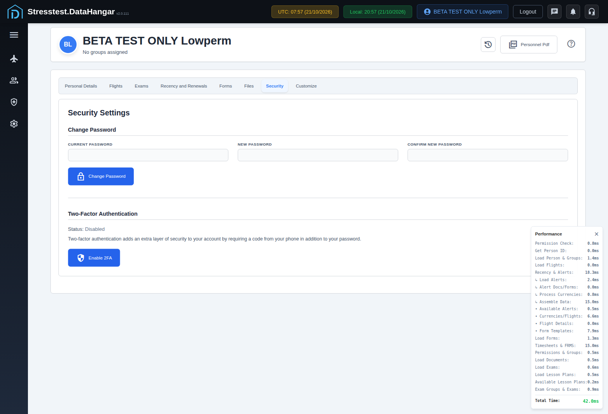

### BUG-PERM-001: Sidebar lists modules the user has no permission for (all lead to Access Denied)

Severity: Low | Module: Shell (main) sidebar | Check: PERM-007 ([90-permissions](checklists/90-permissions.md))

Steps:
1. Access Manager: create user, give 0 roles / 0 permissions, set credentials, Activate
2. Log in as that user
3. Open the sidebar and click each item

Expected: Only modules the user can open are listed (Roster Builder, Timesheets etc. are already hidden, so filtering exists).

Actual: 17 items listed (Dashboard, Flight Schedule, Active Flights, DFR, Roster Viewer, All Personnel, Flight and Duty, Notices, Recency and Renewals, Safety Reports, Hazard Register, Settings and Tools, File Browser, Form Browser, Task Tracker, Reports, Support); every one shows 'Access Denied'. The landing page (Dashboard) is also Access Denied.

Suspected cause: Sidebar build in main/index.pl does not check the permission types used by each module's own access check. Note: checklist NAV-019 (from the user guide) expects the link to stay visible and show Access Denied, so this may be by design - needs a product decision.

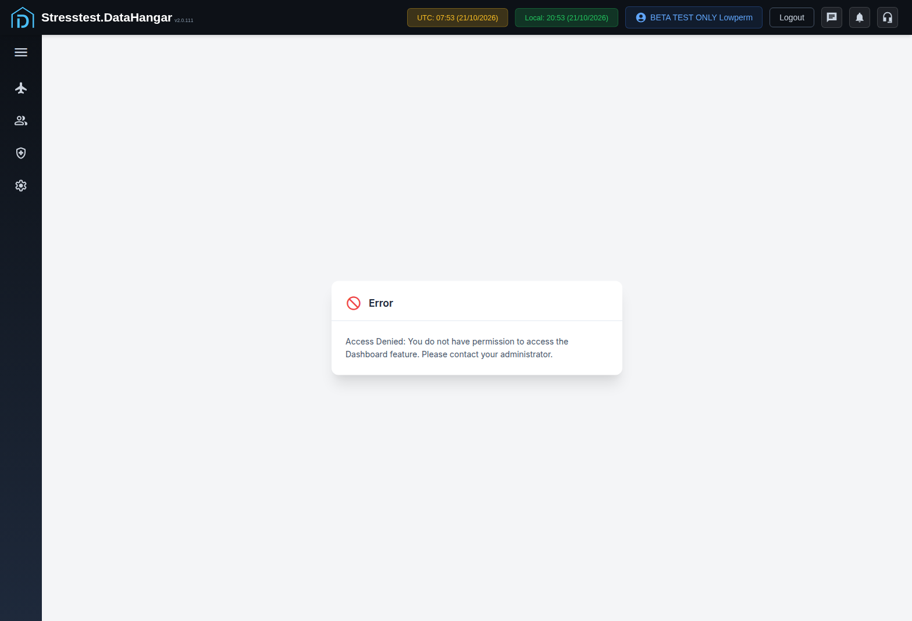

### BUG-POP-001: Error modal ('Failed to Create User') does not close with Esc

Severity: Low | Module: Access Manager (shared errorModal) | Check: AM-S03 ([04-access-manager](checklists/04-access-manager.md))

Steps:
1. Access Manager > New User
2. Username 'root', fill the rest, Create User
3. Error modal 'Failed to Create User - That username is not allowed' opens; press Esc

Expected: Esc closes it (as Help does on the same page).

Actual: Modal stays open; only OK closes it. Same as the logout confirm (BUG-LOG-002).

Suspected cause: #errorModal has no keydown Escape handler.

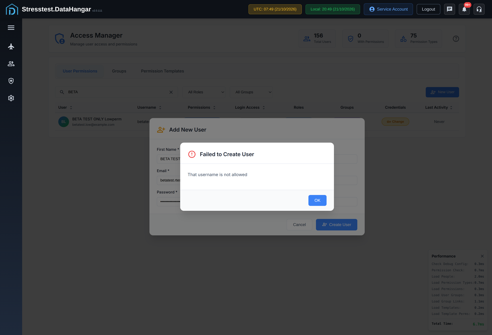

### BUG-POP-002: Manage User Permissions uses a native browser confirm() for unsaved changes

Severity: Low | Module: Access Manager > Manage User Permissions | Check: AM-023 ([04-access-manager](checklists/04-access-manager.md))

Steps:
1. Access Manager > a user's 'N Permissions' badge
2. Tick any permission type
3. Click Cancel

Expected: App-styled confirm modal (like Activate Login Access / Logout), Esc = stay.

Actual: Native Chrome confirm: 'You have unsaved changes. Are you sure you want to cancel?'. Looks out of place, cannot be styled, blocks the page.

Suspected cause: accessmanager JS calls window.confirm() in the Cancel handler.

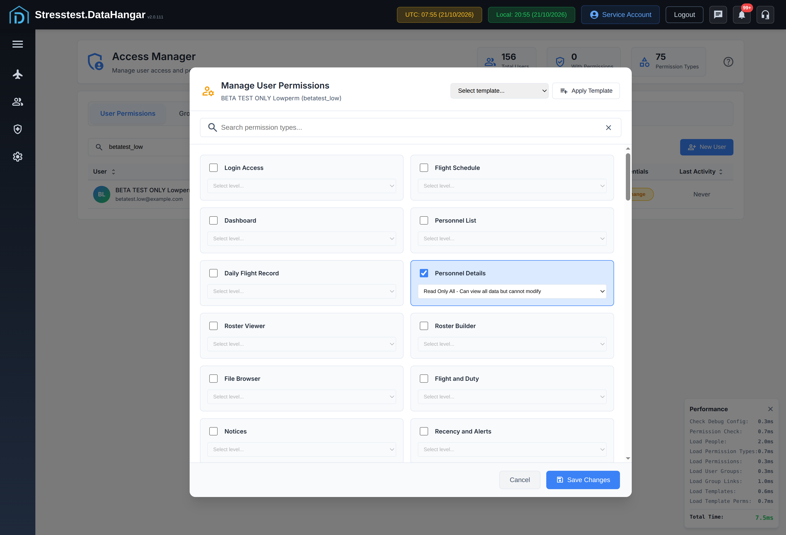

### BUG-POP-004: Flight Schedule popups (View Details, Double Booking alert, note modals) do not close with Esc

Severity: Low | Module: Flight Schedule | Check: FS-013 ([06-flight-schedule](checklists/06-flight-schedule.md))

Steps:
1. Flight Schedule (week view), click a flight to select it
2. Click its note / View Details icon
3. Press Esc

Expected: Popup closes (CON-015).

Actual: Popup stays open on Esc; only OK, x or a click outside closes it. Same for #fad-modal 'Double Booking Detected' and the Add/Edit Note modals.

Suspected cause: #flight-details-modal has no keydown Escape handler (same pattern as BUG-POP-001).

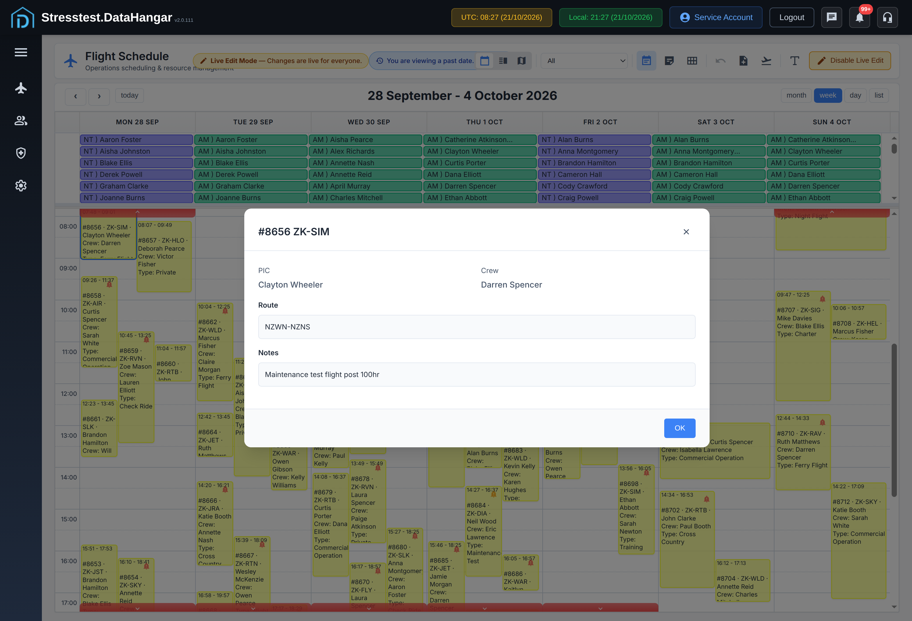

## Test data to clean up

| Checklist | Record | Where | Cleanup done? |
|---|---|---|---|
| 04-access-manager | User BETA TEST ONLY Lowperm (betatest_low, betatest.low@example.com); 1 permission, role Crew, groups Crew + BETA TEST ONLY Group; 2FA enabled during testing, later disabled | Access Manager > User Permissions | No |
| 04-access-manager | Group BETA TEST ONLY Group (all 5 switches on) | Access Manager > Groups | No |
| 06-flight-schedule | Note 'BETA TEST ONLY Note' (21/10/2026) | Flight Schedule | Yes (deleted in FS-024) |
| 06-flight-schedule | Flight #42903 ZK-SIM, PIC BETA TEST ONLY Lowperm, route NZWN-NZWN, notes 'BETA TEST ONLY flight', 21/10/2026 08:30 | Flight Schedule / Flight Details | No |
| 06-flight-schedule | Flights #42904, #42905, #42906 (pasted copies of #42903, week 19-25 Oct 2026; #42906 from BUG-FS-002) | Flight Schedule | Yes (deleted in FS-020) |
| 06-flight-schedule | Planner booking ZK-SIM @ AKL Auckland Base 31/10-02/11/2026, notes 'BETA TEST ONLY booking' | Flight Schedule > Planner | No |
| 06-flight-schedule | Flight template 'BETA TEST ONLY Template' (ZK-SIM, PIC BETA TEST ONLY Lowperm) on the AKL booking | Flight Schedule > Planner > Templates | No |
| 06-flight-schedule | Flight #42908 ZK-SIM, PIC BETA TEST ONLY Lowperm, 22/10/2026 15:10-16:10 (pasted from the template) | Flight Schedule | No |
| 06-flight-schedule | Location 'BETA TEST ONLY Loc' (code BTO) | Flight Schedule > Planner > Add Location | No |
| 07-flight-details | Custom passenger 'BETA TEST ONLY Pax' (80 kg, NOK 'BETA TEST ONLY NOK 000') | Flight #42903 > Passenger List | No |
| 07-flight-details | Comment 'BETA TEST ONLY comment' | Flight #42903 > Comments | No |
| 07-flight-details | Leg 1 (Departure ZZZQ) | Flight #42903 > Times and Weights | No |
| 07-flight-details | Waypoint 'ZZZQ' (added from the leg prompt) | Settings > Waypoints | No |
| 07-flight-details | Pre-existing, not created in this run: customer 'DEVIN TEST Customer Ltd' | Customers | No (check with Jon) |
