# DataHangar test run report (stresstest, v2.0.111)

Generated from the checklist results and bug files on this branch. Testing is still in progress; see [TRACKER.md](TRACKER.md) for coverage.

## Summary

| Severity | Count |
|---|---|
| High | 7 |
| Medium | 54 |
| Low | 92 |

| Bug | Severity | Module | Title |
|---|---|---|---|
| [BUG-AF-004](bugs/BUG-AF-004.md) | High | Active Flights | Active Flights overdue and active times are 13 h out: local SAR/start times are compared with UTC 'now' |
| [BUG-EXM-006](bugs/BUG-EXM-006.md) | High | Exams | Taking an exam: Multi-Response checkboxes toggle twice, so clicking the box does nothing and the saved answer can differ from what is ticked |
| [BUG-PD-006](bugs/BUG-PD-006.md) | High | Personnel Details | Personnel Details > Recency and Renewals: action buttons are hidden (Add Item, Table/Card view, renewal Save / Complete Renewal / Cancel) and Group by / Order by are disabled |
| [BUG-PD-011](bugs/BUG-PD-011.md) | High | Personnel Details | Personnel Details > Security: Change Password always fails with 'Invalid Action: change_password' |
| [BUG-RB-007](bugs/BUG-RB-007.md) | High | Roster Builder | Roster Builder: Clear then Publish of a draft month with no shifts does not clear the live roster and shows no message |
| [BUG-SFS-002](bugs/BUG-SFS-002.md) | High | Settings: Flight Schedule | Changing Schedule Start Time saves a full date-time, and the setting then shows NaN:NaN |
| [BUG-SLP-002](bugs/BUG-SLP-002.md) | High | Settings: Lesson Plans | Lesson Plan Settings: Exercises are never saved; add/edit/delete only change the page and are lost when you leave |
| [BUG-AF-002](bugs/BUG-AF-002.md) | Medium | Active Flights | Active Flights lists future flights that have no SAR time, and the stats cards don't count them |
| [BUG-AM-001](bugs/BUG-AM-001.md) | Medium | Access Manager | New User accepts a 6-character password (placeholder and Change Credentials require 10) |
| [BUG-DFR-002](bugs/BUG-DFR-002.md) | Medium | Daily Flight Record | Daily Flight Record: Clear Filters unticks every status (lists Open, Cancelled and Deleted flights), and the date fields show today's date when no date filter is applied |
| [BUG-DFR-003](bugs/BUG-DFR-003.md) | Medium | Daily Flight Record | Daily Flight Record: changing filters quickly appends results instead of replacing them, showing duplicate and wrong-status rows |
| [BUG-DSH-003](bugs/BUG-DSH-003.md) | Medium | Dashboard / Personnel Details | Dashboard recency item opens Personnel Details on the wrong tab (Personal Details instead of Recency and Renewals) |
| [BUG-EXM-004](bugs/BUG-EXM-004.md) | Medium | Exams | Exam Builder has no way to link or unlink user groups on an exam group |
| [BUG-EXM-008](bugs/BUG-EXM-008.md) | Medium | Exams | Exam Builder: deleting an exam or exam group that has instances fails silently (error only in the console), and graded instances can't be removed |
| [BUG-FB-003](bugs/BUG-FB-003.md) | Medium | File Browser | File Browser: clicking a .txt file shows 'File Access Error' with the file's own text |
| [BUG-FB-005](bugs/BUG-FB-005.md) | Medium | File Browser | File Browser: Read/Write Access groups are not kept after Update Document |
| [BUG-FB-006](bugs/BUG-FB-006.md) | Medium | File Browser | File Browser: deleting a folder fails with 'Invalid Action: filebrowser_deletefolder' |
| [BUG-FBLD-002](bugs/BUG-FBLD-002.md) | Medium | Form Builder | Form Builder View Form: Date and Time widgets default to UTC, not local time |
| [BUG-FBLD-003](bugs/BUG-FBLD-003.md) | Medium | Form Builder | Form Builder: table conditions do nothing in View Form |
| [BUG-FD-001](bugs/BUG-FD-001.md) | Medium | Flight Details | Flight Details Save Changes does not return to the Flight Schedule and gives no success message |
| [BUG-FD-002](bugs/BUG-FD-002.md) | Medium | Flight Details | Flight Details History misses edits saved in Flight Details and shows a false 'Aircraft: ZK-SIM > Unassigned' on schedule moves |
| [BUG-FD-004](bugs/BUG-FD-004.md) | Medium | Flight Details | Leg PIC / Secondary Flight Crew dropdowns offer passengers (e.g. a custom passenger can be chosen as leg PIC) |
| [BUG-FD-005](bugs/BUG-FD-005.md) | Medium | Flight Details | Leg with two unknown waypoints: only the first is offered for adding, the second is silently dropped on save |
| [BUG-FS-001](bugs/BUG-FS-001.md) | Medium | Flight Schedule > Flight Details (new) | New flight defaults to the current UTC time instead of local time (SAR TIME labelled LOCAL shows UTC+1h) |
| [BUG-FS-002](bugs/BUG-FS-002.md) | Medium | Flight Schedule | Esc does not end copy/paste mode on the Flight Schedule - the next click + Ctrl+V creates another flight |
| [BUG-FS-003](bugs/BUG-FS-003.md) | Medium | Flight Schedule | Flight Schedule header overlaps when Live Edit is on - title covered, location pill cut off and its 'Show All' button cannot be clicked |
| [BUG-FS-004](bugs/BUG-FS-004.md) | Medium | Flight Schedule > Location Planner | Planner Add Location replaces the New Booking popup - typed booking and location input is lost |
| [BUG-FS-006](bugs/BUG-FS-006.md) | Medium | Flight Schedule | Flight Schedule month view is slow: flightschedule_json takes ~1.6 s and rendering 2,500 events ~4.5 s |
| [BUG-FS-007](bugs/BUG-FS-007.md) | Medium | Flight Schedule | Edit-mode idle timeout switches Live Edit off silently, throws 'calendarEl is not defined' and leaves the schedule blank |
| [BUG-HAZ-001](bugs/BUG-HAZ-001.md) | Medium | Hazard Register | Hazard Register details: Hazard Type always shows '--' |
| [BUG-HAZ-002](bugs/BUG-HAZ-002.md) | Medium | Hazard Register | Hazard Register details: Final Risk Assessment never shows the saved final risk |
| [BUG-LOG-003](bugs/BUG-LOG-003.md) | Medium | Login / 2FA (main) | 'Trust this device for 30 days' is lost on Logout (logout deletes the trusted-device cookie) |
| [BUG-NAV-001](bugs/BUG-NAV-001.md) | Medium | Shell (main) / Personnel Details | Leaving a page with unsaved changes gives no warning; edits are lost |
| [BUG-NOT-002](bugs/BUG-NOT-002.md) | Medium | Notices | Notice Details: clicking a .txt attachment does nothing (no preview, no download) |
| [BUG-PD-001](bugs/BUG-PD-001.md) | Medium | Personnel Details / My Account | personneldetails/index.js is truncated: ReferenceError getPickerMod on every load |
| [BUG-PD-003](bugs/BUG-PD-003.md) | Medium | Personnel Details > Security | 2FA setup: one wrong verification code closes the setup dialog and issues a new secret |
| [BUG-PD-007](bugs/BUG-PD-007.md) | Medium | Personnel Details | Personnel Details > Recency: 'Days Until Expiry' and status don't match the Last Conducted date |
| [BUG-PD-008](bugs/BUG-PD-008.md) | Medium | Personnel Details | Personnel Details > Recency: the recency summary popup has no Add Manual Entry, no x, and doesn't close with Escape |
| [BUG-PD-009](bugs/BUG-PD-009.md) | Medium | Personnel Details | Personnel Details > Renewal edit: the Today and Calculate links can't be clicked because the date fields cover them |
| [BUG-PD-012](bugs/BUG-PD-012.md) | Medium | Personnel Details | Personnel Details > Files: opening a file shows 'File Access Error' with the file's contents as the message |
| [BUG-PD-016](bugs/BUG-PD-016.md) | Medium | Personnel Details | Personnel Details > Timesheets: Add Claim button does nothing |
| [BUG-PERM-002](bugs/BUG-PERM-002.md) | Medium | Personnel Details / My Account | User with no permissions cannot open their own My Account (no self-service password / 2FA) |
| [BUG-POP-003](bugs/BUG-POP-003.md) | Medium | Access Manager | Access Manager Groups popup: Esc closes with unsaved changes and no warning; reopening shows the unsaved ticks as if saved |
| [BUG-RB-002](bugs/BUG-RB-002.md) | Medium | Roster Builder | Roster Builder: Copy Live to Draft copies one shift at a time and takes about 6 minutes for one month |
| [BUG-RB-003](bugs/BUG-RB-003.md) | Medium | Roster Builder | Roster Builder: copy/paste still works with violation checking ON |
| [BUG-RB-005](bugs/BUG-RB-005.md) | Medium | Roster Builder | Roster Builder: every validation error throws a JS error instead of showing a message (e.g. Apply Shift Pattern with no shifts) |
| [BUG-RPT-003](bugs/BUG-RPT-003.md) | Medium | Reports | Reports tables overlap on a phone: column text is drawn on top of other columns |
| [BUG-RV-002](bugs/BUG-RV-002.md) | Medium | Roster Viewer | Roster Viewer: clicking a shift does not open Shift Details |
| [BUG-SFT-002](bugs/BUG-SFT-002.md) | Medium | Settings: Flight Types | Flight Types: a duplicate Flight Category name ("PIC") is accepted |
| [BUG-SMS-001](bugs/BUG-SMS-001.md) | Medium | Safety Reports | New Safety Report: Escape on the Confidential/Anonymous help closes the report form behind it and loses what you typed |
| [BUG-SMS-002](bugs/BUG-SMS-002.md) | Medium | Safety Reports | New Safety Report: Event Date/Time defaults to the UTC date and time, not local |
| [BUG-SREN-002](bugs/BUG-SREN-002.md) | Medium | Settings: Recency and Renewals | Add Recency accepts negative Days, and a Caution value higher than Warning |
| [BUG-SREN-003](bugs/BUG-SREN-003.md) | Medium | Settings: Recency and Renewals | Add Renewal Type accepts negative Days to Notify and a Frequency of 0 days |
| [BUG-SST-004](bugs/BUG-SST-004.md) | Medium | Settings: Shift Types | Roster Shifts on a phone: the table scrolls the page sideways and the group tabs are hidden |
| [BUG-STZ-001](bugs/BUG-STZ-001.md) | Medium | Settings: Time Zone | Time Zone settings: the Example preview shows UTC, not the selected time zone |
| [BUG-STZ-003](bugs/BUG-STZ-003.md) | Medium | Settings: Time Zone | Time Zone settings: the Example preview shows MM/DD/YYYY for every date format except DD/MM/YYYY |
| [BUG-SUP-001](bugs/BUG-SUP-001.md) | Medium | Support | Support has no page Help (?); Escape doesn't close New Ticket, but a click outside closes it and wipes everything typed |
| [BUG-SWP-002](bugs/BUG-SWP-002.md) | Medium | Settings: Waypoints | Waypoints: moving a waypoint about 250 nm saves with no "Significant Location Change" warning |
| [BUG-SWP-004](bugs/BUG-SWP-004.md) | Medium | Settings: Waypoints | Waypoints on a phone: table columns overlap and Add Waypoint is off-screen |
| [BUG-TS-002](bugs/BUG-TS-002.md) | Medium | Timesheets | Timesheet Approval: status filter 'Unsigned' shows 'No personnel found' although everyone has unsigned days |
| [BUG-TS-003](bugs/BUG-TS-003.md) | Medium | Timesheets | Timesheet Approval list totals don't match Timesheet Details (Rostered Days and Duty Hours) |
| [BUG-AF-001](bugs/BUG-AF-001.md) | Low | Active Flights | Active Flights shows SAR Time '01/01/1970 00:00' for flights with SAR watch disabled |
| [BUG-AF-003](bugs/BUG-AF-003.md) | Low | Active Flights | Active Flights has no page Help (?), and its popups (About Live Tracking, Adjust SAR, Add Note) don't close with Escape |
| [BUG-AM-002](bugs/BUG-AM-002.md) | Low | Access Manager | Last Activity hover date ignores Settings > Time Zone format |
| [BUG-AM-003](bugs/BUG-AM-003.md) | Low | Access Manager | Last Activity column sort does not change order |
| [BUG-AM-004](bugs/BUG-AM-004.md) | Low | Access Manager > Manage User Permissions | Permission level dropdown shows bare codes 'WA' and 'G' next to full labels |
| [BUG-CHAT-001](bugs/BUG-CHAT-001.md) | Low | Chat | Chat has no page Help (?); Escape doesn't close Create Channel; empty name does nothing with no message |
| [BUG-CHAT-002](bugs/BUG-CHAT-002.md) | Low | Chat | Chat times show 12-hour '01:32 AM' and date separators 'Thursday, October 22, 2026' instead of the org format |
| [BUG-DFR-001](bugs/BUG-DFR-001.md) | Low | Daily Flight Record | Daily Flight Record has no page Help (?), and its popups (Manage Columns, Notes full text) don't close with Escape |
| [BUG-DSH-001](bugs/BUG-DSH-001.md) | Low | Dashboard | Dashboard side tabs are icon-only with no tooltip or label |
| [BUG-EXM-001](bugs/BUG-EXM-001.md) | Low | Exams | Exam Builder/Editor have no page Help (?); Escape doesn't close Add Group, Add Exam or Choose Question Type |
| [BUG-EXM-002](bugs/BUG-EXM-002.md) | Low | Exams | Exam dates ignore the org format: 'Oct 22, 2026' in Exam Builder and '10/22/2026 01:46 AM' in Exam Instances batches |
| [BUG-EXM-003](bugs/BUG-EXM-003.md) | Low | Exams | Exam viewer 'Read Only' still shows Add Question, Add Group and Save Question |
| [BUG-EXM-005](bugs/BUG-EXM-005.md) | Low | Exams | Exam Builder on a phone: exam table columns and action icons overlap |
| [BUG-EXM-007](bugs/BUG-EXM-007.md) | Low | Exams | Exam Instances batch: deleting a person's instance shows success but the row stays until the page is reloaded |
| [BUG-FAD-001](bugs/BUG-FAD-001.md) | Low | Flight and Duty | Flight and Duty has no page Help (?) |
| [BUG-FAD-002](bugs/BUG-FAD-002.md) | Low | Flight and Duty | Flight and Duty popups (Flight Details, Duty Time Details, Roster Violations, Resolutions Required) ignore Escape |
| [BUG-FAD-003](bugs/BUG-FAD-003.md) | Low | Flight and Duty | Flight and Duty popups show dates as '16 Oct 2026' instead of the configured DD/MM/YYYY |
| [BUG-FAD-004](bugs/BUG-FAD-004.md) | Low | Flight and Duty | Flight and Duty column headers are ambiguous: two '1 Days' and two '24 Hours' columns, and '1 Days' is ungrammatical |
| [BUG-FAD-005](bugs/BUG-FAD-005.md) | Low | Flight and Duty | Flight and Duty 'View as Date' defaults to the UTC date instead of the local date |
| [BUG-FB-001](bugs/BUG-FB-001.md) | Low | File Browser | File Browser has no page Help (?) |
| [BUG-FB-002](bugs/BUG-FB-002.md) | Low | File Browser | File Browser shows Date Uploaded as 'Oct 22, 2026' instead of DD/MM/YYYY |
| [BUG-FB-004](bugs/BUG-FB-004.md) | Low | File Browser | File Browser: Escape doesn't close the Create New Folder or Configure File popups |
| [BUG-FB-007](bugs/BUG-FB-007.md) | Low | File Browser | File Browser on a phone: table is cut off, edit buttons are off-screen |
| [BUG-FBLD-001](bugs/BUG-FBLD-001.md) | Low | Form Builder | Form Builder: popups ignore Escape and outside clicks (Help, Create New Form Template, Edit Options) |
| [BUG-FBLD-004](bugs/BUG-FBLD-004.md) | Low | Form Builder | Form Builder on a phone: page is wider than the screen and the Toolbox covers the form |
| [BUG-FBR-001](bugs/BUG-FBR-001.md) | Low | Form Browser | Form Browser has no page Help (?) |
| [BUG-FBR-002](bugs/BUG-FBR-002.md) | Low | Form Browser | Form Browser and Form Viewer dates ignore the date setting ('Oct 21, 2026', '10:24 PM') |
| [BUG-FBR-003](bugs/BUG-FBR-003.md) | Low | Form Browser | Form Browser on a phone: table is cut off, Created and Created By are off-screen |
| [BUG-FD-003](bugs/BUG-FD-003.md) | Low | Flight Details | Times and Meters: no link to the previous flight next to 'Previous' meter readings |
| [BUG-FS-005](bugs/BUG-FS-005.md) | Low | Flight Schedule | JS error on every Live Edit toggle: Cannot read properties of null (reading 'scrollTop') |
| [BUG-HAZ-003](bugs/BUG-HAZ-003.md) | Low | Hazard Register | Hazard Register has no way to create a hazard entry |
| [BUG-LOG-001](bugs/BUG-LOG-001.md) | Low | Shell (main) | Login Message popup reappears on every browser reload |
| [BUG-LOG-002](bugs/BUG-LOG-002.md) | Low | Shell (main) | Logout throws JS error removeChild; Esc doesn't close the Log Out confirm |
| [BUG-NOT-001](bugs/BUG-NOT-001.md) | Low | Notices | Notices has no page Help (?), and the Create New Notice popup ignores Escape |
| [BUG-NOT-003](bugs/BUG-NOT-003.md) | Low | Notices | Settings and Tools hub: 'Notices' card has no links |
| [BUG-PD-002](bugs/BUG-PD-002.md) | Low | Personnel Details > Security | Personnel Details modals (Enable 2FA, Setup Error alert): title right-aligned, away from its icon |
| [BUG-PD-004](bugs/BUG-PD-004.md) | Low | Personnel Details > Security | Security tab 'Enabled on' date ignores Settings > Time Zone format |
| [BUG-PD-005](bugs/BUG-PD-005.md) | Low | Personnel Details | Personnel Details: History, PDF Options and Legacy Duty Browser popups don't close with Escape, and PDF Options has no x |
| [BUG-PD-010](bugs/BUG-PD-010.md) | Low | Personnel Details | Personnel Details: the 'Performance' timing panel is shown to users and covers buttons |
| [BUG-PD-013](bugs/BUG-PD-013.md) | Low | Personnel Details | Personnel Details: an empty Birth Date shows today's date |
| [BUG-PD-014](bugs/BUG-PD-014.md) | Low | Personnel Details | Digital Signature: wrong password closes the popup and throws away the drawing; empty Save gives no message |
| [BUG-PD-015](bugs/BUG-PD-015.md) | Low | Personnel Details | Flight & Duty Analysis popup: title date is YYYY-MM-DD and Escape doesn't close it |
| [BUG-PERF-001](bugs/BUG-PERF-001.md) | Low | All modules (debug panel) | 'Performance' debug timing panel shown on every page, including to non-admin users |
| [BUG-PERM-001](bugs/BUG-PERM-001.md) | Low | Shell (main) sidebar | Sidebar lists modules the user has no permission for (all lead to Access Denied) |
| [BUG-PL-001](bugs/BUG-PL-001.md) | Low | All Personnel | All Personnel has no page Help (?) |
| [BUG-PL-002](bugs/BUG-PL-002.md) | Low | All Personnel | A person with no name exists and is listed as '?' at the top of All Personnel (person #274, Customer) |
| [BUG-POP-001](bugs/BUG-POP-001.md) | Low | Access Manager (shared errorModal) | Error modal ('Failed to Create User') does not close with Esc |
| [BUG-POP-002](bugs/BUG-POP-002.md) | Low | Access Manager > Manage User Permissions | Manage User Permissions uses a native browser confirm() for unsaved changes |
| [BUG-POP-004](bugs/BUG-POP-004.md) | Low | Flight Schedule | Flight Schedule popups (View Details, Double Booking alert, note modals) do not close with Esc |
| [BUG-RB-001](bugs/BUG-RB-001.md) | Low | Roster Builder | Roster Builder: no page Help (?); Copy/Paste Instructions popup ignores Escape and outside click |
| [BUG-RB-004](bugs/BUG-RB-004.md) | Low | Roster Builder | Roster Builder: Rule Violations popup shows 'Monday, October 5' instead of the configured DD/MM/YYYY date |
| [BUG-RB-006](bugs/BUG-RB-006.md) | Low | Roster Builder | Roster Builder: at phone width the shift palette takes half the screen and the Draft Edit Mode banner covers the search box and palette |
| [BUG-REC-001](bugs/BUG-REC-001.md) | Low | Recency and Renewals | Recency and Renewals overview has no page Help (?) |
| [BUG-REC-002](bugs/BUG-REC-002.md) | Low | Recency and Renewals | Recency and Renewals at phone width: the table is cut off, so Total Items and Actions are hidden |
| [BUG-RPT-001](bugs/BUG-RPT-001.md) | Low | Reports | Reports has no page Help (?), and Escape doesn't close New Report Template |
| [BUG-RPT-002](bugs/BUG-RPT-002.md) | Low | Reports | Reports Export CSV writes dates as '2026-10-16 06:00:00' instead of the org date format |
| [BUG-RV-001](bugs/BUG-RV-001.md) | Low | Roster Viewer | Roster Viewer: no page Help (?) and Group Visibility popup ignores Escape |
| [BUG-RV-003](bugs/BUG-RV-003.md) | Low | Roster Viewer | Roster Viewer shift note popup shows the date as 'October 5, 2026', not the configured DD/MM/YYYY |
| [BUG-SDFR-001](bugs/BUG-SDFR-001.md) | Low | Settings: Daily Flight Record | Daily Flight Record Settings loads a colorpicker.js that does not exist (404 in the console) |
| [BUG-SEFI-001](bugs/BUG-SEFI-001.md) | Low | Settings: Extra Flight Info | Extra Flight Info Settings: no Help (?), and Escape does not close Add Field |
| [BUG-SFRMS-001](bugs/BUG-SFRMS-001.md) | Low | Settings: FRMS | FRMS Settings: no Help (?), and Escape does not close popups |
| [BUG-SFRMS-002](bugs/BUG-SFRMS-002.md) | Low | Settings: FRMS | FRMS Settings on a phone: the page scrolls sideways, "+ Add ... Rule" is off-screen and rule text is clipped |
| [BUG-SFS-001](bugs/BUG-SFS-001.md) | Low | Settings: Flight Schedule | Flight Schedule settings: Slot Duration + goes past 120 and typed values over 120 are accepted |
| [BUG-SFT-001](bugs/BUG-SFT-001.md) | Low | Settings: Flight Types | Flight Types Settings: no Help (?), and Escape does not close popups |
| [BUG-SLP-001](bugs/BUG-SLP-001.md) | Low | Settings: Lesson Plans | Lesson Plan Settings: no Help (?), and Escape does not close popups |
| [BUG-SLP-003](bugs/BUG-SLP-003.md) | Low | Settings: Lesson Plans | Add Lesson accepts negative hours (Solo Hours -1 is saved and shown as "Solo: -1h") |
| [BUG-SMS-003](bugs/BUG-SMS-003.md) | Low | Safety Reports | Safety Report Final Report: Likelihood and Consequence dropdowns list every option twice |
| [BUG-SMS-004](bugs/BUG-SMS-004.md) | Low | Safety Reports / Hazard Register | Add to Hazard Register: Goal 'Mitigate' shows as 'Minimize' in the Hazard Register |
| [BUG-SREN-001](bugs/BUG-SREN-001.md) | Low | Settings: Recency and Renewals | Recency & Renewals Settings: no Help (?), and Escape does not close popups |
| [BUG-SREN-004](bugs/BUG-SREN-004.md) | Low | Settings: Recency and Renewals | Recency & Renewals Settings on a phone: table columns overlap each other |
| [BUG-SRES-001](bugs/BUG-SRES-001.md) | Low | Settings: Resources (Aircraft) | Resources: the meter "Last:" dates show as YYYY-MM-DD instead of the Time Zone date format |
| [BUG-SRM-001](bugs/BUG-SRM-001.md) | Low | Settings: Risk Matrix | Risk Matrix Settings: no Help (?), and Escape does not close popups |
| [BUG-SRM-002](bugs/BUG-SRM-002.md) | Low | Settings: Risk Matrix | Risk Matrix Settings on a phone: the page scrolls sideways and "+ Add Level" is cut off |
| [BUG-SST-001](bugs/BUG-SST-001.md) | Low | Settings: Shift Types | Roster Shifts (Shift Type Editor): no Help (?), and Escape does not close popups |
| [BUG-SST-002](bugs/BUG-SST-002.md) | Low | Settings: Shift Types | New Shift Type: Duty Start/End Time default to the current UTC time |
| [BUG-SST-003](bugs/BUG-SST-003.md) | Low | Settings: Shift Types | Roster Shifts: after Edit Group the selected group jumps back to Duty, so the next New Shift Type goes into the wrong group |
| [BUG-STZ-002](bugs/BUG-STZ-002.md) | Low | Settings: Time Zone | Time Zone settings page has no Help (?) |
| [BUG-SUP-002](bugs/BUG-SUP-002.md) | Low | Support | Support New Ticket: Ctrl+V doesn't paste a screenshot, though the error message tells you to use Ctrl+V |
| [BUG-SUP-003](bugs/BUG-SUP-003.md) | Low | Support | Support ticket: clicking a .txt attachment shows an 'Error' popup containing the file's text |
| [BUG-SWAB-001](bugs/BUG-SWAB-001.md) | Low | Settings: Weight and Balance | Weight & Balance Configs: no Help (?), and Escape does not close popups |
| [BUG-SWAB-002](bugs/BUG-SWAB-002.md) | Low | Settings: Weight and Balance | Weight & Balance Configs: dates show as "14 Oct 2026" / "29 Sept 2026" instead of DD/MM/YYYY |
| [BUG-SWAB-003](bugs/BUG-SWAB-003.md) | Low | Settings: Weight and Balance | Weight & Balance Configs shows a debug "Performance" timing panel to users |
| [BUG-SWAB-004](bugs/BUG-SWAB-004.md) | Low | Settings: Weight and Balance | Weight & Balance Configs: on a phone the page is wider than the screen |
| [BUG-SWP-001](bugs/BUG-SWP-001.md) | Low | Settings: Waypoints | Waypoints Settings: no Help (?), and Escape does not close popups |
| [BUG-SWP-003](bugs/BUG-SWP-003.md) | Low | Settings: Waypoints | Waypoints: the list is not refreshed after you save or delete on the detail page |
| [BUG-TS-001](bugs/BUG-TS-001.md) | Low | Timesheets | Timesheets: no page Help on Timesheet Approval, and the Help (?) on Timesheet Details does nothing |
| [BUG-TS-004](bugs/BUG-TS-004.md) | Low | Timesheets | Timesheet Details shows dates as 'Oct 5' and times with seconds (14:00:00) |
| [BUG-TS-005](bugs/BUG-TS-005.md) | Low | Timesheets | Timesheet Details: F&D and Roster Violation popups ignore Escape and show ISO dates in the title |
| [BUG-TS-006](bugs/BUG-TS-006.md) | Low | Leave Requests | Leave Types: a validation error closes the Add Leave Type popup and throws away what you typed; the popup ignores Escape |
| [BUG-TT-001](bugs/BUG-TT-001.md) | Low | Task Tracker | Task Tracker: Escape doesn't close Help or Add Project |
| [BUG-TT-002](bugs/BUG-TT-002.md) | Low | Task Tracker | Task Tracker dates ignore the date setting ('Dec 31', '2026-10-21') |
| [BUG-TT-003](bugs/BUG-TT-003.md) | Low | Task Tracker | Task Tracker on a phone: feature cards are pushed right and cut off |

## Bugs

### BUG-AF-004: Active Flights overdue and active times are 13 h out: local SAR/start times are compared with UTC 'now'

Severity: High | Module: Active Flights | Check: AF-004 ([08-active-flights](checklists/08-active-flights.md))

Steps:
1. Open flight #42903 (Start 21/10/2026 08:30, SAR TIME (LOCAL) 21/10/2026 09:30 in Flight Details) and set Flight Status to Open, Save
2. At 22:33 local / 09:33 UTC open Sidebar > Flight Operations > Active Flights
3. Look at row #42903

Expected: SAR 09:30 local passed 13 hours ago: 'OVERDUE by 13h 03m', Active Time 14h 03m.

Actual: Row shows SAR '21/10/2026 09:30 OVERDUE by 3m' and Active Time '01h 03m' - the countdown uses UTC now (09:33) against the local time, so an overdue flight looks only just overdue for 13 hours. For a search-and-rescue watch this delays the alarm. Confirmed with Adjust SAR: setting SAR to 21/10/2026 23:30 at 22:34 local shows '13h 55m remaining' instead of about 56m.

Suspected cause: Active Flights compares the stored local SAR/start time with the UTC clock (or Flight Details labels UTC times as local). Related to BUG-FS-001 (Add Flight defaults to UTC).

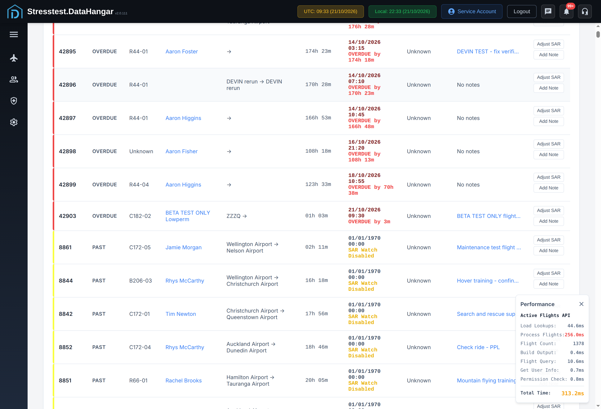
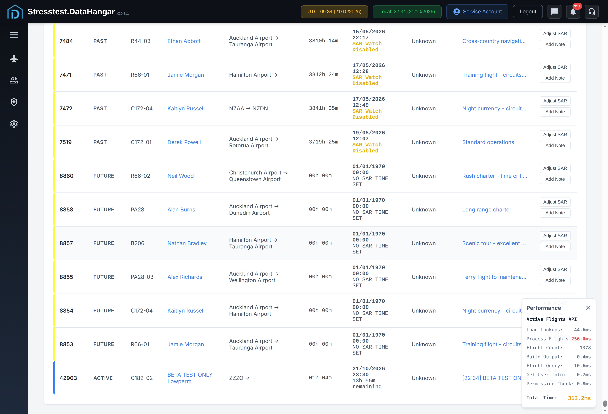

### BUG-EXM-006: Taking an exam: Multi-Response checkboxes toggle twice, so clicking the box does nothing and the saved answer can differ from what is ticked

Severity: High | Module: Exams | Check: EXM-010 ([29-exams](checklists/29-exams.md))

Steps:
1. Assign an exam with a Multi-Response question to a user.
2. Log in as that user > My Account > Exams > click the exam.
3. On the Multi-Response question click directly on a checkbox, then on an option's text.

Expected: Each click ticks or unticks the option once, and the answer saved is what is ticked on screen.

Actual: Clicking the checkbox square leaves it unchanged. renderMultiResponse() in personneldetails/index.js adds a click handler on the option row that flips checkbox.checked and the answers list, so a click on the box (native toggle + row handler) cancels out, and a click on the label fires the row handler twice. In my run the review showed 'Your Answer: BETA 1' while BETA 0 was the one I had just ticked, and the question was marked Incorrect.

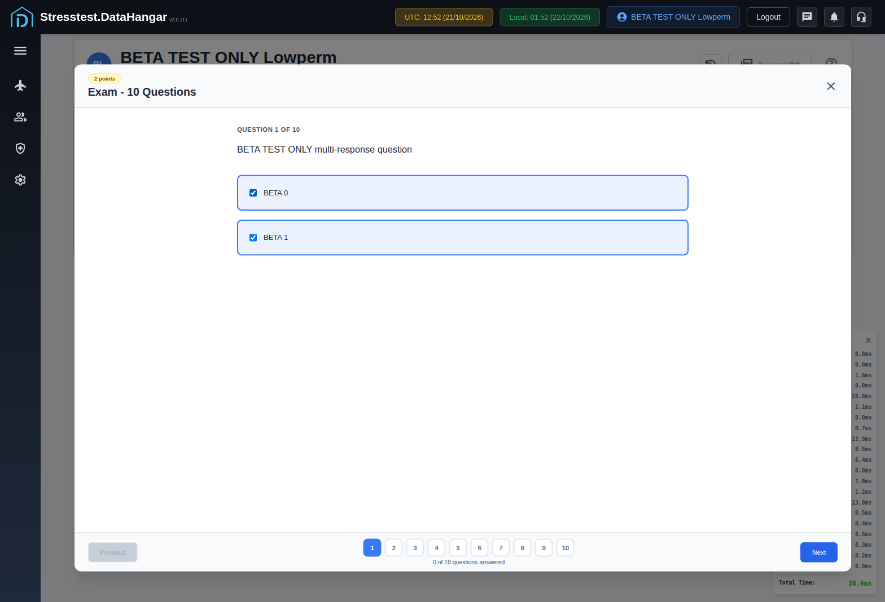
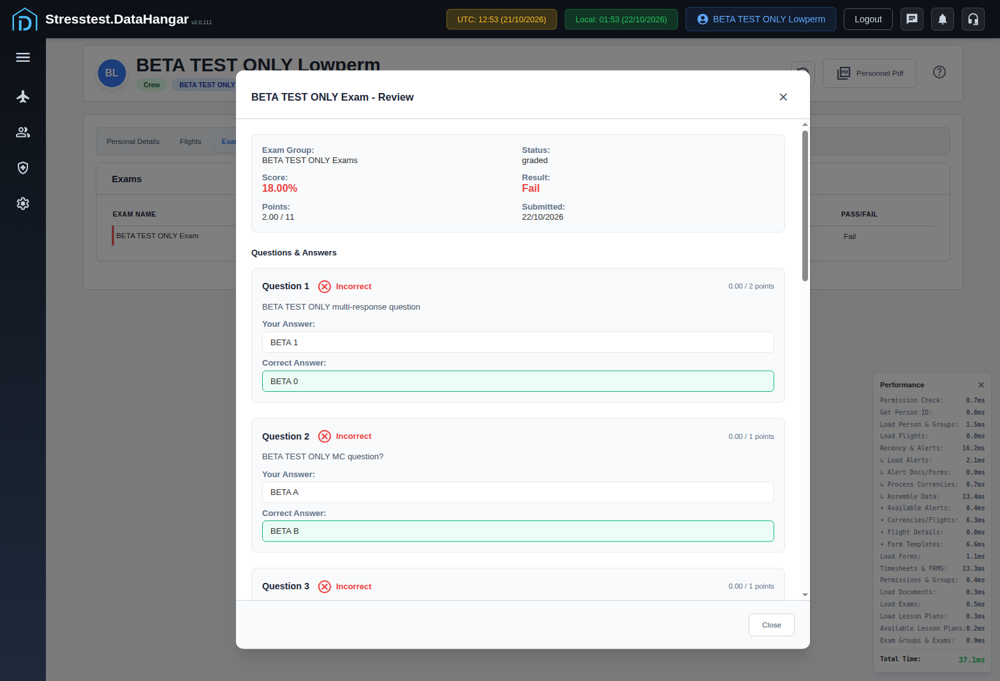

### BUG-PD-006: Personnel Details > Recency and Renewals: action buttons are hidden (Add Item, Table/Card view, renewal Save / Complete Renewal / Cancel) and Group by / Order by are disabled

Severity: High | Module: Personnel Details | Check: PD-019 ([12-personnel-details](checklists/12-personnel-details.md))

Steps:
1. All Personnel > Ethan Abbott > Recency and Renewals tab
2. Try to change Group by to Status, or Order by to Expiry Date
3. Look for the Table / Card view buttons
4. Click the pencil on Dangerous Goods Training and look for Save / Complete Renewal

Expected: Add Item opens the add renewal/recency search; Group by and Order by change the list; Table and Card buttons switch the layout.

Actual: Both dropdowns are disabled (greyed out, can't be changed). #add-recency-btn (Add Item), #view-table-btn and #view-card-btn exist in the page but are hidden (display:none), so you can't add a renewal/recency item or switch to card view. On the renewal edit page (pencil on Dangerous Goods Training) there is no Save, Complete Renewal or Cancel: #save-recency-btn, #complete-renewal-btn and #renewal-cancel-btn have display:none, so a renewal can't be saved or completed from Personnel Details. Renewal edit page has only the Go Back arrow, which discards changes without asking.

Suspected cause: Possibly the page script stops at the 'getPickerMod is not defined' error (BUG-PD-001) before it enables these controls.

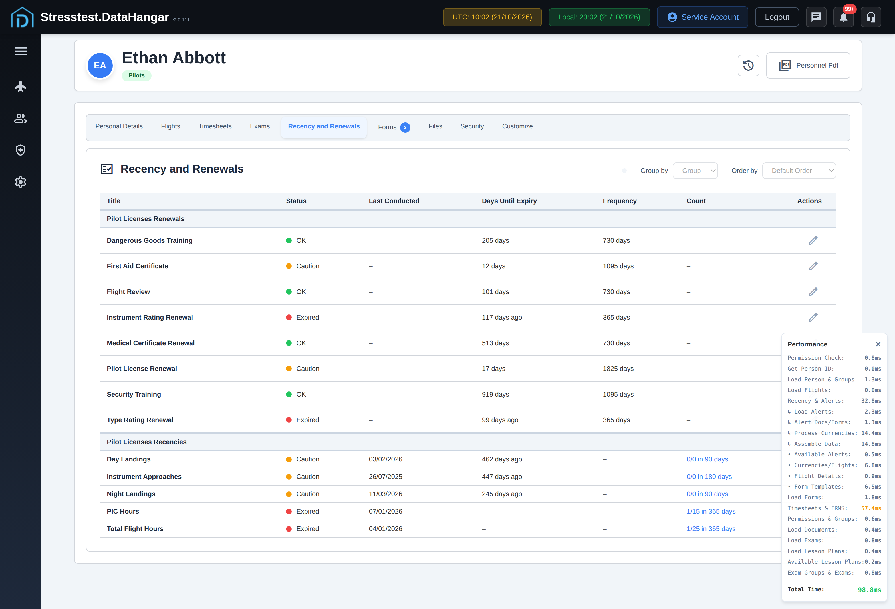

### BUG-PD-011: Personnel Details > Security: Change Password always fails with 'Invalid Action: change_password'

Severity: High | Module: Personnel Details | Check: PD-026 ([12-personnel-details](checklists/12-personnel-details.md))

Steps:
1. As Service Account: All Personnel > BETA TEST ONLY Lowperm > Security tab
2. Enter the correct current password, a new 14-character password twice
3. Click Change Password

Expected: 'Password changed' and the new password works; a wrong current password gives a clear 'Current password is incorrect' message.

Actual: Both with the correct and with a wrong current password: 'Password Change Failed - Invalid Action: change_password'. The password is not changed. The client-side checks work: empty fields 'Please fill in all password fields', short 'New password must be at least 8 characters long', mismatch 'New passwords do not match'. Same result when betatest_low changes its own password from My Account (header name > own Personnel Details > Security).

Suspected cause: The page posts action=change_password, which the server doesn't recognise (missing or renamed handler).

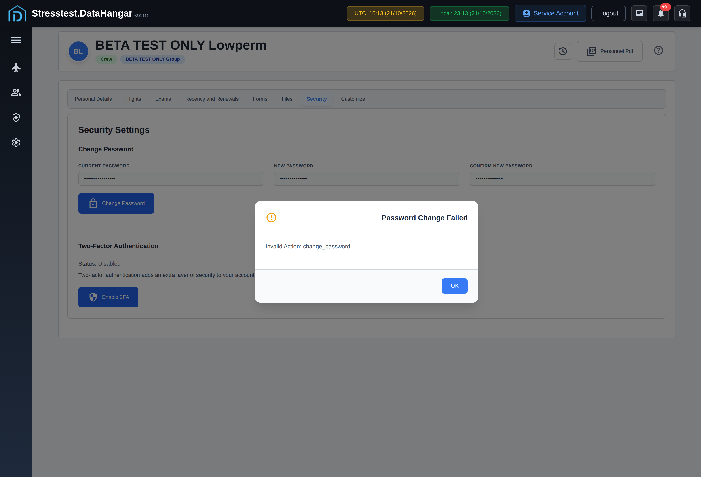
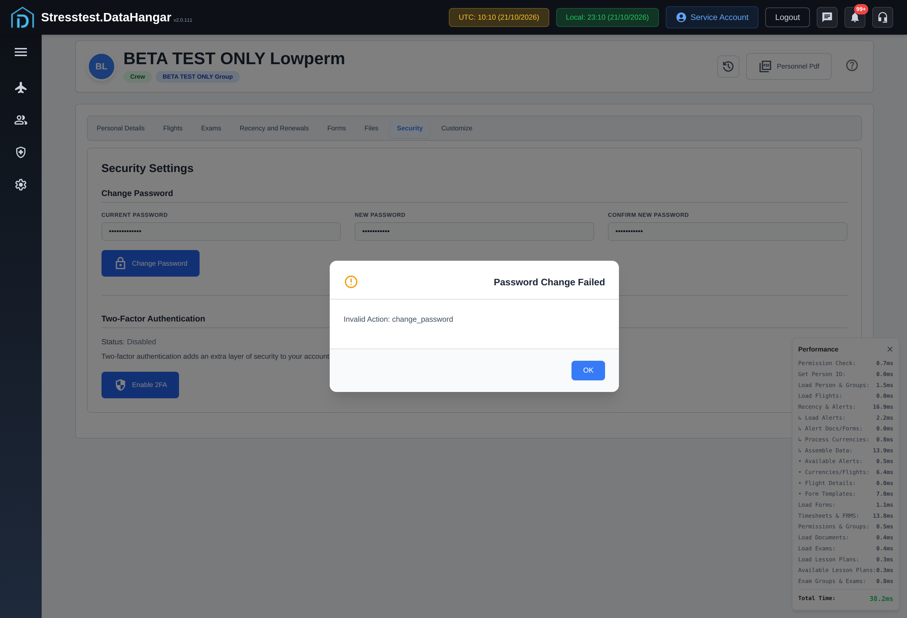
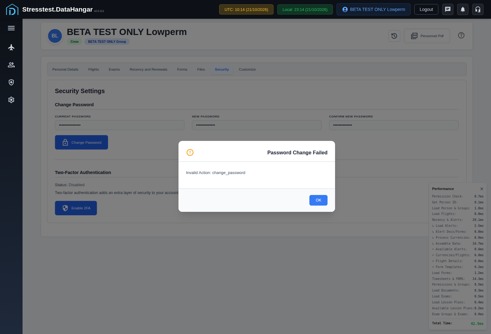

### BUG-RB-007: Roster Builder: Clear then Publish of a draft month with no shifts does not clear the live roster and shows no message

Severity: High | Module: Roster Builder | Check: RB-013 ([14-roster-builder](checklists/14-roster-builder.md))

Steps:
1. Settings and Tools > Roster Builder, pick a month that has a shift in the Live Roster (test used December 2027 with one BETA TEST ONLY Office Hours shift)
2. Select a draft that has no shifts for that month
3. Publish Month > Clear then Publish
4. Accept the browser confirm 'The draft ... has no shifts for December 2027. Publishing it will clear the live roster for this month. Do you want to continue?'
5. Switch to Live Roster (also after changing month and back)

Expected: Live roster for the month is cleared and a 'published successfully' message shows.

Actual: No toast or message at all, and the live shift is still there after reloading the month. Publish Only (Merge) with one shift worked ('published to live roster successfully').

Suspected cause: Suspected: publishDraft() (rosterbuilder/index.js around line 4139) hits an error in the clear/publish path, and the catch calls openErrorModal(), which itself throws (BUG-RB-005), so the failure is swallowed with no message. The 'draft has no shifts' path also uses a native confirm() instead of the app's popup.

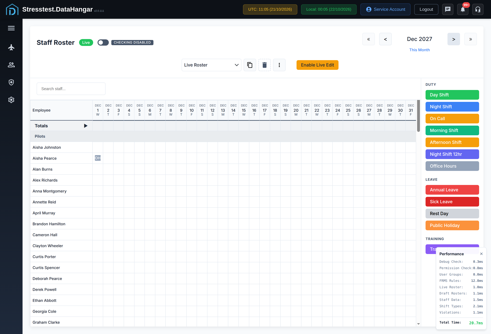

### BUG-SFS-002: Changing Schedule Start Time saves a full date-time, and the setting then shows NaN:NaN

Severity: High | Module: Settings: Flight Schedule | Check: SFS-004 ([31-settings-flightschedule](checklists/31-settings-flightschedule.md))

Steps:
1. Settings and Tools > Operations > Flight Schedule.
2. In Schedule Start Time, type 06:00 and press Tab.
3. Click Update Changes ("Settings updated successfully").
4. Reload the page.

Expected: Start time is saved as 06:00 and still shows 06:00 after reload.

Actual: The page saves the picker's full value ("2026-10-22 06:00:00"). On reload it splits that on ":" to get the hours, gets NaN, and the box shows "NaN:NaN". The server then stores "NaN-NaN-NaN NaN:NaN:NaN". After that, typing a new time does not enable Update Changes, so a user can't fix it from the UI.

Suspected cause: templates2/settings_flightschedule/index.js: the change listener does state.scheduleStartTime = e.target.value, but datetimepicker.js writes "YYYY-MM-DD HH:MM:SS" to .dtp-hidden-input. init then does state.scheduleStartTime.split(":").map(Number). Fix: keep only HH:MM (e.g. value.slice(11,16)) and check it is valid before saving.

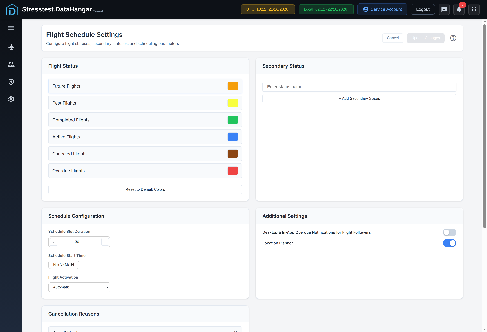

### BUG-SLP-002: Lesson Plan Settings: Exercises are never saved; add/edit/delete only change the page and are lost when you leave

Severity: High | Module: Settings: Lesson Plans | Check: SLP-001 ([42-settings-lessonplans](checklists/42-settings-lessonplans.md))

Steps:
1. Settings and Tools > Lesson Plans > Exercises > Add Exercise.
2. Name "BETA TEST ONLY Ex", then Save. It shows in the list.
3. Click edit on it, change the name to "BETA TEST ONLY Ex2", then Save.
4. Go to Settings and Tools, then back to Lesson Plans > Exercises.

Expected: The exercise is saved to the server, edit renames it, and it's still there when you come back.

Actual: No request goes to the server on Save (none seen in the network log), and no success message shows. Edit adds a second row ("BETA TEST ONLY Ex" and "BETA TEST ONLY Ex2") instead of renaming. When you come back, the list says "No exercises configured". So exercises can never be set up, and the Exercise Configuration on lessons can't be used. Lesson Plans on the same page do save (POST settings_lessonplans_save, "Ok:14").

Suspected cause: templates2/settings_lessonplans/index.js saveExercise() and deleteExercise() only change the in-memory exercises array ("// TODO: Implement API integration"), and loadExercises() only re-renders that array. The edit form doesn't carry the id, so data.id is empty and edit takes the "Add new" branch.

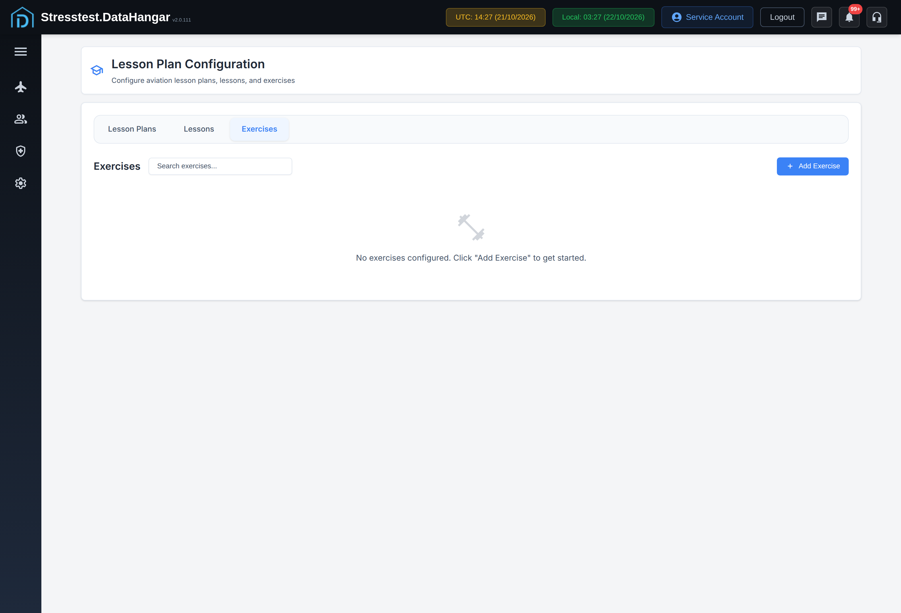

### BUG-AF-002: Active Flights lists future flights that have no SAR time, and the stats cards don't count them

Severity: Medium | Module: Active Flights | Check: AF-001 ([08-active-flights](checklists/08-active-flights.md))

Steps:
1. Sidebar > Flight Operations > Active Flights
2. Look at the status column and the stats cards

Expected: Only open flights whose start or SAR time has passed are listed, and Total = Active + Past + Overdue.

Actual: 6 FUTURE flights (#8853, #8854, #8855, #8857, #8858, #8860) are listed with Active Time 00h 00m and SAR Time '01/01/1970 00:00 NO SAR TIME SET'. Cards show Total 1377, Active 0, Past 1364, Overdue 7, so the 6 future flights are in Total but in no other card.

Suspected cause: An empty SAR time is stored/treated as 0 (1970), which counts as 'passed', so future flights pass the list filter.

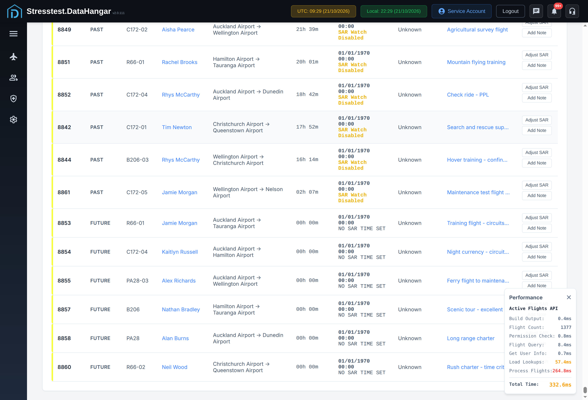
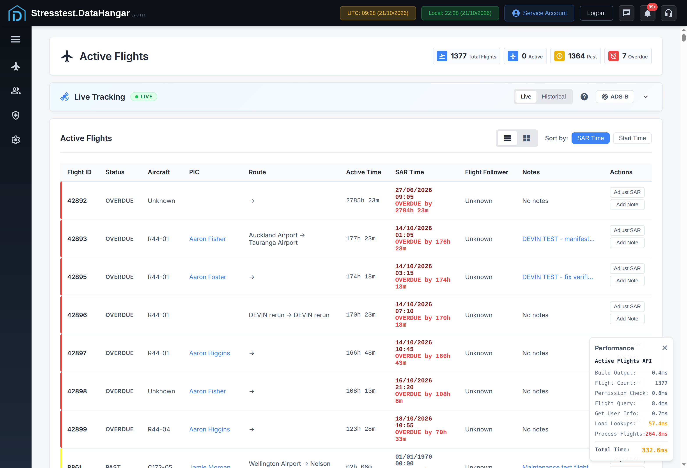

### BUG-AM-001: New User accepts a 6-character password (placeholder and Change Credentials require 10)

Severity: Medium | Module: Access Manager | Check: AM-010 ([04-access-manager](checklists/04-access-manager.md))

Steps:
1. Settings and Tools > Access Manager > New User
2. Fill all fields, Password and Confirm = a 6-character value (e.g. 'short1')
3. Click Create User

Expected: Rejected: 'Password must be at least 10 characters' (placeholder says 'Minimum 10 characters'; Change Credentials needs 10).

Actual: Toast 'User BETA TEST ONLY Lowperm created successfully'; account created with the 6-char password.

Suspected cause: No min-length check in the New User handler (client and server) for create; only Change Credentials enforces 10.

### BUG-DFR-002: Daily Flight Record: Clear Filters unticks every status (lists Open, Cancelled and Deleted flights), and the date fields show today's date when no date filter is applied

Severity: Medium | Module: Daily Flight Record | Check: DFR-008 ([09-daily-flight-record](checklists/09-daily-flight-record.md))

Steps:
1. Sidebar > Flight Operations > Daily Flight Record
2. Expand Advanced Filters: Completed and Complete Locked are ticked, Date From/To both show 21/10/2026 (today) but the list has flights from other days
3. Type Rego ZK-SIM (or any filter), press Enter
4. Click Clear Filters

Expected: Clear Filters goes back to the default view: Completed + Complete Locked, no other filters. Empty date filters show empty fields (or the dates shown are actually applied).

Actual: Clear Filters unticks all five status pills, so the list shows every status, including Open and Deleted flights (e.g. #9476 Open, #42902 Deleted), and the filter badge disappears. The Date From/To fields show today's date on load and after clearing, yet no date filter is applied.

Suspected cause: Clear resets status checkboxes to unchecked instead of the defaults, and an empty status set is treated as 'all'. The date pickers display a default value that is not sent as a filter.

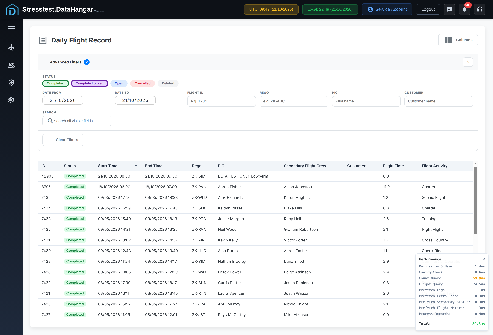
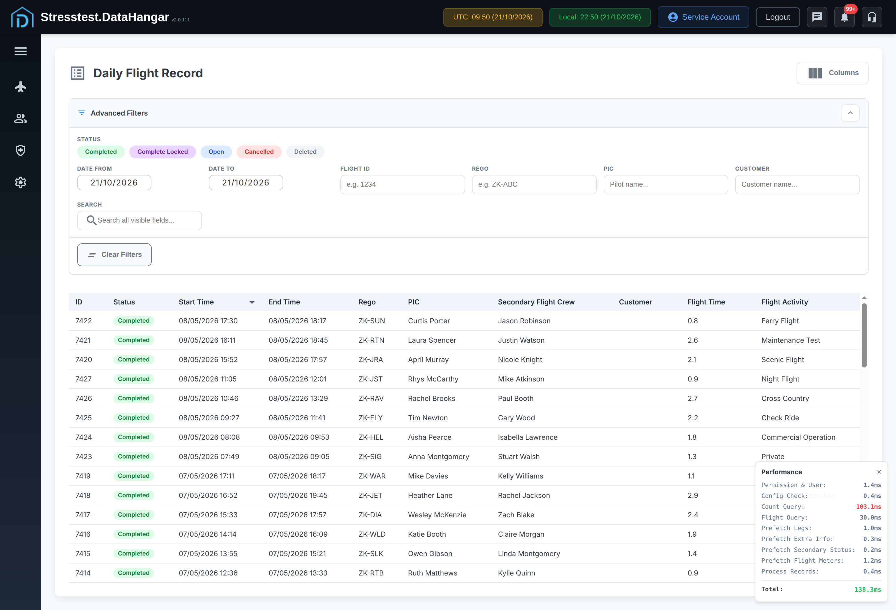

### BUG-DFR-003: Daily Flight Record: changing filters quickly appends results instead of replacing them, showing duplicate and wrong-status rows

Severity: Medium | Module: Daily Flight Record | Check: DFR-008 ([09-daily-flight-record](checklists/09-daily-flight-record.md))

Steps:
1. Sidebar > Flight Operations > Daily Flight Record > expand Advanced Filters
2. Click the Open status pill twice quickly (on, then off)
3. Look at the list: only Completed + Complete Locked are ticked
4. Or: with only Cancelled ticked, quickly click Completed, Complete Locked and Cancelled to get back to the defaults

Expected: The list always matches the current filters, each flight once (30 Completed rows).

Actual: Open on/off quickly: 60 rows, 30 Open flights plus 30 Completed, although Open is unticked. Three quick clicks back to the defaults: 90 rows of which 60 are duplicate IDs. Changing one filter at a time (4 s apart) is correct. Seen earlier too: Flight ID 42903 listed twice followed by unfiltered flights.

Suspected cause: Each filter change starts a new load, and every response is appended to the table; earlier, slower requests are not cancelled or ignored, and the table is not cleared per request.

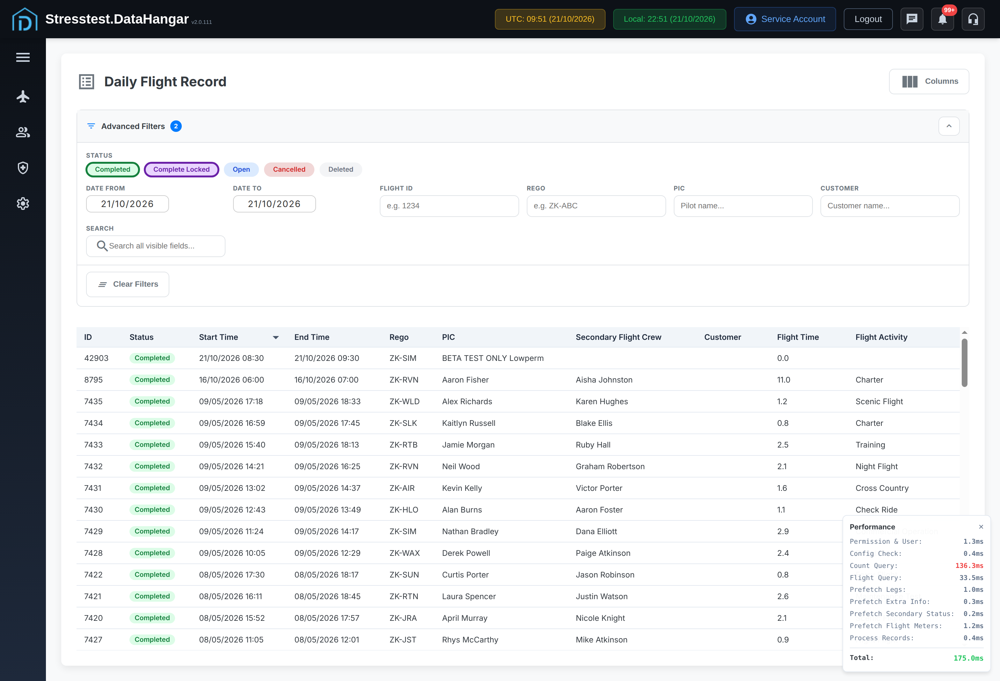

### BUG-DSH-003: Dashboard recency item opens Personnel Details on the wrong tab (Personal Details instead of Recency and Renewals)

Severity: Medium | Module: Dashboard / Personnel Details | Check: DSH-006 ([05-dashboard](checklists/05-dashboard.md))

Steps:
1. Open Dashboard from the sidebar
2. Recency and Renewals tab (first tab) is shown
3. Click 'Flight Review'

Expected: Own Personnel Details opens on the Recency and Renewals tab with Flight Review highlighted.

Actual: Personnel Details opens (URL has alertname_id=3) but the Personal Details tab is active; user has to find the Recency tab manually. Page also throws 'getPickerMod is not defined' (BUG-PD-001), which may be what stops the tab switch.

Suspected cause: alertname_id param not used to select the Recency tab, or the tab-switch code never runs because index.js is truncated (BUG-PD-001). Retest after BUG-PD-001 is fixed.

### BUG-EXM-004: Exam Builder has no way to link or unlink user groups on an exam group

Severity: Medium | Module: Exams | Check: EXM-003 ([29-exams](checklists/29-exams.md))

Steps:
1. Settings and Tools > Training > Exam Builder (Service Account, permission A)
2. Look at an exam group header (e.g. 'BETA TEST ONLY Exams' or 'Aviation Theory')

Expected: 'User Groups:' badges and an 'Add User Group' button on each exam group, with a remove x on each badge.

Actual: The group header only has Add Exam and Delete Group. No User Groups row or Add User Group button is shown for any group.

Suspected cause: createUsergroupBadges() (exambuilder/index.js line 291) builds the User Groups row and Add User Group button but is never called.

### BUG-EXM-008: Exam Builder: deleting an exam or exam group that has instances fails silently (error only in the console), and graded instances can't be removed

Severity: Medium | Module: Exams | Check: EXM-001 ([29-exams](checklists/29-exams.md))

Steps:
1. Assign an exam and let the person submit it.
2. Exam Builder > exam row > Delete > Confirm.
3. Group header > Delete Group > Confirm.

Expected: A clear message saying why it can't be deleted, plus a way to archive the exam or remove its instances.

Actual: The confirm closes, no toast or message, and the exam/group stay. Console only: 'Cannot delete exam: 1 exam instance(s) exist. Exams with instances cannot be deleted.' and the same for the group. Exam Instances only lets you delete unstarted instances, so a test exam that has been taken can never be removed.

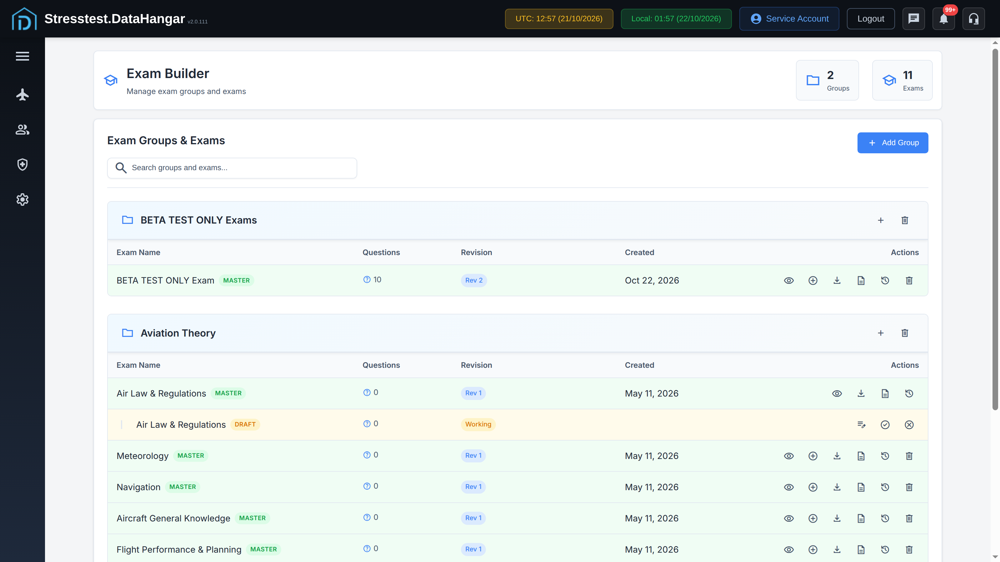

### BUG-FB-003: File Browser: clicking a .txt file shows 'File Access Error' with the file's own text

Severity: Medium | Module: File Browser | Check: FB-006 ([22-file-browser](checklists/22-file-browser.md))

Steps:
1. Administration > File Browser
2. Search 'BETA_TEST_ONLY'
3. Click BETA_TEST_ONLY_notice-GCKLCWJK.txt

Expected: The file opens in the preview (or downloads).

Actual: An error popup titled 'File Access Error' shows the file content ('BETA TEST ONLY notice attachment - please ignore'). No preview opens. Same cause as BUG-NOT-002 and BUG-PD-012.

Suspected cause: filebrowser/index.js handleFilePreview(): any text/plain response that is not 'Ok' is treated as an error message, so every real .txt file is shown as an error.

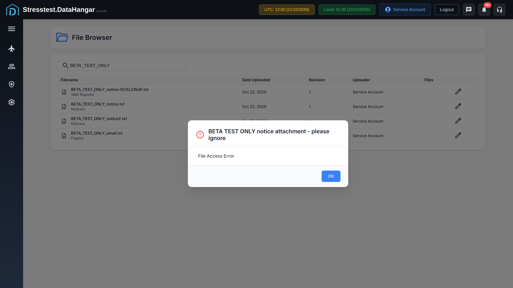

### BUG-FB-005: File Browser: Read/Write Access groups are not kept after Update Document

Severity: Medium | Module: File Browser | Check: FB-007 ([22-file-browser](checklists/22-file-browser.md))

Steps:
1. Administration > File Browser, open edit (Configure File) on a file
2. Tick Read Access 'BETA TEST ONLY Group'
3. Update Document
4. Open edit on the same file again

Expected: BETA TEST ONLY Group is still ticked and the file is limited to that group.

Actual: No group is ticked. The request sent read_access with the group (id 103), but the popup shows nothing ticked when reopened. Moving the file to Root (Parent Folder) did save.

Suspected cause: Either the server does not store read_access/write_access, or handleOpenConfigModal() does not tick the saved groups. Needs a server-side check.

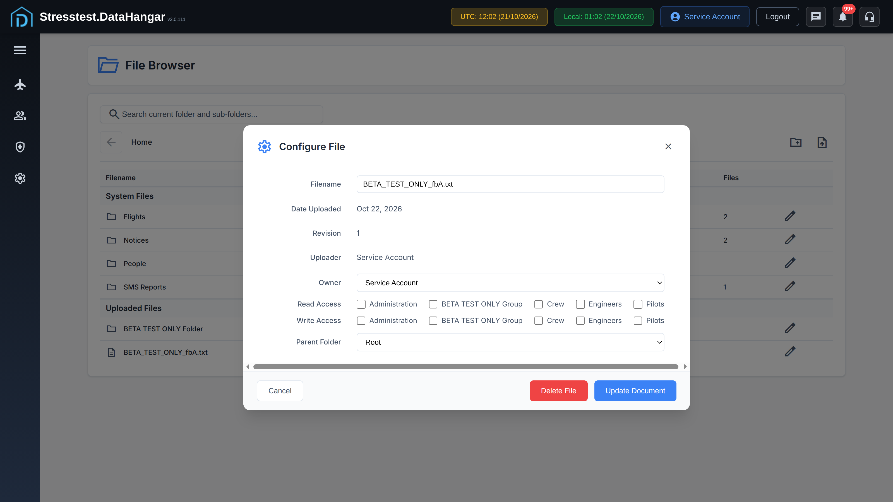

### BUG-FB-006: File Browser: deleting a folder fails with 'Invalid Action: filebrowser_deletefolder'

Severity: Medium | Module: File Browser | Check: FB-008 ([22-file-browser](checklists/22-file-browser.md))

Steps:
1. Administration > File Browser > Make Folder 'BETA TEST ONLY Folder'
2. Click edit on the folder, then Delete
3. Confirm

Expected: The folder is deleted.

Actual: Error popup 'Delete Failed: Invalid Action: filebrowser_deletefolder' and the folder stays. The confirm popup also says 'delete this file' for a folder.

Suspected cause: filebrowser/index.js performDeleteFolder() posts action filebrowser_deletefolder, which the server does not handle.

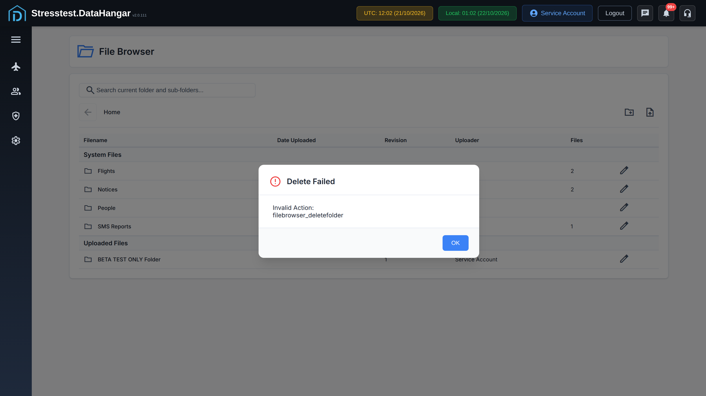

### BUG-FBLD-002: Form Builder View Form: Date and Time widgets default to UTC, not local time

Severity: Medium | Module: Form Builder | Check: FBLD-S04 ([23-form-builder](checklists/23-form-builder.md))

Steps:
1. Settings and Tools > Form Builder, open a template with Date and Time widgets
2. Click View Form
3. Compare Date/Time with the header Local clock

Expected: Local date and time: 22/10/2026 01:07.

Actual: 21/10/2026 and 12:07, which is the UTC date and time. Same as earlier FORM-06.

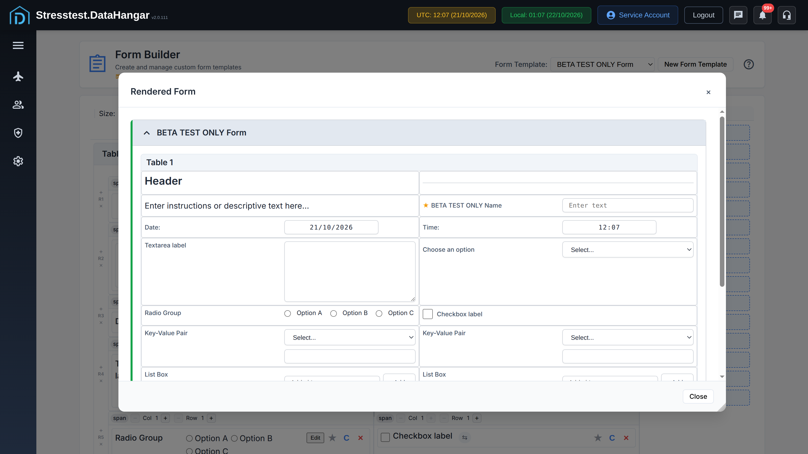

### BUG-FBLD-003: Form Builder: table conditions do nothing in View Form

Severity: Medium | Module: Form Builder | Check: FBLD-005 ([23-form-builder](checklists/23-form-builder.md))

Steps:
1. Settings and Tools > Form Builder, template with a Dropdown (BETA A/B/C) in Table 1
2. Add Table 2, click its C (Conditions)
3. IF 'Choose an option' is 'BETA A' THEN show this table > Add > Save Conditions > Save Form Template
4. View Form, pick BETA B, then BETA A

Expected: Table 2 is hidden until BETA A is picked.

Actual: Table 2 is always shown (with nothing picked, with BETA A and with BETA B). No console errors.

Suspected cause: formbuilder/index.js render script looks up formContainer.querySelector('[data-table-id=...]') and [data-widget-id=...], but the rendered preview has no elements with data-table-id or data-widget-id, so every condition returns early. Related to FORM-17/FORM-18.

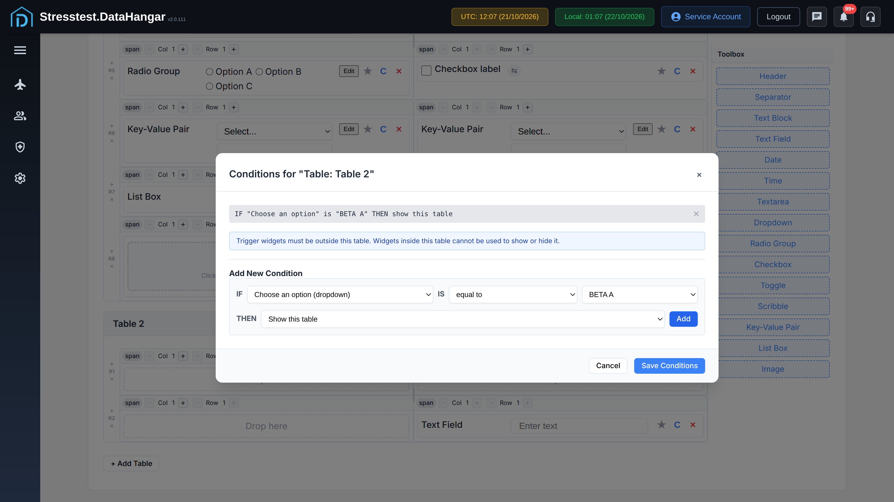

### BUG-FD-001: Flight Details Save Changes does not return to the Flight Schedule and gives no success message

Severity: Medium | Module: Flight Details | Check: FD-034 ([07-flight-details](checklists/07-flight-details.md))

Steps:
1. Flight Schedule > Schedule Only > week
2. Double-click flight #42903 > Flight Details
3. Add a passenger or comment
4. Click Save Changes

Expected: Flight is saved and you return to where you came from (the Flight Schedule week you were on), as described in the guide.

Actual: The page reloads in place (URL now has return_url=/index.pl?action=flightschedule) and stays on Flight Details. No toast or message says it was saved; only the greyed-out Save Changes button hints at it. The user has to click Back.

Suspected cause: Save handler reloads the details page with return_url instead of navigating to return_url after a successful save.

### BUG-FD-002: Flight Details History misses edits saved in Flight Details and shows a false 'Aircraft: ZK-SIM > Unassigned' on schedule moves

Severity: Medium | Module: Flight Details | Check: FD-037 ([07-flight-details](checklists/07-flight-details.md))

Steps:
1. Flight Schedule > Enable Live Edit > move/resize flight #42903 (ZK-SIM)
2. Double-click it > Flight Details > add a custom passenger and a comment > Save Changes
3. Click History

Expected: History shows every change including the Flight Details save (passenger added, comment added), and only fields that really changed.

Actual: The Flight Details save at 10:17 pm is not listed; newest entry is the 09:31 pm schedule move. Each schedule move/resize entry lists 'Aircraft: ZK-SIM > Unassigned' (the aircraft stayed ZK-SIM) and 'Source: (blank) > Flight Schedule'. Values are shown as raw '2026-10-21 09:30:00' instead of DD/MM/YYYY HH:MM.

Suspected cause: Schedule drag/resize audit compares against a payload without aircraft (null > 'Unassigned'); Flight Details save path either does not write to the audit log or only logs main-table fields (passengers/comments not tracked).

### BUG-FD-004: Leg PIC / Secondary Flight Crew dropdowns offer passengers (e.g. a custom passenger can be chosen as leg PIC)

Severity: Medium | Module: Flight Details | Check: FD-005 ([07-flight-details](checklists/07-flight-details.md))

Steps:
1. Open flight #42903 > Passenger List > Add Custom Passenger 'BETA TEST ONLY Pax'
2. Times and Weights > Add Leg
3. Open the leg PIC or Secondary Flight Crew dropdown

Expected: Only Crew or Student role people (like the flight-level PIC list).

Actual: Leg PIC and Secondary Flight Crew list 'BETA TEST ONLY Lowperm' and 'BETA TEST ONLY Pax' - the custom passenger can be picked as the leg's pilot, which would put a passenger's hours into crew/FRMS records.

Suspected cause: Leg crew dropdowns are filled from the whole manifest (crew + passengers) instead of crew only.

### BUG-FD-005: Leg with two unknown waypoints: only the first is offered for adding, the second is silently dropped on save

Severity: Medium | Module: Flight Details | Check: FD-022 ([07-flight-details](checklists/07-flight-details.md))

Steps:
1. Open flight #42903 > Times and Weights > Add Leg
2. Departure 'ZZZQ', Destination 'NZWN' (neither in Settings > Waypoints)
3. Save Changes > 'Add New Waypoint' for ZZZQ > Add Waypoint
4. Back, reopen the flight > Times and Weights

Expected: You are asked about each unknown waypoint (ZZZQ, then NZWN) before the flight is saved; nothing you typed is lost.

Actual: Only ZZZQ is prompted ('Waypoint "ZZZQ" added successfully'), then the flight saves straight away and the leg Destination is stored empty - NZWN is lost without a warning. Typing NZWN again and saving does prompt for it.

Suspected cause: After 'Add Waypoint' the save continues without re-validating the remaining unknown waypoints, and unknown codes are blanked instead of blocking the save.

### BUG-FS-001: New flight defaults to the current UTC time instead of local time (SAR TIME labelled LOCAL shows UTC+1h)

Severity: Medium | Module: Flight Schedule > Flight Details (new) | Check: FS-011 ([06-flight-schedule](checklists/06-flight-schedule.md))

Steps:
1. Settings > Time Zone is Pacific/Auckland (header shows UTC 08:25, Local 21:25)
2. Flight Schedule > Enable Live Edit > Add Flight
3. Look at Start Time, End Time and SAR TIME (LOCAL)

Expected: Start defaults to local now (21:25), end +1h (22:25), SAR time in local time.

Actual: Start 21/10/2026 08:25, End 09:25, SAR TIME (LOCAL) 09:25 - all UTC values. Near midnight the date would also be wrong. Also Cancel with no changes does nothing (only the back arrow leaves).

Suspected cause: New-flight defaults built from server/UTC now() rather than the org time zone. Confirm whether flights are stored in UTC and shown in local everywhere else (see 92-xc-dates).

### BUG-FS-002: Esc does not end copy/paste mode on the Flight Schedule - the next click + Ctrl+V creates another flight

Severity: Medium | Module: Flight Schedule | Check: FS-021 ([06-flight-schedule](checklists/06-flight-schedule.md))

Steps:
1. Flight Schedule > Enable Live Edit
2. Select a flight, Ctrl+C, click an empty slot, Ctrl+V, Paste
3. Toast: '... press Escape to finish.' Press Esc
4. Click another empty slot, press Ctrl+V

Expected: Esc ends paste mode; Ctrl+V afterwards does nothing.

Actual: No feedback on Esc; the click shows 'Press Ctrl+V to paste the flight here' and Ctrl+V creates another flight (created #42906). Users can create unwanted live flights.

Suspected cause: Escape keydown handler does not clear the copied-flight clipboard state (or is not bound inside the schedule iframe).

### BUG-FS-003: Flight Schedule header overlaps when Live Edit is on - title covered, location pill cut off and its 'Show All' button cannot be clicked

Severity: Medium | Module: Flight Schedule | Check: FS-008 ([06-flight-schedule](checklists/06-flight-schedule.md))

Steps:
1. Flight Schedule at 1568 px wide
2. Pick a location in Locations (pill 'Viewing location: Auckland Base')
3. Go to a past week and click Enable Live Edit

Expected: Title, Live Edit banner, past-date banner and location pill all readable (wrap to a second line if needed).

Actual: 'Live Edit Mode' banner is drawn over the 'Flight Schedule' title and subtitle; 'Viewing location: Auckland Base' is cut to 'Viewing' and hidden behind the view buttons. The pill's 'Show All' button sits under the view-mode buttons, so a click lands on 'Schedule & Planner' instead (the location filter can only be cleared after turning Live Edit off or via Locations > All Locations).

Suspected cause: Header banners are absolutely positioned / flex row with no wrap; no room left when 3 banners show.

### BUG-FS-004: Planner Add Location replaces the New Booking popup - typed booking and location input is lost

Severity: Medium | Module: Flight Schedule > Location Planner | Check: FS-029 ([06-flight-schedule](checklists/06-flight-schedule.md))

Steps:
1. Flight Schedule > Planner Only > Rows by Location > Enable Live Edit
2. Drag across empty days in a location row > New Booking opens; type a note
3. Click 'Add Location' in New Booking
4. Leave Name and Code empty, click Save, then OK on the Error popup

Expected: Add Location opens on top of New Booking; after the error you are back in Add Location with your input; after saving you return to New Booking with the new location selected and your note kept.

Actual: Add Location replaces New Booking (the note is gone). OK on 'Name and Code are required.' closes all popups, so the user has to start again. After a successful Save ('Location created') New Booking does not come back either.

Suspected cause: Planner popups use one shared modal slot: opening a modal closes the current one and closing the error closes everything instead of returning to the parent modal.

### BUG-FS-006: Flight Schedule month view is slow: flightschedule_json takes ~1.6 s and rendering 2,500 events ~4.5 s

Severity: Medium | Module: Flight Schedule | Check: FS-034 ([06-flight-schedule](checklists/06-flight-schedule.md))

Steps:
1. Flight Schedule > Schedule Only
2. Click Month (October 2026, range 28/09-08/11)
3. Measure in DevTools Network: index.pl?action=flightschedule_json&start=2026-09-28&end=2026-11-09

Expected: Server response < 500 ms; month view usable in about 1-2 s.

Actual: Request 1,590 ms (first byte 844 ms); 2,493 events take 4.5 s from click to render. Page freezes while rendering.

Suspected cause: Whole 6-week range returned with full event details in one JSON call and every event rendered; consider a summary per day for month view, indexes on flight start/end, or lazy loading of 'more' events.

### BUG-FS-007: Edit-mode idle timeout switches Live Edit off silently, throws 'calendarEl is not defined' and leaves the schedule blank

Severity: Medium | Module: Flight Schedule | Check: FS-025 ([06-flight-schedule](checklists/06-flight-schedule.md))

Steps:
1. Flight Schedule > Planner Only (or any view) > Enable Live Edit
2. Do not touch the page for 20 minutes

Expected: Edit mode turns off with the message 'Edit mode has been disabled due to inactivity.'

Actual: At 20 min the button silently returns to 'Enable Live Edit'; no popup or toast, and the console shows uncaught ReferenceError 'calendarEl is not defined', so the rest of the timeout handler (probably the message and the calendar refresh) does not run. A user who comes back can think they are still editing. Afterwards the schedule is left blank (month view 'October 2026' with no flights) until the page is reloaded.

Suspected cause: Inactivity handler references a variable calendarEl that is not in scope (renamed or local to another function).

### BUG-HAZ-001: Hazard Register details: Hazard Type always shows '--'

Severity: Medium | Module: Hazard Register | Check: HAZ-003 ([20-hazard-register](checklists/20-hazard-register.md))

Steps:
1. Flight Safety > Safety Reports > report #2060 > Final Report: Add to Hazard Register, Type = Hazard (later Risk), Save Changes
2. Flight Safety > Hazard Register > click #2060
3. Look at Hazard Details > HAZARD TYPE

Expected: Shows the type picked on the safety report (Hazard / Risk).

Actual: Shows '--'.

Suspected cause: hazarddetails.js getHazardTypeText() only knows the codes E/S/I/C/P (Eliminate, Substitute, Isolate, Control, PPE). The Safety Report form saves Hazard/Risk, so every type falls back to '--'.

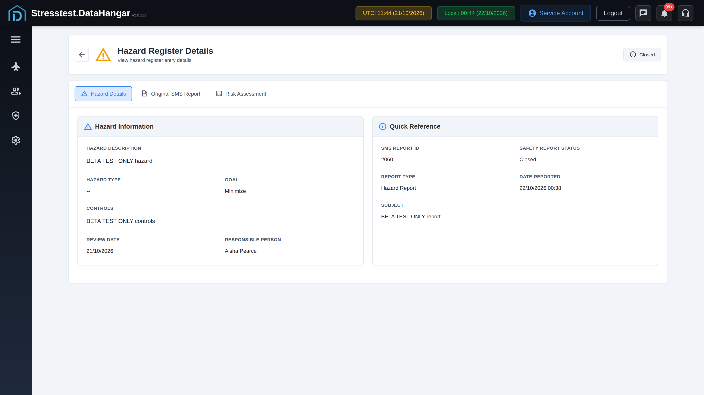

### BUG-HAZ-002: Hazard Register details: Final Risk Assessment never shows the saved final risk

Severity: Medium | Module: Hazard Register | Check: HAZ-003 ([20-hazard-register](checklists/20-hazard-register.md))

Steps:
1. Safety report #2060: Final Report tab, Final Risk Unlikely x Minor, Save Changes (saved: reloading the report shows Unlikely/Minor)
2. Flight Safety > Hazard Register > #2060 > Risk Assessment tab

Expected: Final Risk & Review shows Likelihood Unlikely, Consequence Minor and the resulting risk level. The list's Risk column should then use the final risk too.

Actual: Final Risk shows Likelihood '--', Consequence '--', risk '--'. Only the Closure Description is filled. The list Risk column shows the initial risk (Low).

Suspected cause: hazarddetails.js (~line 221) only shows the card and the closure description. Its comment says 'You would need to fetch the final risk details from the API'; that was never done.

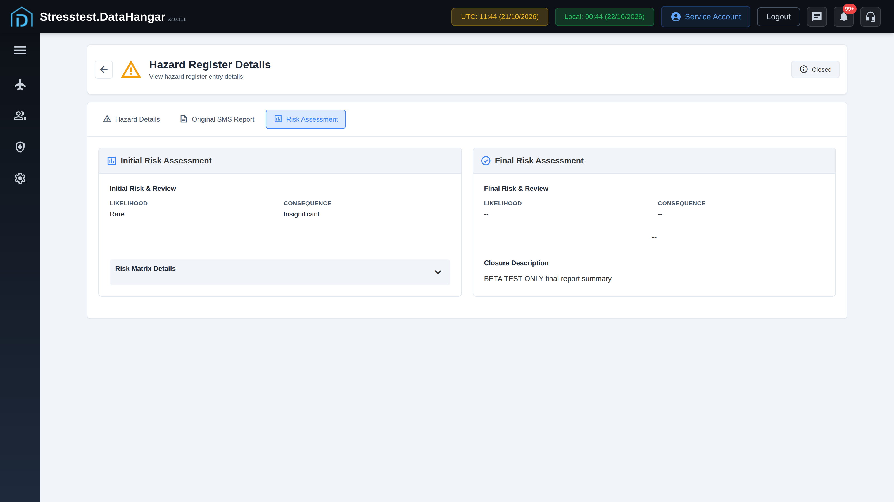

### BUG-LOG-003: 'Trust this device for 30 days' is lost on Logout (logout deletes the trusted-device cookie)

Severity: Medium | Module: Login / 2FA (main) | Check: LOG-010 ([01-login-auth](checklists/01-login-auth.md))

Steps:
1. Log in as a 2FA user, tick 'Trust this device for 30 days', enter a valid code
2. Check cookies: dhkey_trusted_<user> set, expires in 29-30 days
3. Click Logout > Log Out
4. Log in again with username + password

Expected: 2FA page skipped on this browser for 30 days.

Actual: Logout deletes all cookies (dhkey_<user>, dhkey_trusted_<user>, dhkey_username); the next login asks for the 2FA code again. Trust only survives if the user never logs out.

Suspected cause: Logout handler expires every dhkey_* cookie; should keep dhkey_trusted_*.

### BUG-NAV-001: Leaving a page with unsaved changes gives no warning; edits are lost

Severity: Medium | Module: Shell (main) / Personnel Details | Check: NAV-015 ([02-shell-navigation](checklists/02-shell-navigation.md))

Steps:
1. Click Service Account (top bar) to open My Personnel Details
2. Type in Middle Name: Save Changes becomes enabled
3. Hover Flight Operations in the sidebar and click Dashboard

Expected: Guide §3: 'The current page has unsaved changes...' modal with Cancel (stay) and Continue (leave).

Actual: Dashboard opens immediately, no modal; the typed change is discarded.

Suspected cause: Dirty-state check in `main/index.js` menu click handler is not wired to Personnel Details (or not at all).

### BUG-NOT-002: Notice Details: clicking a .txt attachment does nothing (no preview, no download)

Severity: Medium | Module: Notices | Check: NOT-006 ([17-notices](checklists/17-notices.md))

Steps:
1. Flight Safety > Notices > open 'BETA TEST ONLY Notice' (#1189)
2. Click the attached file BETA_TEST_ONLY_notice.txt

Expected: Preview popup (or download) for the attachment.

Actual: Nothing appears. The browser sends HEAD and GET to noticedetails_servefile&doc_id=453, but no preview, error or download is shown.

Suspected cause: handleFilePreview() in notices/noticedetails.js treats any text/plain response that isn't 'Ok' as an error message (showErrorModal('File Access Error', text)), so a real .txt file's content is taken as an error and the preview never opens. Same pattern as BUG-PD-012.

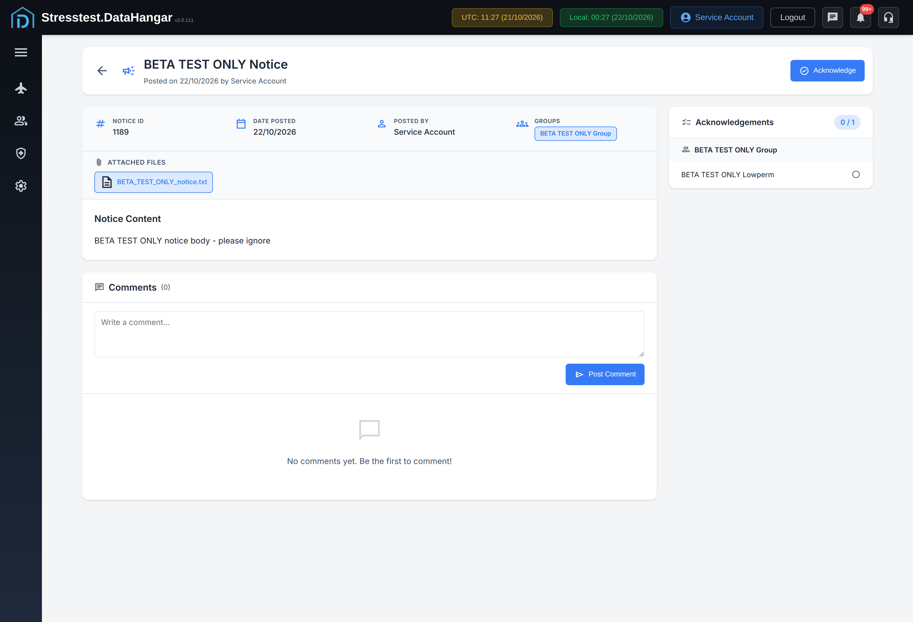

### BUG-PD-001: personneldetails/index.js is truncated: ReferenceError getPickerMod on every load

Severity: Medium | Module: Personnel Details / My Account | Check: PD-S01 ([12-personnel-details](checklists/12-personnel-details.md))

Steps:
1. Click Service Account (top bar) or open any person from All Personnel
2. Watch the console

Expected: No console errors.

Actual: `ReferenceError: getPickerMod is not defined` at `templates2/personneldetails/index.js?v=2.0.111:13734`. The file's last line is `window.getPickerMode = getPickerMod` (cut off; should be `getPickerMode;`), so `window.getPickerMode` is never set and anything after it never runs.

Suspected cause: `personneldetails/index.js` last line truncated during build/deploy; restore `window.getPickerMode = getPickerMode;` and check nothing else is missing from the end of the file.

### BUG-PD-003: 2FA setup: one wrong verification code closes the setup dialog and issues a new secret

Severity: Medium | Module: Personnel Details > Security | Check: PD-027 ([12-personnel-details](checklists/12-personnel-details.md))

Steps:
1. My Account > Security > Enable 2FA, enter password, Confirm
2. Scan the QR code / note the key
3. Enter a wrong 6-digit code, click Verify and Enable
4. Click OK on '2FA Setup Failed - Error: Invalid verification code'

Expected: Setup dialog stays open with the same QR/key so the user can retry the code.

Actual: Setup dialog closes. Clicking Enable 2FA again generates a new key and new backup codes, so the entry already added to the authenticator app is useless and must be deleted and re-scanned.

Suspected cause: Verify failure handler closes #2fa-setup-modal and discards the pending secret.

### BUG-PD-007: Personnel Details > Recency: 'Days Until Expiry' and status don't match the Last Conducted date

Severity: Medium | Module: Personnel Details | Check: PD-021 ([12-personnel-details](checklists/12-personnel-details.md))

Steps:
1. All Personnel > Ethan Abbott > Recency and Renewals tab
2. Look at the Pilot Licenses Recencies rows (today 21/10/2026)

Expected: Days match the dates, e.g. Day Landings last conducted 03/02/2026 with a 90-day window expired about 170 days ago (260 days since last conducted), and an expired item shows Expired.

Actual: Day Landings: Last Conducted 03/02/2026, '462 days ago', status Caution, count 0/0 in 90 days. Instrument Approaches: 26/07/2025, '447 days ago', Caution, 0/0 in 180 days. Night Landings: 11/03/2026, '245 days ago', Caution. None of these numbers match the dates, and items long past their window show Caution, not Expired. PIC Hours / Total Flight Hours show Expired with no days value.

Suspected cause: Needs a check against the recency rules; a 0/0 requirement may be treated as Caution, and the days value may come from a different date than Last Conducted.

### BUG-PD-008: Personnel Details > Recency: the recency summary popup has no Add Manual Entry, no x, and doesn't close with Escape

Severity: Medium | Module: Personnel Details | Check: PD-021 ([12-personnel-details](checklists/12-personnel-details.md))

Steps:
1. All Personnel > Ethan Abbott > Recency and Renewals tab
2. Click the Day Landings count '0/0 in 90 days'
3. Look for Add Manual Entry and a close button; press Escape

Expected: The popup lists the recency flights/entries, has Add Manual Entry (Date*, Value*, Notes) and closes with x, outside click and Escape.

Actual: 'Recency summary for Day Landings' lists 4 manual entries (03/02/2026, 15/06/2025, 02/06/2025, 17/04/2025) but has no buttons at all: no Add Manual Entry, no x. Escape does nothing; only clicking outside closes it. So manual recency entries can't be added from this page.

Suspected cause: Possibly the dialog buttons are built by the part of personneldetails/index.js that is cut off (BUG-PD-001).

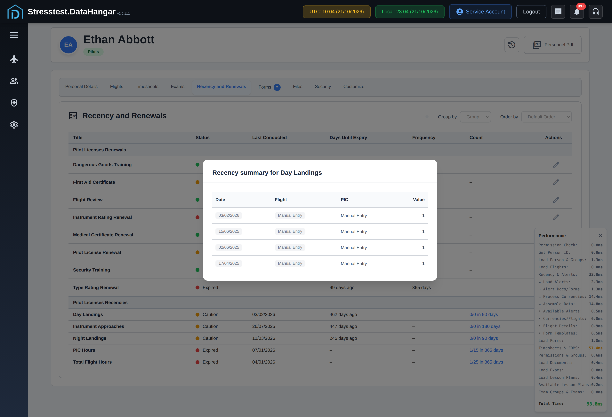

### BUG-PD-009: Personnel Details > Renewal edit: the Today and Calculate links can't be clicked because the date fields cover them

Severity: Medium | Module: Personnel Details | Check: PD-022 ([12-personnel-details](checklists/12-personnel-details.md))

Steps:
1. All Personnel > Ethan Abbott > Recency and Renewals > edit (pencil) on Dangerous Goods Training
2. Click 'Today' next to Last Conducted
3. Click 'Calculate' next to Expires

Expected: Today sets Last Conducted to today; Calculate sets Expires to Last Conducted + frequency.

Actual: The date boxes are squeezed and overlap the links. A real click on 'Calculate' lands on the Renewal Notes textarea and a click on 'Today' lands on the Scheduled field's container, so nothing happens. When the link is triggered from code, Calculate works: Expires 20/10/2028 and toast 'Expiry date set to 20/10/2028 (730 days from Last Conducted)', which is correct and in the org date format.

Suspected cause: Layout of .input-with-button-container: the date inputs are too narrow and the link sits under the next field.

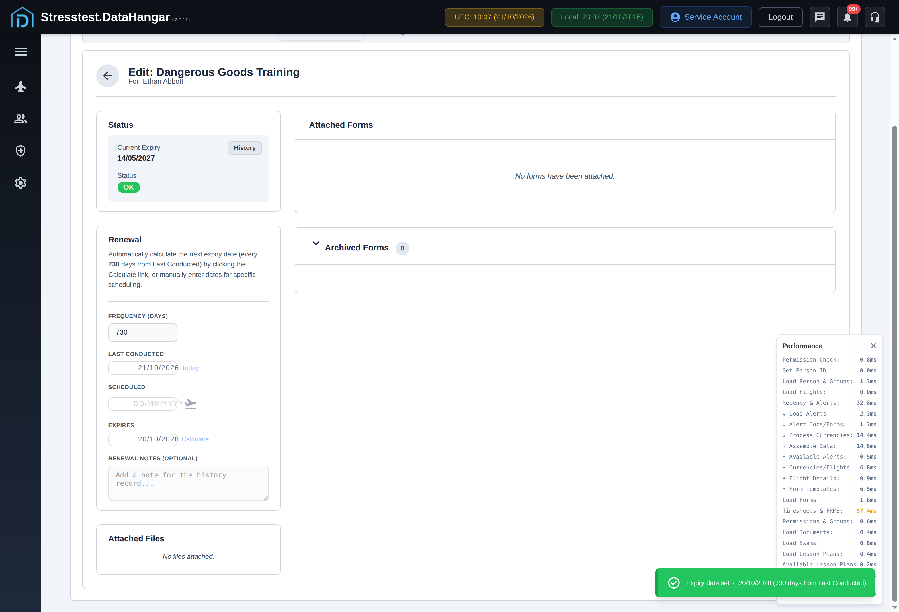

### BUG-PD-012: Personnel Details > Files: opening a file shows 'File Access Error' with the file's contents as the message

Severity: Medium | Module: Personnel Details | Check: PD-025 ([12-personnel-details](checklists/12-personnel-details.md))

Steps:
1. All Personnel > BETA TEST ONLY Lowperm > Files tab
2. Browse > BETA_TEST_ONLY_pd.txt (30 B) > Upload
3. Click the file name in the list

Expected: The file opens in a preview (or a new tab).

Actual: An error popup 'File Access Error' appears whose message is the text inside the file ('BETA TEST ONLY personnel file'). No preview opens. After pressing OK on that error, the Delete file button does nothing: the confirm popup is set active but stays hidden (display:none), so nothing appears until the page is reloaded. The page also has two buttons with id confirm-modal-ok-btn (#alert-modal and #confirm-modal).

Suspected cause: The preview call probably expects JSON and treats the raw file response as an error message.

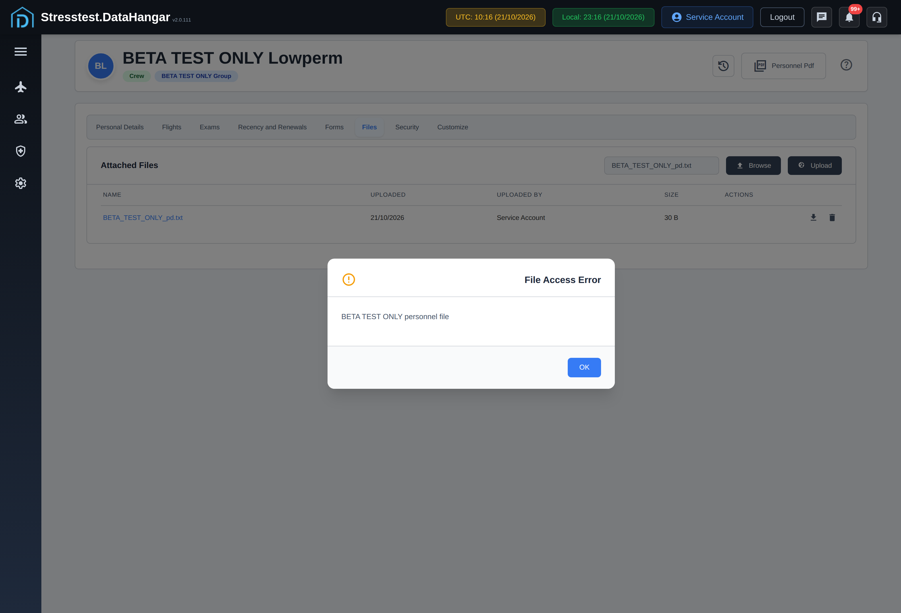
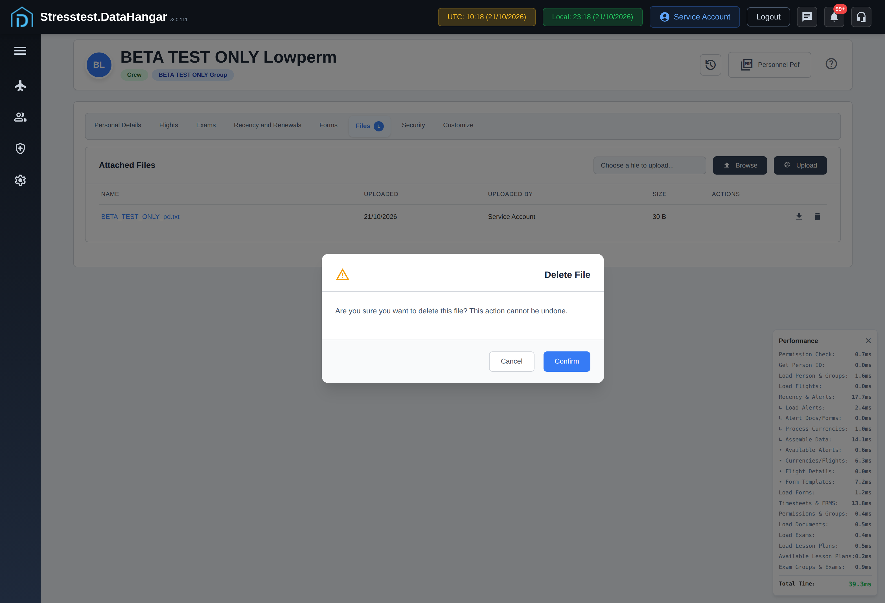

### BUG-PD-016: Personnel Details > Timesheets: Add Claim button does nothing

Severity: Medium | Module: Personnel Details | Check: PD-010 ([12-personnel-details](checklists/12-personnel-details.md))

Steps:
1. All Personnel > Ethan Abbott > Timesheets (October 2026)
2. On 01 Thu (Draft) click Add Claim

Expected: A claim form opens (or the day's Timesheet Details opens) so a claim can be added.

Actual: Nothing happens: no popup, no page change, no network request, no console error. Add Claim is enabled on past days and disabled on future days, so it looks usable.

Suspected cause: Click handler for .timesheet-claim-btn is probably not bound, possibly because the page script stops early (BUG-PD-001, getPickerMod is not defined).

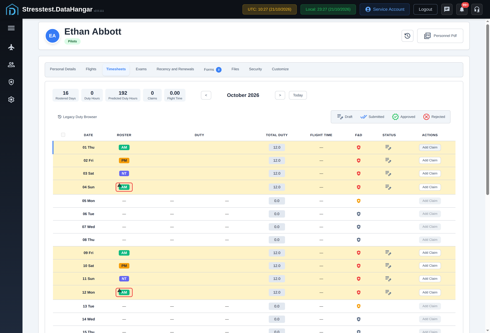

### BUG-PERM-002: User with no permissions cannot open their own My Account (no self-service password / 2FA)

Severity: Medium | Module: Personnel Details / My Account | Check: PERM-007 ([90-permissions](checklists/90-permissions.md))

Steps:
1. Log in as a user with 0 permissions (BETA TEST ONLY Lowperm)
2. Click your name in the top bar

Expected: Own My Account opens (at least Security and Customize tabs) so the user can change password and set up 2FA.

Actual: 'Access Denied: You do not have permission to access the Personnel Details' for person_id=276 (own record).

Suspected cause: Personnel Details access check does not allow self (person_id == logged-in person) when no Personnel permission row exists.

### BUG-POP-003: Access Manager Groups popup: Esc closes with unsaved changes and no warning; reopening shows the unsaved ticks as if saved

Severity: Medium | Module: Access Manager | Check: AM-019 ([04-access-manager](checklists/04-access-manager.md))

Steps:
1. Settings and Tools > Access Manager, search betatest_low
2. Click the '0 Groups' badge
3. Tick 'Crew' (On Roster auto-ticks)
4. Press Esc
5. Note the row still says '0 Groups'
6. Click the Groups badge again

Expected: Esc with unsaved changes asks to confirm (app modal); if discarded, the popup reopens with the saved memberships.

Actual: Popup closes silently, nothing is saved, and on reopen 'Crew' is still ticked even though the user has 0 groups. Saving then would apply changes the user thought were thrown away.

Suspected cause: Groups modal has no dirty check on Esc/close and doesn't reset its checkbox state from the server data when reopened.

### BUG-RB-002: Roster Builder: Copy Live to Draft copies one shift at a time and takes about 6 minutes for one month

Severity: Medium | Module: Roster Builder | Check: RB-003 ([14-roster-builder](checklists/14-roster-builder.md))

Steps:
1. Settings and Tools > Roster Builder
2. Select Roster View: BETA TEST ONLY Draft
3. Bulk actions > Copy Live to Draft > Clear then Copy

Expected: Copy finishes in a few seconds (one server call for the month).

Actual: An 'In Progress... Copying shift N of 1690 for <name>' dialog runs for about 6 minutes (10:41 to about 10:47 UTC on stresstest) and blocks the page. Closing the tab partway would leave a half-copied draft.

Suspected cause: Client loops over every live shift and saves each with its own request instead of a bulk copy endpoint.

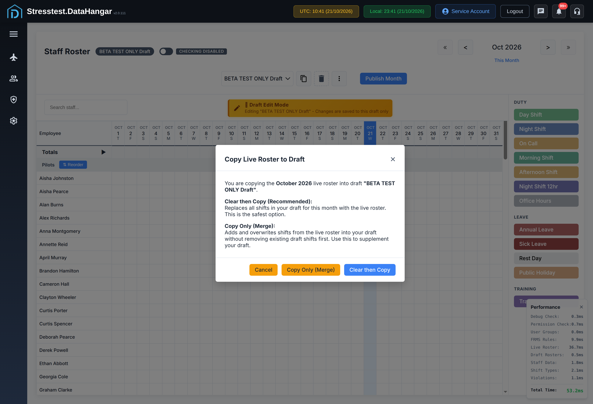
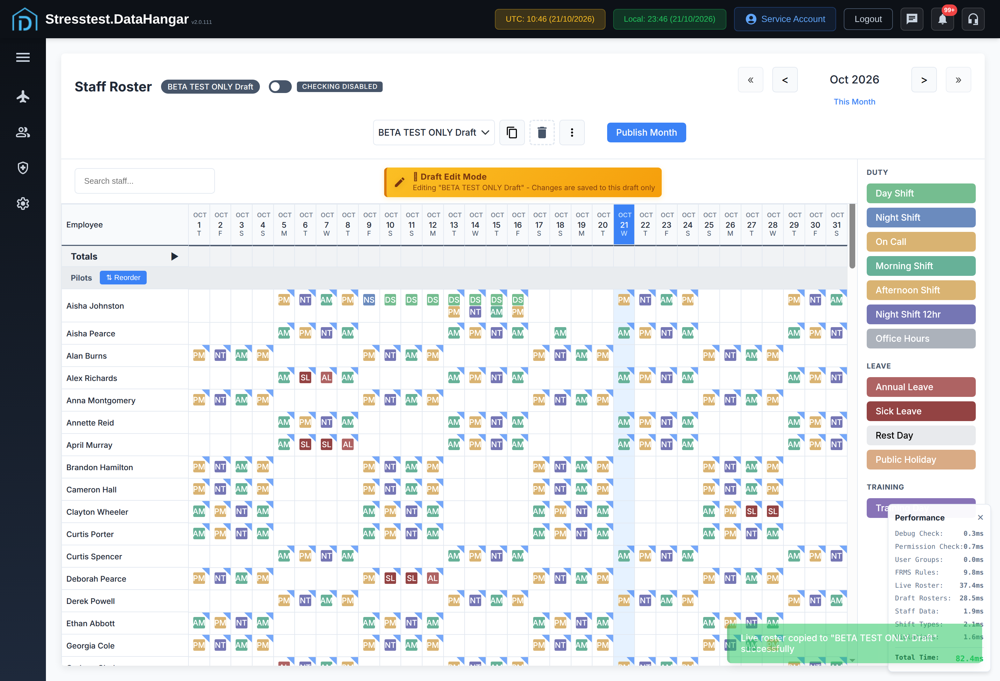

### BUG-RB-003: Roster Builder: copy/paste still works with violation checking ON

Severity: Medium | Module: Roster Builder | Check: RB-006 ([14-roster-builder](checklists/14-roster-builder.md))

Steps:
1. Settings and Tools > Roster Builder, select a draft
2. Turn the violations toggle ON (badge VIOLATIONS FOUND)
3. Click a cell with a shift, Ctrl+C
4. Click an empty cell, Ctrl+V

Expected: Copy/paste is not allowed while violation checking is on (documented behaviour), with a message saying why.

Actual: 'Copied 1 cell(s)' then 'Successfully pasted 1 shift(s)' - the shift is pasted with no warning, even onto a day that then shows a violation.

Suspected cause: rosterbuilder/index.js copy handler (around line 4528-4555) and paste never check violationsEnabled; only an empty selection is rejected.

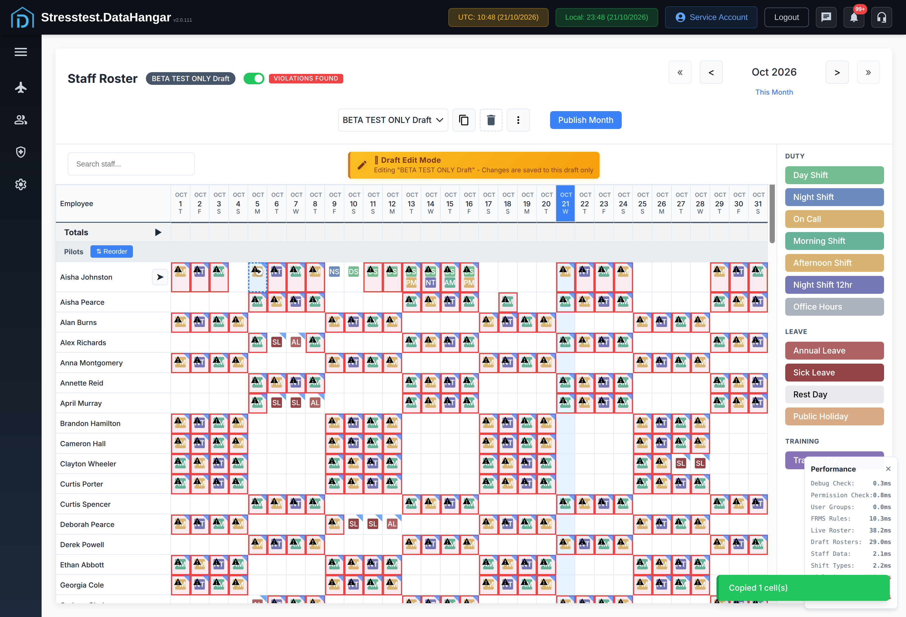
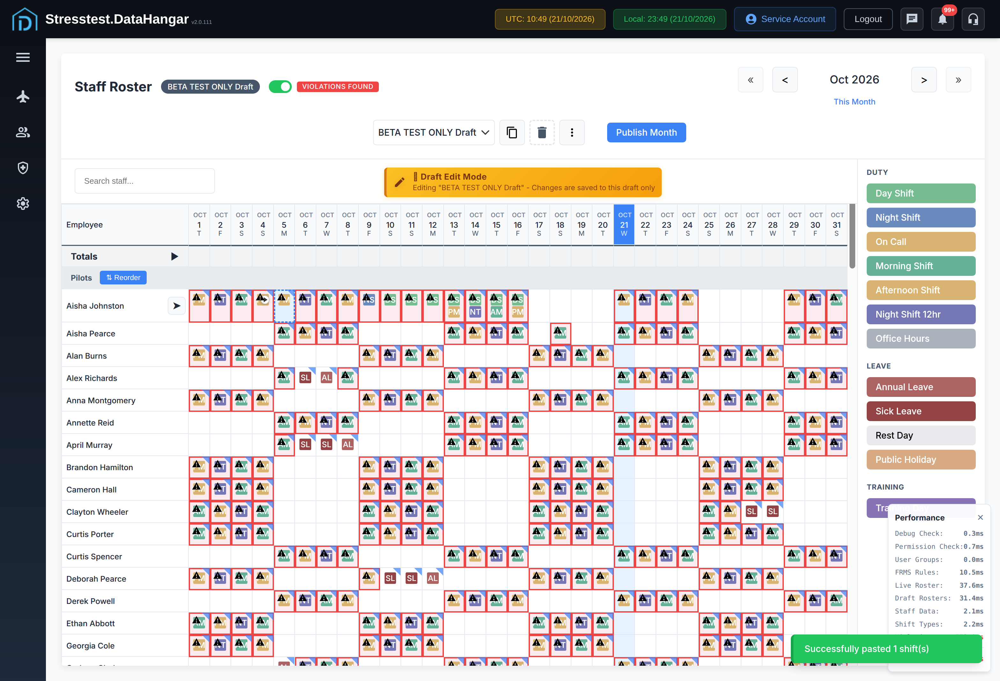

### BUG-RB-005: Roster Builder: every validation error throws a JS error instead of showing a message (e.g. Apply Shift Pattern with no shifts)

Severity: Medium | Module: Roster Builder | Check: RB-008 ([14-roster-builder](checklists/14-roster-builder.md))

Steps:
1. Settings and Tools > Roster Builder, select a draft
2. Click a person's name > Shift Summary > Apply Shift Pattern
3. Leave the pattern empty and click Apply

Expected: Error popup 'Please add at least one shift to the pattern.' and the pattern popup stays open.

Actual: The pattern popup closes, no message appears, and the console shows 'Cannot read properties of undefined (reading 'overlay')'.

Suspected cause: openErrorModal() (rosterbuilder/index.js line 5057) hides elements.predictModal.overlay, but there is no predictModal in the elements map, so it throws before showing the error. Every openErrorModal call on the page is affected.

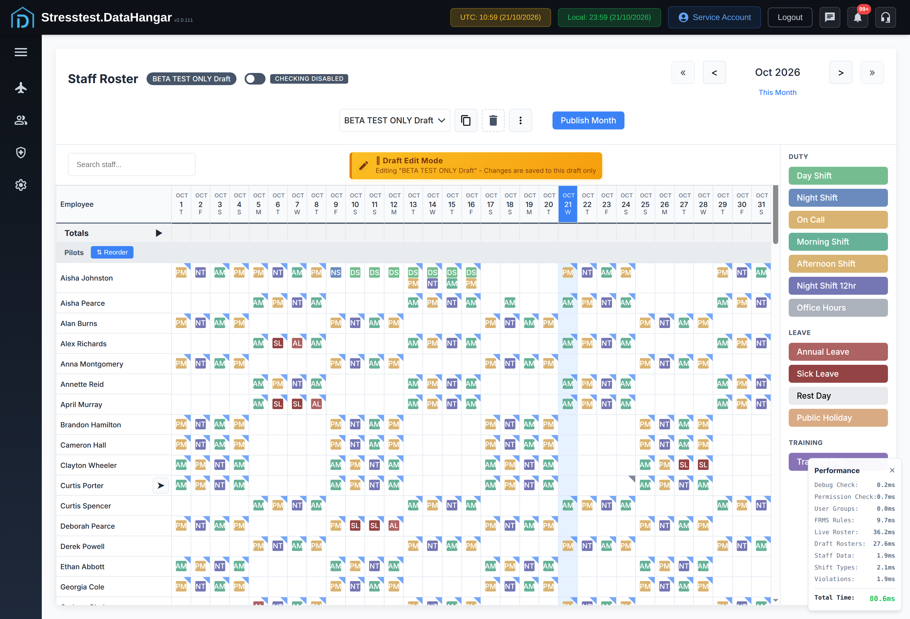

### BUG-RPT-003: Reports tables overlap on a phone: column text is drawn on top of other columns

Severity: Medium | Module: Reports | Check: RPT-S05 ([26-reports](checklists/26-reports.md))

Steps:
1. Open Administration > Reports at 390px wide (phone)
2. Look at the Report Templates list

Expected: Readable rows (card layout or stacked columns), no overlapping text.

Actual: Template Name, Data Source, Columns, Filters, Last Run and Run By text run into each other (e.g. 'QA SMS Filter 107SMS Reports' over '16/10/2026 16:07'); Actions are cut off and need horizontal scroll.

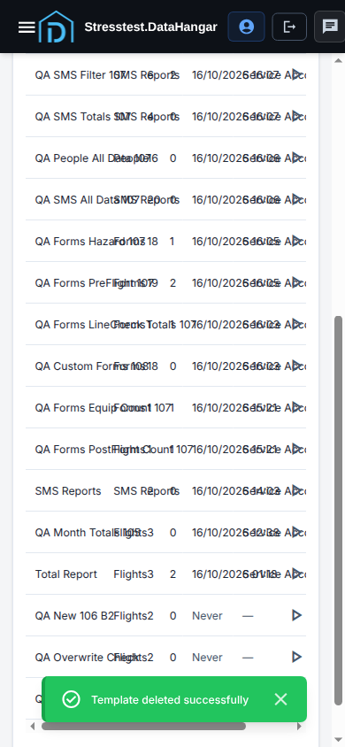

### BUG-RV-002: Roster Viewer: clicking a shift does not open Shift Details

Severity: Medium | Module: Roster Viewer | Check: RV-004 ([13-roster-viewer](checklists/13-roster-viewer.md))

Steps:
1. Personnel > Roster Viewer (October 2026)
2. Click the PM shift for Aisha Johnston on 5 Oct (centre of the badge)
3. Then click the small blue corner on the same badge

Expected: Clicking a shift opens Shift Details (shift name, times, notes).

Actual: Clicking the badge does nothing (no popup, no console error). Only the tiny blue corner opens a 'Note for Aisha Johnston' popup with the date and note text.

Suspected cause: Only the note-corner element has a click handler; .assigned-shift has none.

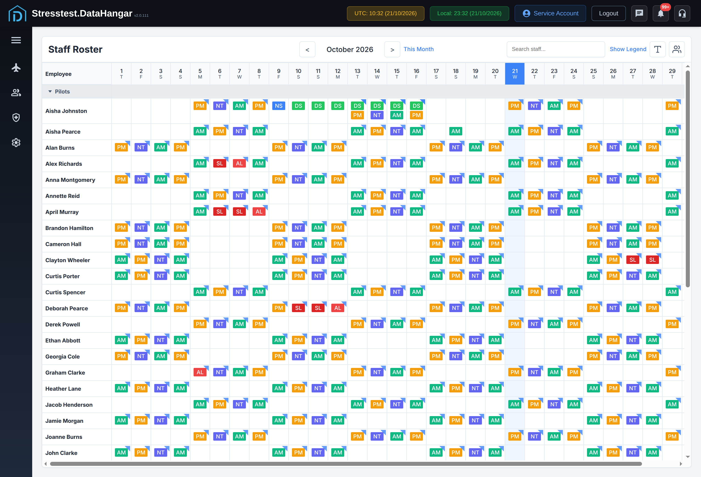

### BUG-SFT-002: Flight Types: a duplicate Flight Category name ("PIC") is accepted

Severity: Medium | Module: Settings: Flight Types | Check: SFT-001 ([37-settings-flighttypes](checklists/37-settings-flighttypes.md))

Steps:
1. Settings and Tools > Configuration > Flight Types > Flight Categories.
2. Add Flight Category, name "PIC" (already exists as ID 3), then Save.

Expected: Refused with a "name already exists" message.

Actual: "Flight category added successfully". The list now has two "PIC" rows (ID 3 and ID 15), so the Flight Details, FRMS and Reports dropdowns would show two PIC options.

Suspected cause: No unique check on the name, either client-side or server-side.

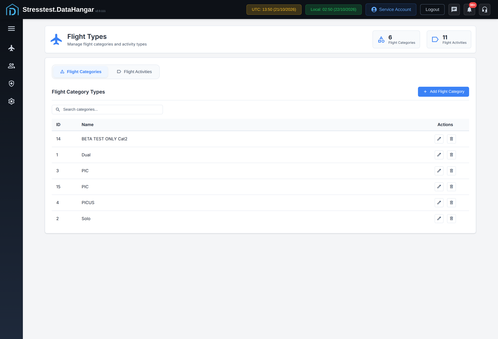

### BUG-SMS-001: New Safety Report: Escape on the Confidential/Anonymous help closes the report form behind it and loses what you typed

Severity: Medium | Module: Safety Reports | Check: SMS-004 ([19-safety-reports](checklists/19-safety-reports.md))

Steps:
1. Flight Safety > Safety Reports > New Report
2. Type a Subject
3. Click the (?) next to Confidential
4. Press Escape

Expected: Escape closes only the help popup; the report form stays open with the Subject kept.

Actual: The Create New Safety Report form closes and the help popup stays open. Reopening New Report shows an empty Subject.

Suspected cause: The global Escape handler in smsreports/index.js closes document.querySelector('.modal-overlay.active'), which is the first (outer) popup, not the top one.

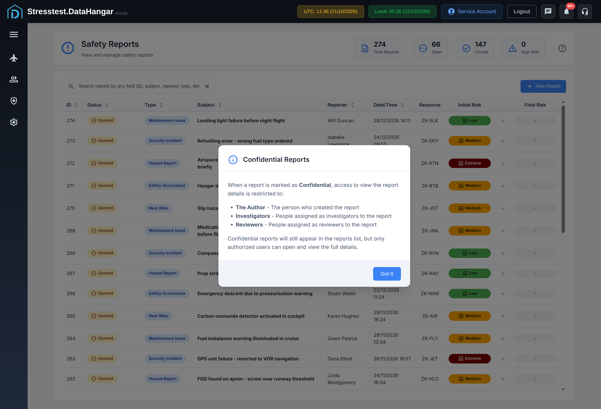

### BUG-SMS-002: New Safety Report: Event Date/Time defaults to the UTC date and time, not local

Severity: Medium | Module: Safety Reports | Check: SMS-S04 ([19-safety-reports](checklists/19-safety-reports.md))

Steps:
1. At a time when UTC and local dates differ (e.g. local 00:37 22/10/2026, UTC 11:37 21/10/2026)
2. Flight Safety > Safety Reports > New Report
3. Look at Event Date/Time

Expected: Defaults to the local date and time (22/10/2026 00:37), as set in Settings > Time Zone.

Actual: Defaults to 21/10/2026 11:37, the UTC date and time. A report saved without changing it is dated 13 hours early. Same issue as BUG-FS-001 and BUG-FAD-005.

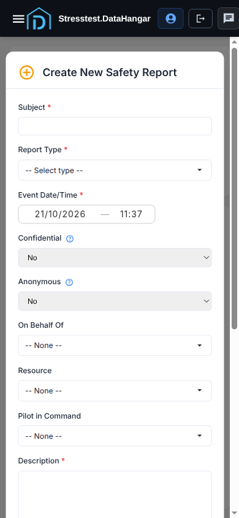

### BUG-SREN-002: Add Recency accepts negative Days, and a Caution value higher than Warning

Severity: Medium | Module: Settings: Recency and Renewals | Check: SREN-001 ([41-settings-renewals](checklists/41-settings-renewals.md))

Steps:
1. Settings and Tools > Recency and Renewals > Recencies > Add Recency.
2. Name "BETA TEST ONLY Rec", Days -5, Warning Value 10, Caution Value 20, then Save.

Expected: Days must be a positive number. Caution should not be above Warning, since the existing items use Warning 30 / Caution 15 and Warning 50 / Caution 25.

Actual: "Recency added successfully". The row shows Days -5, Warning 10, Caution 20. A negative period would make every recency check meaningless, and the warning levels are inverted.

Suspected cause: input_days and the value inputs have no min attribute, and the save doesn't check the values on either side.

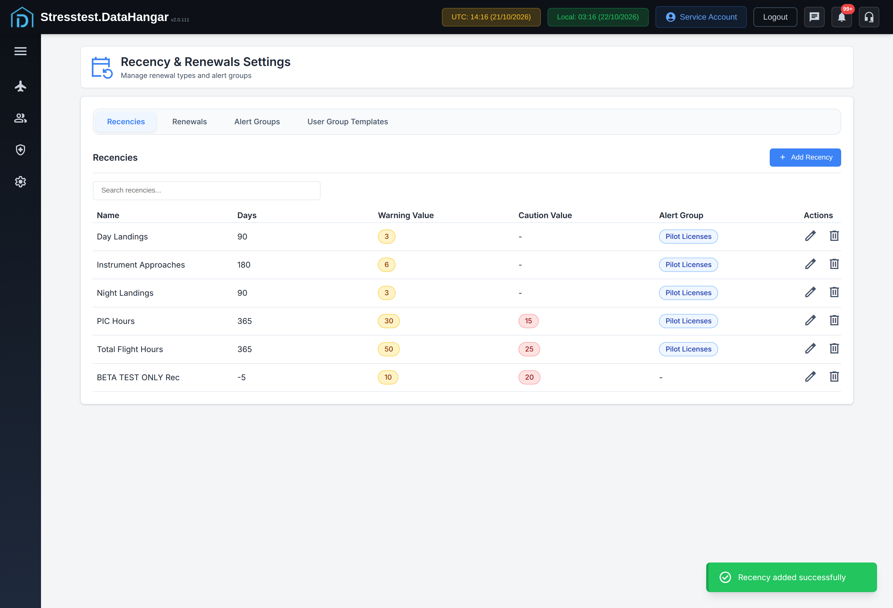

### BUG-SREN-003: Add Renewal Type accepts negative Days to Notify and a Frequency of 0 days

Severity: Medium | Module: Settings: Recency and Renewals | Check: SREN-002 ([41-settings-renewals](checklists/41-settings-renewals.md))

Steps:
1. Settings and Tools > Recency and Renewals > Renewals > Add Renewal.
2. Name "BETA TEST ONLY Ren", Days to Notify -10, Frequency (Days) 0, then Save.

Expected: Both must be positive numbers (Frequency at least 1 day). The save should be refused with a message.

Actual: "Renewal type added successfully". The row shows Days to Notify -10 and Frequency 0. A 0-day renewal would be due again straight away, and a negative notify window means no notice ever comes before expiry.

Suspected cause: The number inputs have no min attribute, and the server doesn't check the range.

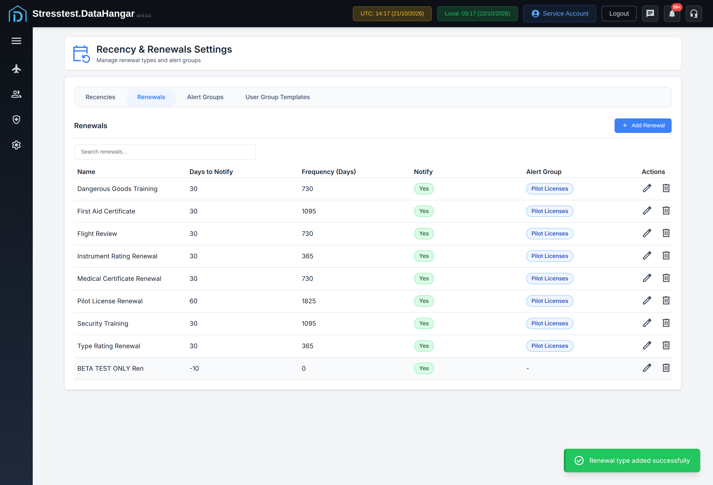

### BUG-SST-004: Roster Shifts on a phone: the table scrolls the page sideways and the group tabs are hidden

Severity: Medium | Module: Settings: Shift Types | Check: SST-S05 ([39-settings-shifttypes](checklists/39-settings-shifttypes.md))

Steps:
1. Open Settings and Tools > Roster Shifts at a 390 px width.

Expected: Group tabs (or a dropdown) to switch groups, and rows that fit or scroll inside their own box.

Actual: The table is 513 px wide, so the whole page scrolls sideways and "On Schedule" and Actions (edit/delete) are off-screen. The Duty/Leave/Training/... group tabs are not shown, so you can't switch groups.

Suspected cause: The table has no overflow-x wrapper or card layout, and the pill nav is hidden at narrow widths with no dropdown shown instead.

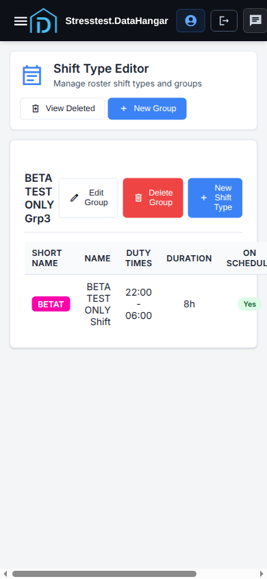

### BUG-STZ-001: Time Zone settings: the Example preview shows UTC, not the selected time zone

Severity: Medium | Module: Settings: Time Zone | Check: STZ-S04 ([33-settings-timezone](checklists/33-settings-timezone.md))

Steps:
1. Settings and Tools > Configuration > Time Zone (time zone is Pacific/Auckland).
2. Look at the Example preview (Date & Time, Date Only, Time Only).

Expected: The preview shows the current Pacific/Auckland date and time (22/10/2026 02:16, the same as the header's Local clock).

Actual: The preview shows 21/10/2026 13:16, which is UTC (the same as the header's UTC clock). So the page that sets the time zone shows the wrong local time. This is the same UTC default problem as BUG-FS-001, BUG-SMS-002 and BUG-FBLD-002.

Suspected cause: The preview pickers are given new Date() (the browser's time, which is UTC here) instead of the time in the configured zone.

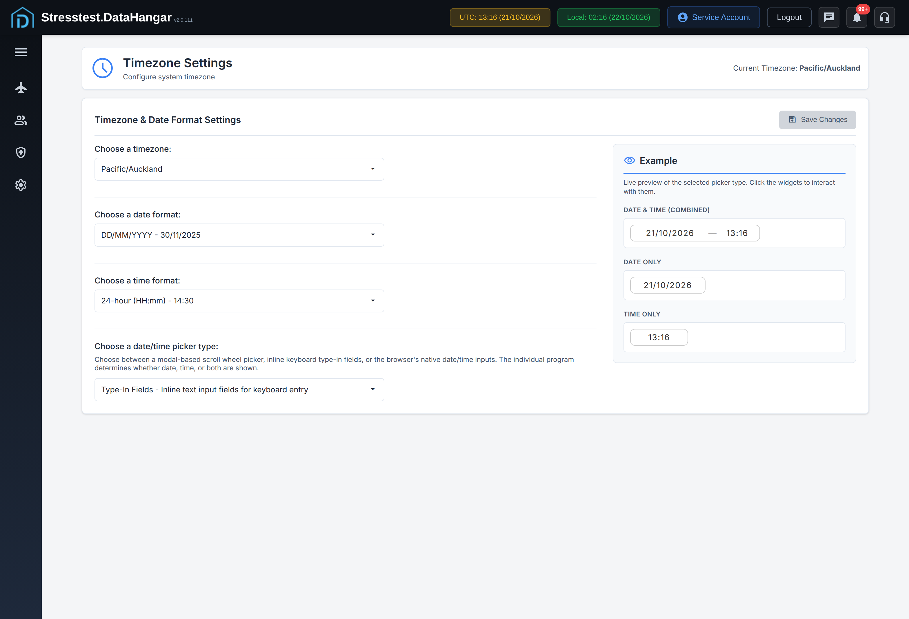

### BUG-STZ-003: Time Zone settings: the Example preview shows MM/DD/YYYY for every date format except DD/MM/YYYY

Severity: Medium | Module: Settings: Time Zone | Check: STZ-002 ([33-settings-timezone](checklists/33-settings-timezone.md))

Steps:
1. Settings and Tools > Configuration > Time Zone.
2. In "Choose a date format", pick YYYY-MM-DD, then DD.MM.YYYY.
3. Look at the Example preview.

Expected: The preview follows the chosen format: 2026-10-21, then 21.10.2026.

Actual: Both show "10/21/2026" (US order). Picking DD/MM/YYYY again shows 21/10/2026. Also, 4 of the 10 date formats (DD MMM YYYY, MMM DD, YYYY, DD MMMM YYYY, MMMM DD, YYYY) and 3 of the 5 time formats (all the 12-hour ones) are listed but greyed out, with no explanation of why. The time preview also ignores the choice: with HH:mm:ss picked it still shows "13:20". Once saved, the format itself does work: the header clocks show "02:20:15 (2026-10-22)" and Daily Flight Record shows "2026-10-21 08:30:00".

Suspected cause: The preview picker seems to fall back to the browser locale for any format it does not know. The disabled options look deliberate (the type-in picker can't parse them?), but the page doesn't say so.

### BUG-SUP-001: Support has no page Help (?); Escape doesn't close New Ticket, but a click outside closes it and wipes everything typed

Severity: Medium | Module: Support | Check: SUP-S02 ([27-support](checklists/27-support.md))

Steps:
1. Administration > Support
2. Look for a Help (?) button
3. Click New Ticket, type a Subject and Bug Report fields
4. Press Escape
5. Click once on the dark area outside the popup
6. Click New Ticket again

Expected: Help (?) exists. Escape closes the popup (or nothing loses data). An outside click either does nothing or asks before throwing away typed text.

Actual: No Help button. Escape does nothing. One outside click closes New Ticket, and reopening it shows every field empty (openNewTicketModal clears them), so the typed ticket is lost with no warning.

Suspected cause: No keydown handler; overlay click calls closeNewTicketModal without a dirty check; openNewTicketModal resets all fields.

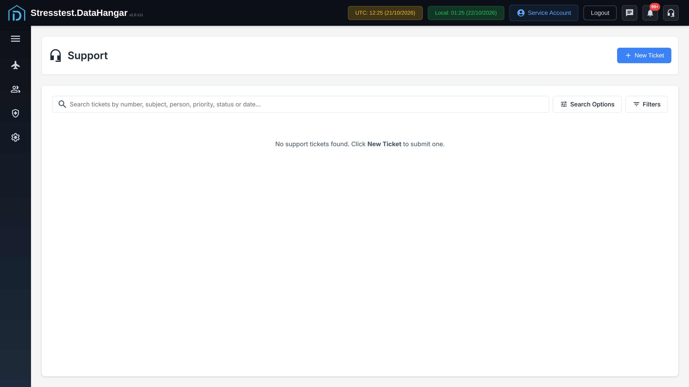
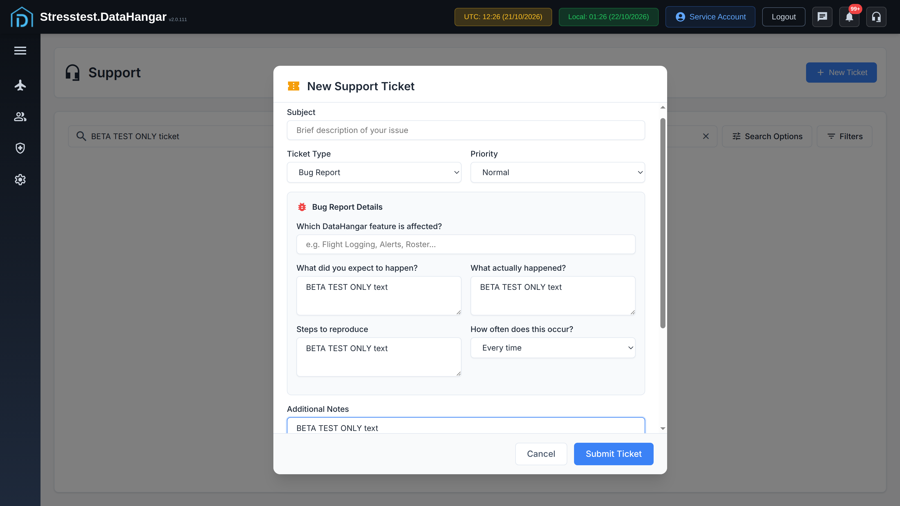

### BUG-SWP-002: Waypoints: moving a waypoint about 250 nm saves with no "Significant Location Change" warning

Severity: Medium | Module: Settings: Waypoints | Check: SWP-006 ([38-settings-waypoints](checklists/38-settings-waypoints.md))

Steps:
1. Settings and Tools > Waypoint Locations, then open waypoint "BETA TEST ONLY WP1" (-36.85, 174.76).
2. Change Latitude to -41.000000.
3. Click Save Changes.

Expected: A "Significant Location Change" confirmation, since the move is over 1 nm. The code has this check.

Actual: Saved straight away with "Waypoint saved successfully" and no warning. That move is about 250 nm.

Suspected cause: In settings_waypoints/index.js the >1 nm check (calculateDistanceNM, then the "Significant Location Change" showModal) is only in the old edit-modal save handler. The detail-page Save Changes path does not call it.

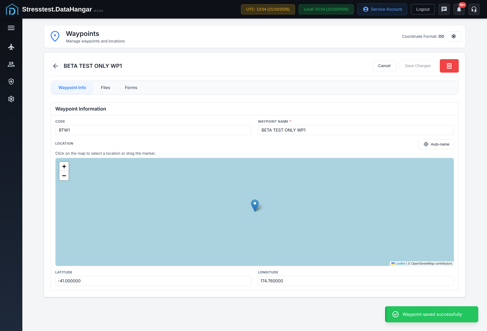

### BUG-SWP-004: Waypoints on a phone: table columns overlap and Add Waypoint is off-screen

Severity: Medium | Module: Settings: Waypoints | Check: SWP-S05 ([38-settings-waypoints](checklists/38-settings-waypoints.md))

Steps:
1. Open Settings and Tools > Waypoint Locations at a 390 px width.

Expected: Readable rows (cards or a table that scrolls), with every header button on screen.

Actual: Code, Latitude, Longitude and Flights are squeezed into a 303 px table, so their text overlaps and can't be read (e.g. "NZAA-37.008056174.791667"). The header button row is 420 px wide, so "Add Waypoint" is cut off at the right edge and the page scrolls sideways.

Suspected cause: There is no responsive rule for the table cells (no wrap or min-width) or for the header button row (no flex-wrap).

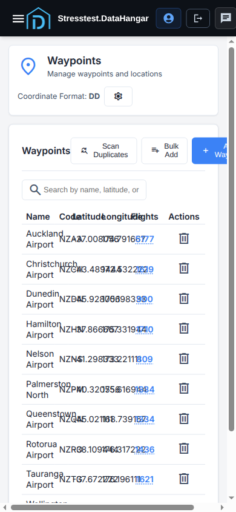

### BUG-TS-002: Timesheet Approval: status filter 'Unsigned' shows 'No personnel found' although everyone has unsigned days

Severity: Medium | Module: Timesheets | Check: TS-001 ([15-timesheets-leave](checklists/15-timesheets-leave.md))

Steps:
1. Administration > Settings and Tools > Timesheets (October 2026)
2. Note e.g. Aaron Foster Unsigned 10
3. Set the status filter to Unsigned

Expected: Everyone with unsigned days is listed (110 people).

Actual: 'No personnel found'. All Status lists 110 people, all with Unsigned counts above 0.

Suspected cause: filterPersonnel() in timesheets/index.js skips days with no timesheet_id ('if (!day.timesheet_id) return false') and then compares day.status to the filter value, but unsigned days have no timesheet record, so Unsigned can never match. The counts use other status names too ('draft'/'submitted'/'denied'), so Pending/Rejected may also never match.

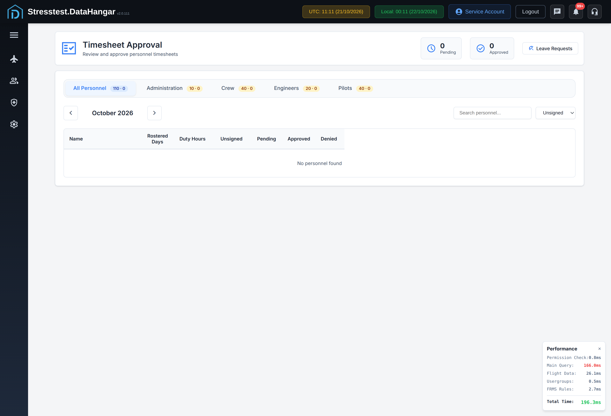

### BUG-TS-003: Timesheet Approval list totals don't match Timesheet Details (Rostered Days and Duty Hours)

Severity: Medium | Module: Timesheets | Check: TS-002 ([15-timesheets-leave](checklists/15-timesheets-leave.md))

Steps:
1. Administration > Settings and Tools > Timesheets (October 2026)
2. Read Aisha Johnston's row
3. Click Aisha Johnston to open Timesheet Details

Expected: Rostered Days and Duty Hours in the list match the details page.

Actual: List: 13 Rostered Days, 0.0h Duty Hours, 13 Unsigned. Details: 19 Rostered Days, 180 Duty Hours. Every person in the list shows 0.0h. The list's 13 seems to count only days up to today (21 Oct).

Suspected cause: List and details compute totals differently: the list appears to count rostered days up to today and duty hours only from saved timesheets.

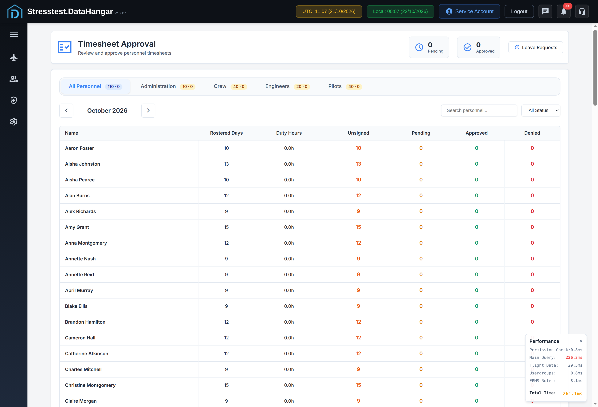

### BUG-AF-001: Active Flights shows SAR Time '01/01/1970 00:00' for flights with SAR watch disabled

Severity: Low | Module: Active Flights | Check: AF-004 ([08-active-flights](checklists/08-active-flights.md))

Steps:
1. Sidebar > Flight Operations > Active Flights
2. Look at the SAR Time column for PAST flights (e.g. #8861, #8844)

Expected: Flights without SAR watch show a dash or just 'SAR Watch Disabled' in the SAR Time column.

Actual: SAR Time shows '01/01/1970 00:00' above 'SAR Watch Disabled' (Unix epoch shown for an empty SAR time).

Suspected cause: Empty/0 SAR timestamp formatted as a date instead of being treated as no value.

### BUG-AF-003: Active Flights has no page Help (?), and its popups (About Live Tracking, Adjust SAR, Add Note) don't close with Escape

Severity: Low | Module: Active Flights | Check: AF-S02 ([08-active-flights](checklists/08-active-flights.md))

Steps:
1. Sidebar > Flight Operations > Active Flights
2. Look for the Help (?) button in the page header
3. Click the help icon in the Live Tracking box ('About Live Tracking')
4. Press Escape; look for an x button
5. Click Adjust SAR or Add Note on an OVERDUE row, press Escape

Expected: Like other modules, a page Help (?) button that opens help; every help popup closes with Got it, x, clicking outside and Escape.

Actual: No page-level Help (?) button exists (the only help is 'About Live Tracking'). That popup has only 'Got it', no x, and Escape does not close it. Adjust SAR and Add Note popups also stay open on Escape (Add Note with typed text and no prompt). Got it / Cancel and clicking outside do close them.

### BUG-AM-002: Last Activity hover date ignores Settings > Time Zone format

Severity: Low | Module: Access Manager | Check: AM-007 ([04-access-manager](checklists/04-access-manager.md))

Steps:
1. Settings > Time Zone is DD/MM/YYYY, 24-hour
2. Access Manager: hover the Last Activity value of Service Account ('4 mins ago')

Expected: Exact date in org format, e.g. 21/10/2026 20:45 (local).

Actual: Tooltip '21 Oct 2026, 07:45 am': hard-coded format, 12-hour, and shows the UTC time (07:45) rather than local (20:45).

Suspected cause: Tooltip built with toLocaleString / fixed format instead of formatDateWithConfig; timestamp not converted to org time zone.

### BUG-AM-003: Last Activity column sort does not change order

Severity: Low | Module: Access Manager | Check: AM-005 ([04-access-manager](checklists/04-access-manager.md))

Steps:
1. Access Manager > User Permissions
2. Click the Last Activity header, then click it again

Expected: Ascending then descending: Service Account (only user with activity) moves from top to bottom.

Actual: Same order both times: Service Account, Alex Richards, Zoe Mason, Curtis Porter... User and Username sort correctly.

Suspected cause: Sort comparator for Last Activity ignores direction (or sorts on the relative text with 'Never' handled separately).

### BUG-AM-004: Permission level dropdown shows bare codes 'WA' and 'G' next to full labels

Severity: Low | Module: Access Manager > Manage User Permissions | Check: AM-020 ([04-access-manager](checklists/04-access-manager.md))

Steps:
1. Access Manager > a user's 'N Permissions' badge
2. Look at the level dropdown for Personnel Details (also Flight Schedule, Dashboard, DFR)

Expected: Every level has a readable label, e.g. 'Read/Write All - Can view and modify all data', 'Group - level defined by group membership' (as in the Help).

Actual: Options: 'Read Only All - ...', 'WA', 'Read Only Own - ...', 'Write Own - ...', 'G'.

Suspected cause: Label map in accessmanager JS is missing WA and G (falls back to the code).

### BUG-CHAT-001: Chat has no page Help (?); Escape doesn't close Create Channel; empty name does nothing with no message

Severity: Low | Module: Chat | Check: CHAT-S02 ([28-chat](checklists/28-chat.md))

Steps:
1. Click the header chat icon
2. Look for a Help (?) button
3. Click + (Create channel), click Create with no name
4. Press Escape

Expected: Help (?) exists; empty name shows a message; Escape closes the popup.

Actual: No Help button. Create with an empty name does nothing and shows nothing (external CHAT-05). Escape leaves the popup open (external CHAT-06); outside click now closes it.

### BUG-CHAT-002: Chat times show 12-hour '01:32 AM' and date separators 'Thursday, October 22, 2026' instead of the org format

Severity: Low | Module: Chat | Check: CHAT-S04 ([28-chat](checklists/28-chat.md))

Steps:
1. Settings > Time Zone has 24-hour HH:mm
2. Header chat icon > #beta-test-only-channel
3. Send a message and read its time

Expected: 01:32 (HH:mm) and 22/10/2026 (DD/MM/YYYY), local time.

Actual: Message time '01:32 AM' (12-hour, external CHAT-01 still present) and day separator 'Thursday, October 22, 2026'.

### BUG-DFR-001: Daily Flight Record has no page Help (?), and its popups (Manage Columns, Notes full text) don't close with Escape

Severity: Low | Module: Daily Flight Record | Check: DFR-S02 ([09-daily-flight-record](checklists/09-daily-flight-record.md))

Steps:
1. Sidebar > Flight Operations > Daily Flight Record
2. Look for the Help (?) button in the page header
3. Click Columns (Manage Columns popup), press Escape
4. Click a Notes cell (Notes full-text popup), press Escape

Expected: A page Help (?) button like other modules; the Manage Columns popup closes with x, clicking outside and Escape.

Actual: There is no Help (?) button on the page. Manage Columns closes with x, Done and clicking outside, and stays open on drag-out (correct), but Escape does nothing. The Notes full-text popup also stays open on Escape.

Suspected cause: No help content or button wired for this module; the column modal has no keydown Escape handler.

### BUG-DSH-001: Dashboard side tabs are icon-only with no tooltip or label

Severity: Low | Module: Dashboard | Check: DSH-012 ([05-dashboard](checklists/05-dashboard.md))

Steps:
1. Open Dashboard from the sidebar
2. Hover each of the 6 tabs above the right-hand panel

Expected: Each tab has a tooltip/label (Recency and Renewals, Unread Notices, Unsigned Timesheets, Safety Actions, Exams, Project Tasks).

Actual: Tabs show only Material icons (update, notifications, assignment_late, assignment, quiz, checklist); no title, aria-label or tooltip. Users must click each to find out what it is; screen readers read the icon ligature names.

Suspected cause: Tab buttons render the icon only; add title + aria-label (or a short text label).

### BUG-EXM-001: Exam Builder/Editor have no page Help (?); Escape doesn't close Add Group, Add Exam or Choose Question Type

Severity: Low | Module: Exams | Check: EXM-S02 ([29-exams](checklists/29-exams.md))

Steps:
1. Settings and Tools > Training > Exam Builder
2. Look for a Help (?) button
3. Click Add Group, press Escape

Expected: Help (?) like other modules; Escape closes the popup.

Actual: No page Help (the help_outline icons on each exam row have no title or action). Add Group / Add Exam stay open on Escape; only outside click, x or Cancel close them. Escape is only handled in the confirm popups. In the Exam Editor, Escape also doesn't close Choose Question Type.

Suspected cause: Only showConfirm/showAlert add an Escape listener; the global keydown handles Enter only.

### BUG-EXM-002: Exam dates ignore the org format: 'Oct 22, 2026' in Exam Builder and '10/22/2026 01:46 AM' in Exam Instances batches

Severity: Low | Module: Exams | Check: EXM-S04 ([29-exams](checklists/29-exams.md))

Steps:
1. Settings and Tools > Training > Exam Builder
2. Read the Created column (e.g. new 'BETA TEST ONLY Exam')

Expected: 22/10/2026 (DD/MM/YYYY as set in Settings > Time Zone).

Actual: 'Oct 22, 2026' (existing exams show 'May 11, 2026'). Exam Instances > Browse Batches shows '10/22/2026 01:46 AM' (US MM/DD, 12-hour).

### BUG-EXM-003: Exam viewer 'Read Only' still shows Add Question, Add Group and Save Question

Severity: Low | Module: Exams | Check: EXM-004 ([29-exams](checklists/29-exams.md))

Steps:
1. Settings and Tools > Training > Exam Builder
2. On a MASTER exam click View (Read Only)
3. Open any question

Expected: Read-only view hides or disables Add Question, Add Group, Save Question and the option editors.

Actual: Banner says 'Viewing Master exam (Rev 2) - Read Only' but Add Question, Add Group and each question's Save Question / Add Image / Add Option are shown (external FUNC-05 still present).

### BUG-EXM-005: Exam Builder on a phone: exam table columns and action icons overlap

Severity: Low | Module: Exams | Check: EXM-S05 ([29-exams](checklists/29-exams.md))

Steps:
1. Settings and Tools > Training > Exam Builder
2. Resize to 390px wide

Expected: Exams shown as cards or a readable table with tappable actions.

Actual: The table is squeezed: Questions/Revision headers overlap, the MASTER/Rev pills sit under the action icons, and the icons overlap the Created date.

### BUG-EXM-007: Exam Instances batch: deleting a person's instance shows success but the row stays until the page is reloaded

Severity: Low | Module: Exams | Check: EXM-009 ([29-exams](checklists/29-exams.md))

Steps:
1. Settings and Tools > Exam Instances > Browse Batches > open a batch.
2. Add a person (row appears).
3. Click the bin on that person > OK.

Expected: The row is removed and the batch totals update.

Actual: Toast 'Exam instance deleted successfully' but the row and the totals (2 TOTAL, 50% complete) stay. After leaving and reopening Exam Instances the row is gone. Adding a person does refresh the list.

### BUG-FAD-001: Flight and Duty has no page Help (?)

Severity: Low | Module: Flight and Duty | Check: FAD-S02 ([16-flight-and-duty](checklists/16-flight-and-duty.md))

Steps:
1. Flight Safety > Flight and Duty
2. Look for the (?) Help button in the page header

Expected: A Help (?) button that opens the page help.

Actual: The header only has 'View as Date'; there is no Help button.

### BUG-FAD-002: Flight and Duty popups (Flight Details, Duty Time Details, Roster Violations, Resolutions Required) ignore Escape

Severity: Low | Module: Flight and Duty | Check: FAD-S02 ([16-flight-and-duty](checklists/16-flight-and-duty.md))

Steps:
1. Flight Safety > Flight and Duty
2. Click Aisha Johnston's 11.0h flight time value
3. Press Escape

Expected: Escape closes the popup.

Actual: The popup stays open. Outside click and Close/Ok work; drag-out keeps it open (correct).

Suspected cause: flightandduty/index.js has no keydown handler for #customModal; only the overlay click and Close button call closeModal().

### BUG-FAD-003: Flight and Duty popups show dates as '16 Oct 2026' instead of the configured DD/MM/YYYY

Severity: Low | Module: Flight and Duty | Check: FAD-S04 ([16-flight-and-duty](checklists/16-flight-and-duty.md))

Steps:
1. Flight Safety > Flight and Duty
2. Click Aisha Johnston's 11.0h flight time value (flight #8795)
3. Click the Roster error icon on Aisha Johnston

Expected: Dates as 16/10/2026 (Settings > Time Zone format, as used by the View as Date box).

Actual: Flight Details shows '16 Oct 2026'; Roster Violations shows '23 Oct 2026', '31 Oct 2026' and so on.

Suspected cause: Hard-coded toLocaleDateString('en-NZ', {day:'2-digit', month:'short', year:'numeric'}) in flightandduty/index.js instead of the Time Zone date format.

### BUG-FAD-004: Flight and Duty column headers are ambiguous: two '1 Days' and two '24 Hours' columns, and '1 Days' is ungrammatical

Severity: Low | Module: Flight and Duty | Check: FAD-002 ([16-flight-and-duty](checklists/16-flight-and-duty.md))

Steps:
1. Flight Safety > Flight and Duty
2. Scroll to the Pilots group and read the column headers

Expected: Each FRMS rule column can be told apart (e.g. rule name or limit in the header) and singular periods read '1 Day'.

Actual: Flight Time: 24 Hours (10h), 1 Days (8h), 1 Days (8h), 7 Days (40h). Duty Time: 24 Hours (14h), 24 Hours (8h), 28 Days (180h). The two '1 Days' and the two '24 Hours' columns only differ by the small limit in brackets.

Suspected cause: Header uses only the rule period ('<n> Days'/'<n> Hours') with no rule name and no singular form.

### BUG-FAD-005: Flight and Duty 'View as Date' defaults to the UTC date instead of the local date

Severity: Low | Module: Flight and Duty | Check: FAD-003 ([16-flight-and-duty](checklists/16-flight-and-duty.md))

Steps:
1. Do this when the local date differs from UTC (e.g. after 00:00 NZ time)
2. Flight Safety > Flight and Duty > View as Date

Expected: Date box shows today's local date (22/10/2026 at Local 00:19 22/10/2026).

Actual: Date box shows 21/10/2026 (the UTC date); the hidden value is '2026-10-21 11:19:37', i.e. UTC time.

Suspected cause: The View as Date picker is initialised from the server/UTC time rather than the Settings > Time Zone local time.

### BUG-FB-001: File Browser has no page Help (?)

Severity: Low | Module: File Browser | Check: FB-S02 ([22-file-browser](checklists/22-file-browser.md))

Steps:
1. Administration > File Browser
2. Look for the Help (?) button in the header

Expected: A Help (?) button like other modules (Safety Reports, Hazard Register, Settings and Tools).

Actual: No Help button. The header only has search, Back, Make Folder and Upload File.

### BUG-FB-002: File Browser shows Date Uploaded as 'Oct 22, 2026' instead of DD/MM/YYYY

Severity: Low | Module: File Browser | Check: FB-S04 ([22-file-browser](checklists/22-file-browser.md))

Steps:
1. Administration > File Browser
2. Open SMS Reports > 2026 > October > SMS Report 2060, or search 'BETA_TEST_ONLY'
3. Look at Date Uploaded

Expected: 22/10/2026, as set in Settings > Time Zone.

Actual: Oct 22, 2026

### BUG-FB-004: File Browser: Escape doesn't close the Create New Folder or Configure File popups

Severity: Low | Module: File Browser | Check: FB-S03 ([22-file-browser](checklists/22-file-browser.md))

Steps:
1. Administration > File Browser > Make Folder (create_new_folder)
2. Type a name
3. Press Escape

Expected: The popup closes (as on Safety Reports, Hazard Register and Settings and Tools).

Actual: Both popups stay open on Escape (Create New Folder, Configure File).

Suspected cause: filebrowser/index.js has no keydown/Escape handler.

### BUG-FB-007: File Browser on a phone: table is cut off, edit buttons are off-screen

Severity: Low | Module: File Browser | Check: FB-S05 ([22-file-browser](checklists/22-file-browser.md))

Steps:
1. Open Administration > File Browser on a 390px wide screen

Expected: Cards (or a layout that fits), like Safety Reports and Hazard Register on a phone.

Actual: The table stays 585px wide in a 390px screen. Revision, Uploader and the edit buttons are hidden; you have to scroll sideways to reach them.

### BUG-FBLD-001: Form Builder: popups ignore Escape and outside clicks (Help, Create New Form Template, Edit Options)

Severity: Low | Module: Form Builder | Check: FBLD-S02 ([23-form-builder](checklists/23-form-builder.md))

Steps:
1. Settings and Tools > Form Builder
2. Click Help (?)
3. Press Escape, then click outside the popup

Expected: The popup closes, as on Settings and Tools, Safety Reports and Hazard Register.

Actual: Help, Create New Form Template and Edit Dropdown Options stay open on Escape and outside clicks. Only x, Close or Cancel close them. Same as earlier FORM-20.

Suspected cause: formbuilder/index.js has no Escape handler and no overlay click handler; closeModal() only runs on [data-close] buttons.

### BUG-FBLD-004: Form Builder on a phone: page is wider than the screen and the Toolbox covers the form

Severity: Low | Module: Form Builder | Check: FBLD-S05 ([23-form-builder](checklists/23-form-builder.md))

Steps:
1. Open Settings and Tools > Form Builder on a 390px wide screen

Expected: A usable layout, or a clear 'use a larger screen' message.

Actual: The page is 644px wide in a 390px screen and scrolls sideways. The Toolbox panel opens over the form. The header, Form Template, Allow Confidential and Auto-Attach are cut off.

### BUG-FBR-001: Form Browser has no page Help (?)

Severity: Low | Module: Form Browser | Check: FBR-S02 ([24-form-browser](checklists/24-form-browser.md))

Steps:
1. Administration > Form Browser
2. Look for the Help (?) button in the header

Expected: A Help (?) button like other modules.

Actual: No Help button. The header only has search and Back.

### BUG-FBR-002: Form Browser and Form Viewer dates ignore the date setting ('Oct 21, 2026', '10:24 PM')

Severity: Low | Module: Form Browser | Check: FBR-S04 ([24-form-browser](checklists/24-form-browser.md))

Steps:
1. Administration > Form Browser
2. Open Flights > 2026 > October > Flight 42903 - 2026-10-21
3. Look at Created

Expected: 21/10/2026, as set in Settings > Time Zone.

Actual: List: 'Oct 21, 2026'. Form Viewer header: 'Oct 21, 2026 10:24 PM' (12-hour clock). Same as earlier FORM-08.

### BUG-FBR-003: Form Browser on a phone: table is cut off, Created and Created By are off-screen

Severity: Low | Module: Form Browser | Check: FBR-S05 ([24-form-browser](checklists/24-form-browser.md))

Steps:
1. Open Administration > Form Browser on a 390px wide screen
2. Search 'QA Post'

Expected: Cards (or a layout that fits), like Safety Reports on a phone.

Actual: The table keeps its desktop width and scrolls sideways. Created and Created By are hidden off to the right.

### BUG-FD-003: Times and Meters: no link to the previous flight next to 'Previous' meter readings

Severity: Low | Module: Flight Details | Check: FD-019 ([07-flight-details](checklists/07-flight-details.md))

Steps:
1. Open flight #42903 (ZK-SIM) > Times and Weights
2. Look at Meters (Engine Hours, Flight Hours)

Expected: Each meter shows the previous reading and a link to the flight it came from (guide).

Actual: 'Previous: 2450.3 (+0.0)' is shown but there is no link; the only link in the panel is an info icon (href '#'). The user cannot check which flight set the previous reading.

### BUG-FS-005: JS error on every Live Edit toggle: Cannot read properties of null (reading 'scrollTop')

Severity: Low | Module: Flight Schedule | Check: FS-008 ([06-flight-schedule](checklists/06-flight-schedule.md))

Steps:
1. Flight Schedule (Planner Only or Schedule view), DevTools console open
2. Click Enable Live Edit
3. Click Disable Live Edit

Expected: No console errors.

Actual: Each click logs uncaught TypeError "Cannot read properties of null (reading 'scrollTop')". The toggle still works, but later code in the same handler does not run.

Suspected cause: Edit-mode toggle handler saves/restores the scroll position of an element that does not exist in the current view mode (e.g. the time-grid scroller while the planner is shown); needs a null check.

### BUG-HAZ-003: Hazard Register has no way to create a hazard entry

Severity: Low | Module: Hazard Register | Check: HAZ-002 ([20-hazard-register](checklists/20-hazard-register.md))

Steps:
1. Flight Safety > Hazard Register
2. Look for a New / Create button

Expected: A Create New Hazard button that makes the hazard entry and its safety report (as the checklist describes).

Actual: The only buttons are Help and the search clear. Hazards can only be added from a Safety Report's Final Report tab.

Suspected cause: hazardregister/index.js still has handleAddReport() and wires #addReportBtn plus the New Report / Confidential / Anonymous popups (copied from Safety Reports), but the page has no #addReportBtn.

### BUG-LOG-001: Login Message popup reappears on every browser reload

Severity: Low | Module: Shell (main) | Check: LOG-013 ([01-login-auth](checklists/01-login-auth.md))

Steps:
1. Log in and close the Login Message with OK
2. Press F5 / reload on any page

Expected: Guide: Login Message is shown after login (once per login).

Actual: The Login Message opens again after every reload. Guide or app?

### BUG-LOG-002: Logout throws JS error removeChild; Esc doesn't close the Log Out confirm

Severity: Low | Module: Shell (main) | Check: LOG-016 ([01-login-auth](checklists/01-login-auth.md))

Steps:
1. Click Logout in the top bar
2. Press Esc (nothing happens)
3. Click Log Out

Expected: Esc closes the confirm (CON-015); no console errors.

Actual: Esc ignored (see POP-02). On Log Out the console logs `Failed to execute 'removeChild' on 'Node': The node to be removed is not a child of this node.` Logout itself works.

### BUG-NOT-001: Notices has no page Help (?), and the Create New Notice popup ignores Escape

Severity: Low | Module: Notices | Check: NOT-S02 ([17-notices](checklists/17-notices.md))

Steps:
1. Flight Safety > Notices
2. Look for the (?) Help button
3. Click New Notice, press Escape

Expected: A Help (?) button; Escape closes the New Notice popup.

Actual: No Help button in the header. The Create New Notice popup stays open after Escape (x and Cancel work).

Suspected cause: notices/index.js has no Escape handler for #newNoticeModalOverlay.

### BUG-NOT-003: Settings and Tools hub: 'Notices' card has no links

Severity: Low | Module: Notices | Check: NOT-010 ([17-notices](checklists/17-notices.md))

Steps:
1. Administration > Settings and Tools
2. Find the 'Notices' card

Expected: Card links to a Notices setting, or no card at all.

Actual: The card says 'Manage system-wide notices and announcements.' but has no links or buttons. Every other card has at least one link.

Suspected cause: Confirm whether this card is meant to be there.

### BUG-PD-002: Personnel Details modals (Enable 2FA, Setup Error alert): title right-aligned, away from its icon

Severity: Low | Module: Personnel Details > Security | Check: PD-027 ([12-personnel-details](checklists/12-personnel-details.md))

Steps:
1. My Account > Security
2. Click Enable 2FA

Expected: Header like other modals: icon then title, left-aligned (e.g. 'Activate Login Access').

Actual: Lock icon on the far left, 'Enable 2FA' title pushed to the far right of the header. Same on the shared #alert-modal ('Setup Error / Invalid password').

Suspected cause: Header uses justify-content: space-between without the title wrapper used by other modals.

### BUG-PD-004: Security tab 'Enabled on' date ignores Settings > Time Zone format

Severity: Low | Module: Personnel Details > Security | Check: PD-S04 ([12-personnel-details](checklists/12-personnel-details.md))

Steps:
1. Settings > Time Zone is DD/MM/YYYY, 24-hour HH:mm
2. Enable 2FA on an account, view My Account > Security

Expected: 'Enabled on: 21/10/2026 21:03'.

Actual: 'Enabled on: 2026-10-21 21:03:55' (raw database format).

Suspected cause: Value printed as-is; not passed through formatDateWithConfig/formatTimeWithConfig.

### BUG-PD-005: Personnel Details: History, PDF Options and Legacy Duty Browser popups don't close with Escape, and PDF Options has no x

Severity: Low | Module: Personnel Details | Check: PD-S03 ([12-personnel-details](checklists/12-personnel-details.md))

Steps:
1. All Personnel > Ethan Abbott (Personnel Details)
2. Click History, press Escape
3. Click Personnel Pdf, press Escape, look for an x
4. Timesheets tab > Legacy Duty Browser, press Escape

Expected: Like the Help popup on this page, every popup closes with x, clicking outside and Escape.

Actual: Help closes with Escape, x and outside click. Personnel History closes with x and outside click but not Escape. Personnel PDF Options has no x (only Cancel / Generate PDF) and does not close with Escape. All three stay open on drag-out (correct). Timesheets > Legacy Duty Browser popup also ignores Escape (its Close button works).

### BUG-PD-010: Personnel Details: the 'Performance' timing panel is shown to users and covers buttons

Severity: Low | Module: Personnel Details | Check: PD-024 ([12-personnel-details](checklists/12-personnel-details.md))

Steps:
1. Open any person in Personnel Details
2. Look at the bottom right corner
3. Forms tab > archive a form > open Archived Forms and click Unarchive

Expected: Debug timing info is hidden from normal users, or at least doesn't cover page controls.

Actual: A 'Performance' panel (Permission Check, Load Person & Groups ... Total Time) is shown at the bottom right on every load. It sits on top of the Archived Forms Unarchive button, so the click goes to the panel until you close it with its x. At 390 px width the panel covers most of the Photo section (Choose photo / Upload).

### BUG-PD-013: Personnel Details: an empty Birth Date shows today's date

Severity: Low | Module: Personnel Details | Check: PD-004 ([12-personnel-details](checklists/12-personnel-details.md))

Steps:
1. All Personnel > BETA TEST ONLY Lowperm (no birth date on file) > Personal Details
2. Look at Birth Date

Expected: Birth Date is blank when none is recorded.

Actual: The box shows 21/10/2026 (today), but the field has no value (data-has-value=false, initialValue empty). Users will think today's date is saved as the birth date.

Suspected cause: The date picker fills in today for empty values; may be linked to the picker load error in BUG-PD-001 (getPickerMod is not defined). Same pattern as the DFR date boxes in BUG-DFR-002.

### BUG-PD-014: Digital Signature: wrong password closes the popup and throws away the drawing; empty Save gives no message

Severity: Low | Module: Personnel Details | Check: PD-007 ([12-personnel-details](checklists/12-personnel-details.md))

Steps:
1. All Personnel > BETA TEST ONLY Lowperm > Personal Details > Create Signature
2. Click Save Signature with nothing drawn and no password
3. Draw a signature, enter a wrong password, click Save Signature

Expected: Empty drawing or password shows a message such as 'Please draw your signature' / 'Enter your password'. A wrong password shows the error and keeps the popup open with the drawing, so the user can retype the password.

Actual: Save with nothing drawn or no password does nothing at all, with no message. A wrong password shows 'Save Failed - Incorrect password' and closes the Create Signature popup, so the drawing is lost and must be redrawn. The correct password saves ('Digital signature saved successfully').

Suspected cause: Save handler returns silently on empty input, and the error path closes the modal before showing the alert.

### BUG-PD-015: Flight & Duty Analysis popup: title date is YYYY-MM-DD and Escape doesn't close it

Severity: Low | Module: Personnel Details | Check: PD-016 ([12-personnel-details](checklists/12-personnel-details.md))

Steps:
1. All Personnel > Ethan Abbott > Timesheets (October 2026)
2. On 01 Thu click the Flight & Duty Info (F&D) icon
3. Read the popup title, then press Escape

Expected: Title date follows Settings > Time Zone (DD/MM/YYYY, e.g. 01/10/2026). Escape closes the popup.

Actual: Title reads 'Flight & Duty Analysis for 2026-10-01'. Escape does nothing; only the x closes it. The rest-advice text also uses a different style ('6:00 AM on Friday, October 2, 2026') from the 24-hour setting.

Suspected cause: Popup builds the title from the raw ISO data-date and the rest text with a hard-coded en-US format instead of the shared date/time formatter.

### BUG-PERF-001: 'Performance' debug timing panel shown on every page, including to non-admin users

Severity: Low | Module: All modules (debug panel) | Check: PERF-001 ([95-performance](checklists/95-performance.md))

Steps:
1. Log in as any user (also BETA TEST ONLY Lowperm with one permission)
2. Open My Account or Access Manager

Expected: Debug timing panel hidden for normal users (only when debug is switched on for an admin), or at least off by default.

Actual: Bottom-right 'Performance' panel lists internal step timings (Permission Check, Load People, Load Permissions, Total Time...). Covers content and toasts, exposes internals.

Suspected cause: Debug config ('Check Debug Config') is enabled site-wide on stresstest, or the check does not consider the user's role. Confirm with Jon whether this is intentional on staging.

### BUG-PERM-001: Sidebar lists modules the user has no permission for (all lead to Access Denied)

Severity: Low | Module: Shell (main) sidebar | Check: PERM-007 ([90-permissions](checklists/90-permissions.md))

Steps:
1. Access Manager: create user, give 0 roles / 0 permissions, set credentials, Activate
2. Log in as that user
3. Open the sidebar and click each item

Expected: Only modules the user can open are listed (Roster Builder, Timesheets etc. are already hidden, so filtering exists).

Actual: 17 items listed (Dashboard, Flight Schedule, Active Flights, DFR, Roster Viewer, All Personnel, Flight and Duty, Notices, Recency and Renewals, Safety Reports, Hazard Register, Settings and Tools, File Browser, Form Browser, Task Tracker, Reports, Support); every one shows 'Access Denied'. The landing page (Dashboard) is also Access Denied.

Suspected cause: Sidebar build in main/index.pl does not check the permission types used by each module's own access check. Note: checklist NAV-019 (from the user guide) expects the link to stay visible and show Access Denied, so this may be by design - needs a product decision.

### BUG-PL-001: All Personnel has no page Help (?)

Severity: Low | Module: All Personnel | Check: PL-S02 ([11-all-personnel](checklists/11-all-personnel.md))

Steps:
1. Sidebar > Personnel > All Personnel
2. Look for the Help (?) button in the page header

Expected: A Help (?) button that opens help for the page, as on Personnel Details and Flight Details.

Actual: The page has only the search box and the group/role filters. There is no Help (?) button.

### BUG-PL-002: A person with no name exists and is listed as '?' at the top of All Personnel (person #274, Customer)

Severity: Low | Module: All Personnel | Check: PL-001 ([11-all-personnel](checklists/11-all-personnel.md))

Steps:
1. Sidebar > Personnel > All Personnel
2. Look at the first row (or set All Roles > Customer)
3. Click it

Expected: Every person has at least a name or company; creating a person or customer without one is refused.

Actual: The first row has a '?' avatar, an empty name, No Groups and role Customer. It opens Personnel Details for person_id=274 with First, Middle, Last Name and Company all empty. Its History only shows forms filled by Service Account on 17 Oct 2026 (AUDIT All Widgets), so it already existed before this run. How it was created isn't known; possibly an empty New Customer save in Flight Details.

Suspected cause: Person/customer create path allows saving with all name fields empty.

### BUG-POP-001: Error modal ('Failed to Create User') does not close with Esc

Severity: Low | Module: Access Manager (shared errorModal) | Check: AM-S03 ([04-access-manager](checklists/04-access-manager.md))

Steps:
1. Access Manager > New User
2. Username 'root', fill the rest, Create User
3. Error modal 'Failed to Create User - That username is not allowed' opens; press Esc

Expected: Esc closes it (as Help does on the same page).

Actual: Modal stays open; only OK closes it. Same as the logout confirm (BUG-LOG-002).

Suspected cause: #errorModal has no keydown Escape handler.

### BUG-POP-002: Manage User Permissions uses a native browser confirm() for unsaved changes

Severity: Low | Module: Access Manager > Manage User Permissions | Check: AM-023 ([04-access-manager](checklists/04-access-manager.md))

Steps:
1. Access Manager > a user's 'N Permissions' badge
2. Tick any permission type
3. Click Cancel

Expected: App-styled confirm modal (like Activate Login Access / Logout), Esc = stay.

Actual: Native Chrome confirm: 'You have unsaved changes. Are you sure you want to cancel?'. Looks out of place, cannot be styled, blocks the page.

Suspected cause: accessmanager JS calls window.confirm() in the Cancel handler.

### BUG-POP-004: Flight Schedule popups (View Details, Double Booking alert, note modals) do not close with Esc

Severity: Low | Module: Flight Schedule | Check: FS-013 ([06-flight-schedule](checklists/06-flight-schedule.md))

Steps:
1. Flight Schedule (week view), click a flight to select it
2. Click its note / View Details icon
3. Press Esc

Expected: Popup closes (CON-015).

Actual: Popup stays open on Esc; only OK, x or a click outside closes it. Same for #fad-modal 'Double Booking Detected' and the Add/Edit Note modals.

Suspected cause: #flight-details-modal has no keydown Escape handler (same pattern as BUG-POP-001).

### BUG-RB-001: Roster Builder: no page Help (?); Copy/Paste Instructions popup ignores Escape and outside click

Severity: Low | Module: Roster Builder | Check: RB-S02 ([14-roster-builder](checklists/14-roster-builder.md))

Steps:
1. Settings and Tools > Roster Builder
2. Look for the Help (?) button
3. Click the copy/paste instructions (?) icon, press Escape, then click outside the popup

Expected: Standard page Help (?) like other modules; Escape and outside click close popups.

Actual: Only a 'View copy/paste instructions' icon; no page Help. The Copy/Paste Instructions popup stays open on Escape and outside click; only × or Close work. The cell Note popup ('Note for <name>') also ignores Escape (outside click and x work). Shift Summary popup also ignores Escape (outside click works). Reset Custom Order confirm also ignores Escape. Confirm Live Roster Edit popup also ignores Escape.

Suspected cause: Page has no help include; modal lacks Escape/outside-click handlers.

### BUG-RB-004: Roster Builder: Rule Violations popup shows 'Monday, October 5' instead of the configured DD/MM/YYYY date

Severity: Low | Module: Roster Builder | Check: RB-S04 ([14-roster-builder](checklists/14-roster-builder.md))

Steps:
1. Settings and Tools > Roster Builder, select a draft
2. Turn the violations toggle ON
3. Click the warning triangle on a flagged shift (Aisha Johnston, 5 Oct)

Expected: Date shown in the Time Zone setting format, e.g. Monday 05/10/2026.

Actual: 'For Aisha Johnston on Monday, October 5:' - US long format, no year. Same issue as BUG-RV-003 in Roster Viewer.

Suspected cause: rosterbuilder/index.js line 5403 (and the note modal at 5247) uses toLocaleDateString(undefined, {weekday,month,day}) - browser locale, no year - instead of the shared Time Zone date formatter.

### BUG-RB-006: Roster Builder: at phone width the shift palette takes half the screen and the Draft Edit Mode banner covers the search box and palette

Severity: Low | Module: Roster Builder | Check: RB-S05 ([14-roster-builder](checklists/14-roster-builder.md))

Steps:
1. Settings and Tools > Roster Builder, select a draft
2. Resize the window to 390 px wide

Expected: Grid usable, palette collapsible or below the grid, banner doesn't cover controls.

Actual: The roster grid gets only about 175 px (names column plus no visible days) while the palette fills the right half. The orange Draft Edit Mode banner sits on top of the search box and the first palette items. The violations toggle and Enable Live Edit are hidden. No page-level sideways scroll.

Suspected cause: No narrow-screen layout for the builder: grid and palette stay side by side and the banner is absolutely positioned.

### BUG-REC-001: Recency and Renewals overview has no page Help (?)

Severity: Low | Module: Recency and Renewals | Check: REC-S02 ([18-recency](checklists/18-recency.md))

Steps:
1. Flight Safety > Recency and Renewals
2. Look for the (?) Help button

Expected: A Help (?) button in the page header, like other modules.

Actual: No Help button. The header only has the page title.

### BUG-REC-002: Recency and Renewals at phone width: the table is cut off, so Total Items and Actions are hidden

Severity: Low | Module: Recency and Renewals | Check: REC-S05 ([18-recency](checklists/18-recency.md))

Steps:
1. Flight Safety > Recency and Renewals
2. Narrow the window to 390px

Expected: Cards or a usable layout, with all columns reachable.

Actual: The table stays a table (423px wide inside a 303px card). The Total Items column is cut off and Actions (edit) can't be seen. There's no card view.

### BUG-RPT-001: Reports has no page Help (?), and Escape doesn't close New Report Template

Severity: Low | Module: Reports | Check: RPT-S02 ([26-reports](checklists/26-reports.md))

Steps:
1. Administration > Reports
2. Look for the Help (?) button
3. Click Add Report Template, press Escape

Expected: A Help (?) button like other modules; Escape closes the popup.

Actual: No Help button on the page. The New Report Template popup stays open on Escape.

### BUG-RPT-002: Reports Export CSV writes dates as '2026-10-16 06:00:00' instead of the org date format

Severity: Low | Module: Reports | Check: RPT-009 ([26-reports](checklists/26-reports.md))

Steps:
1. Administration > Reports > Report Results
2. Open 'BETA TEST ONLY Report' (Flights, Scheduled Start Time column)
3. Click Export CSV and open the file

Expected: Dates as on screen and in Settings > Time Zone: 16/10/2026 06:00.

Actual: CSV has '2026-10-16 06:00:00' (ISO with seconds). The screen shows 16/10/2026 06:00.

Suspected cause: exportReportCSV() writes the raw value instead of the formatted one.

### BUG-RV-001: Roster Viewer: no page Help (?) and Group Visibility popup ignores Escape

Severity: Low | Module: Roster Viewer | Check: RV-S02 ([13-roster-viewer](checklists/13-roster-viewer.md))

Steps:
1. Personnel > Roster Viewer
2. Look for the Help (?) button in the page header
3. Click the Group Visibility (people) icon, press Escape

Expected: A Help (?) button like other modules; Escape closes the Group Visibility popup.

Actual: No Help button on the page. Group Visibility stays open on Escape; only × or a click outside closes it.

Suspected cause: Roster Viewer header has no help-button include and the modal has no keydown Escape handler.

### BUG-RV-003: Roster Viewer shift note popup shows the date as 'October 5, 2026', not the configured DD/MM/YYYY

Severity: Low | Module: Roster Viewer | Check: RV-S04 ([13-roster-viewer](checklists/13-roster-viewer.md))

Steps:
1. Settings > Time Zone is DD/MM/YYYY
2. Personnel > Roster Viewer, click the blue corner of Aisha Johnston's 5 Oct shift

Expected: Date: 05/10/2026

Actual: Date: October 5, 2026

Suspected cause: Popup uses toLocaleDateString with a hard-coded long format instead of the shared date formatter.

### BUG-SDFR-001: Daily Flight Record Settings loads a colorpicker.js that does not exist (404 in the console)

Severity: Low | Module: Settings: Daily Flight Record | Check: SDFR-S01 ([32-settings-dfr](checklists/32-settings-dfr.md))

Steps:
1. Settings and Tools > Operations > Daily Flight Record.
2. Open DevTools > Console.

Expected: The page loads with no console errors.

Actual: GET /templates2/settings_dfr/colorpicker.js returns 404, and the console logs "Failed to load resource: the server responded with a status of 404". The page has no colour controls, so this looks like a leftover script tag copied from Flight Schedule Settings.

Suspected cause: The settings_dfr template has a <script src="colorpicker.js"> but that file is not in templates2/settings_dfr/. Remove the tag.

### BUG-SEFI-001: Extra Flight Info Settings: no Help (?), and Escape does not close Add Field

Severity: Low | Module: Settings: Extra Flight Info | Check: SEFI-S02 ([36-settings-extraflightinfo](checklists/36-settings-extraflightinfo.md))

Steps:
1. Settings and Tools > Configuration > Extra Flight Info.
2. Look for a Help (?).
3. Click Add New Field, then press Escape.

Expected: A Help (?) is shown, and Escape closes the popup.

Actual: There is no Help button, and Escape leaves Add New Field open.

Suspected cause: No help modal, and no keydown handler on the modals.

### BUG-SFRMS-001: FRMS Settings: no Help (?), and Escape does not close popups

Severity: Low | Module: Settings: FRMS | Check: SFRMS-S02 ([40-settings-frms](checklists/40-settings-frms.md))

Steps:
1. Settings and Tools > Fatigue Risk Management Settings.
2. Look for a Help (?) button.
3. Click + Add Flight Time Limit Rule, then press Escape.

Expected: There is a page Help (?), and Escape closes the popup.

Actual: There is no page Help (?). Escape leaves Add Flight Time Limit Rule open. Only the small field (?) tips are there.

Suspected cause: The page has no help modal, and there is no keydown Escape handler on its modals.

### BUG-SFRMS-002: FRMS Settings on a phone: the page scrolls sideways, "+ Add ... Rule" is off-screen and rule text is clipped

Severity: Low | Module: Settings: FRMS | Check: SFRMS-S05 ([40-settings-frms](checklists/40-settings-frms.md))

Steps:
1. Open Settings and Tools > Fatigue Risk Management Settings at a 390 px width.
2. Pick Rostered Shift Rules (or any tab) from the section dropdown.

Expected: The rule list, search and the Add button fit the screen.

Actual: The page is 506 px wide, so it scrolls sideways. "+ Add Roster Rule" is off the right edge, and long rule names (e.g. "A 'Night Shift 12hr' shift can only be followed by: Rest Day") are cut off. The section dropdown itself works.

Suspected cause: The .table-header row (search + Add button) and .rule-list have fixed or minimum widths and don't wrap below 768 px.

### BUG-SFS-001: Flight Schedule settings: Slot Duration + goes past 120 and typed values over 120 are accepted

Severity: Low | Module: Settings: Flight Schedule | Check: SFS-003 ([31-settings-flightschedule](checklists/31-settings-flightschedule.md))

Steps:
1. Settings and Tools > Operations > Flight Schedule
2. Click + on Schedule Slot Duration repeatedly
3. Type 200 in the box

Expected: Value stays between 5 and 120 (the input has min 5, max 120, step 5), and + is disabled at 120.

Actual: + keeps going (135 after 26 clicks from 5) and 200 typed in stays 200. − stops at 5 correctly and typing 7 snaps to 5. handleUpdate() sends the value without checking it, so an out-of-range slot size can be saved.

Suspected cause: handleNumberInput() caps the decrement with Math.max(5, ...) but has no Math.min(120, ...) on increment; handleUpdate() does parseInt only.

### BUG-SFT-001: Flight Types Settings: no Help (?), and Escape does not close popups

Severity: Low | Module: Settings: Flight Types | Check: SFT-S02 ([37-settings-flighttypes](checklists/37-settings-flighttypes.md))

Steps:
1. Settings and Tools > Configuration > Flight Types.
2. Look for a Help (?).

Expected: A Help (?) that explains Categories and Activities and where they are used.

Actual: There is no Help button on the page, and Escape leaves Add Flight Category open.

Suspected cause: The template has no help button or help modal.

### BUG-SLP-001: Lesson Plan Settings: no Help (?), and Escape does not close popups

Severity: Low | Module: Settings: Lesson Plans | Check: SLP-S02 ([42-settings-lessonplans](checklists/42-settings-lessonplans.md))

Steps:
1. Settings and Tools > Lesson Plans.
2. Look for a Help (?) button.
3. Exercises > Add Exercise, then press Escape.

Expected: There is a page Help (?), and Escape closes the popup.

Actual: There is no page Help (?), and Escape leaves Add Exercise open.

Suspected cause: The page has no help modal, and there is no Escape key handler on its modals.

### BUG-SLP-003: Add Lesson accepts negative hours (Solo Hours -1 is saved and shown as "Solo: -1h")

Severity: Low | Module: Settings: Lesson Plans | Check: SLP-003 ([42-settings-lessonplans](checklists/42-settings-lessonplans.md))

Steps:
1. Settings and Tools > Lesson Plans > Lessons > Add Lesson.
2. Lesson Plan "BETA TEST ONLY LP2", Name "BETA TEST ONLY Lesson", Dual 1.5, Solo -1, Ground 1, then Save.

Expected: Hours can't be negative. The save should be refused with a message.

Actual: "Lesson saved successfully" (server replied Ok:65). The lesson card shows "Solo: -1h".

Suspected cause: The lesson-*hours inputs have no min="0", and neither saveLesson() nor settings_lessonplans_lessons_save checks the range.

### BUG-SMS-003: Safety Report Final Report: Likelihood and Consequence dropdowns list every option twice

Severity: Low | Module: Safety Reports | Check: SMS-012 ([19-safety-reports](checklists/19-safety-reports.md))

Steps:
1. Flight Safety > Safety Reports > open report #2060
2. Final Report tab
3. Open the Final Risk Likelihood or Consequence dropdown

Expected: Each option once (Almost Certain, Likely, Possible, Unlikely, Rare).

Actual: Each option appears twice: Almost Certain, Likely, Possible, Unlikely, Rare, Almost Certain, Likely, ... Same for Consequence.

Suspected cause: smsreportdetails.js calls setupFinalRiskAssessment() twice (lines ~2828 and ~3557) and it appendChild()s the options without clearing the selects first.

### BUG-SMS-004: Add to Hazard Register: Goal 'Mitigate' shows as 'Minimize' in the Hazard Register

Severity: Low | Module: Safety Reports / Hazard Register | Check: SMS-013 ([19-safety-reports](checklists/19-safety-reports.md))

Steps:
1. Flight Safety > Safety Reports > open report #2060 > Final Report tab
2. Add to Hazard Register: Hazard 'BETA TEST ONLY hazard', Type Hazard, Goal Mitigate, Controls, Responsible Aisha Pearce
3. Save Changes
4. Flight Safety > Hazard Register

Expected: Goal column shows Mitigate, the value picked.

Actual: Goal column shows 'Minimize'. The two pages use different names for the same goal.

Suspected cause: templates2/hazardregister/index.js maps goal code 'M' to 'Minimize' (line ~584) while the Safety Report Final Report dropdown calls it 'Mitigate'.

### BUG-SREN-001: Recency & Renewals Settings: no Help (?), and Escape does not close popups

Severity: Low | Module: Settings: Recency and Renewals | Check: SREN-S02 ([41-settings-renewals](checklists/41-settings-renewals.md))

Steps:
1. Settings and Tools > Recency and Renewals.
2. Look for a Help (?) button.
3. Click Add Recency, then press Escape.

Expected: There is a page Help (?), and Escape closes the popup.

Actual: There is no page Help (?), and Escape leaves Add Recency open.

Suspected cause: The page has no help modal, and there is no Escape key handler on its modals.

### BUG-SREN-004: Recency & Renewals Settings on a phone: table columns overlap each other

Severity: Low | Module: Settings: Recency and Renewals | Check: SREN-S05 ([41-settings-renewals](checklists/41-settings-renewals.md))

Steps:
1. Settings and Tools > Recency and Renewals > Recencies.
2. Make the window 390 px wide.

Expected: The table scrolls inside its card or switches to a card layout, and the text stays readable.

Actual: The page doesn't scroll sideways and the tabs become a dropdown, which is good. But the columns are squeezed together: Days numbers sit on top of the names ("Landings90", "Approaches180"), the Warning Value / Caution Value headers run into each other, and the edit pencil covers the "Pilot Licenses" pill.

Suspected cause: The table keeps 6 columns at narrow widths, with no overflow wrapper or card layout below 768 px.

### BUG-SRES-001: Resources: the meter "Last:" dates show as YYYY-MM-DD instead of the Time Zone date format

Severity: Low | Module: Settings: Resources (Aircraft) | Check: SRES-S04 ([34-settings-resources](checklists/34-settings-resources.md))

Steps:
1. Settings > Time Zone date format is DD/MM/YYYY.
2. Settings and Tools > Configuration > Resources (Aircraft).
3. Look at the Meters column for C172-02 (ZK-AIR).

Expected: Flight Hours Last: 3102.7 (09/05/2026)

Actual: Flight Hours Last: 3102.7 (2026-05-09). Every "Last:" meter date on the page is in ISO format.

Suspected cause: The raw database date is shown without going through the shared date formatter.

### BUG-SRM-001: Risk Matrix Settings: no Help (?), and Escape does not close popups

Severity: Low | Module: Settings: Risk Matrix | Check: SRM-S02 ([43-settings-riskmatrix](checklists/43-settings-riskmatrix.md))

Steps:
1. Settings and Tools > Risk Matrix.
2. Look for a Help (?) button.
3. Click Add New Matrix, then press Escape.

Expected: There is a page Help (?), and Escape closes the popup.

Actual: There is no page Help (?), and Escape leaves Add New Matrix open.

Suspected cause: The page has no help modal, and there is no Escape key handler on its modals.

### BUG-SRM-002: Risk Matrix Settings on a phone: the page scrolls sideways and "+ Add Level" is cut off

Severity: Low | Module: Settings: Risk Matrix | Check: SRM-S05 ([43-settings-riskmatrix](checklists/43-settings-riskmatrix.md))

Steps:
1. Settings and Tools > Risk Matrix.
2. Make the window 390 px wide.

Expected: No sideways page scrolling. The matrix list wraps or stacks, and the Add Level buttons are fully visible.

Actual: The page is 419 px wide (there is a horizontal scrollbar). The matrix list row (.matrix-nav) is 774 px wide, and "+ Add Level" is cut off at the right edge. The grid itself scrolls inside its own box, which is fine.

Suspected cause: .matrix-nav lays matrix items out in one non-wrapping row, and the level section headers don't wrap below 768 px.

### BUG-SST-001: Roster Shifts (Shift Type Editor): no Help (?), and Escape does not close popups

Severity: Low | Module: Settings: Shift Types | Check: SST-S02 ([39-settings-shifttypes](checklists/39-settings-shifttypes.md))

Steps:
1. Settings and Tools > Roster Shifts.
2. Look for a Help (?).

Expected: A Help (?) that explains groups, duty times, Show on Schedule and Deleted Items.

Actual: There is no Help button on the page, and Escape leaves Create New Group open.

Suspected cause: The template has no help button or help modal.

### BUG-SST-002: New Shift Type: Duty Start/End Time default to the current UTC time

Severity: Low | Module: Settings: Shift Types | Check: SST-002 ([39-settings-shifttypes](checklists/39-settings-shifttypes.md))

Steps:
1. Settings and Tools > Roster Shifts > pick a group > New Shift Type.
2. Look at Duty Start Time and Duty End Time.

Expected: Empty duty times (most shifts here have none), or the local time if a default is wanted.

Actual: Both show 14:02, which is the UTC time. Local time was 03:02 (Pacific/Auckland). If you save without changing them you get a 0-hour duty at a UTC time.

Suspected cause: The DateTimePicker is given new Date() in UTC (same pattern as BUG-FS-001, SMS-002 and FBLD-002), and the duty times are not left empty when unset.

### BUG-SST-003: Roster Shifts: after Edit Group the selected group jumps back to Duty, so the next New Shift Type goes into the wrong group

Severity: Low | Module: Settings: Shift Types | Check: SST-001 ([39-settings-shifttypes](checklists/39-settings-shifttypes.md))

Steps:
1. Settings and Tools > Roster Shifts, then click the "BETA TEST ONLY Grp2" tab.
2. Edit Group, rename it, then Update Group ("Group updated successfully").
3. Look at the selected tab, then click New Shift Type and save.

Expected: The renamed group stays selected, and the new shift type goes into it.

Actual: The selected tab and the section header go back to "Duty". "BETA TEST ONLY Shift" was created in Duty and not in the group I had been working on, with nothing to tell me.

Suspected cause: The group list is reloaded after the update and the first group is selected again. The current group ID is not kept.

### BUG-STZ-002: Time Zone settings page has no Help (?)

Severity: Low | Module: Settings: Time Zone | Check: STZ-S02 ([33-settings-timezone](checklists/33-settings-timezone.md))

Steps:
1. Settings and Tools > Configuration > Time Zone.
2. Look for the Help (?) in the page header.

Expected: A Help (?) in the header, like Flight Schedule and Daily Flight Record settings have, that explains the date format, time format and picker type options.

Actual: There is no Help button or help icon anywhere on the page.

Suspected cause: The settings_timezone template has no helpBtn or help modal.

### BUG-SUP-002: Support New Ticket: Ctrl+V doesn't paste a screenshot, though the error message tells you to use Ctrl+V

Severity: Low | Module: Support | Check: SUP-003 ([27-support](checklists/27-support.md))

Steps:
1. Administration > Support > New Ticket
2. Copy a screenshot, click in the Description box and press Ctrl+V
3. Also click Paste Screenshot without clipboard permission

Expected: Ctrl+V adds the screenshot to Attachments (as the clipboard error message says).

Actual: Nothing is attached on Ctrl+V. The page has no paste listener; only the Paste Screenshot button (navigator.clipboard.read) works, and its error says 'use Ctrl+V to paste'.

Suspected cause: sup_index.js has no 'paste' event handler.

### BUG-SUP-003: Support ticket: clicking a .txt attachment shows an 'Error' popup containing the file's text

Severity: Low | Module: Support | Check: SUP-005 ([27-support](checklists/27-support.md))

Steps:
1. Administration > Support > open ticket #8
2. Click the attachment BETA_TEST_ONLY_sup.txt

Expected: File preview shows the text, or the file downloads.

Actual: An 'Error' popup opens whose message is the file content ('BETA TEST ONLY attachment'); the File Preview popup behind it is blocked until OK is clicked. Same pattern as BUG-FB-003.

Suspected cause: Text preview response is passed to showErrorModal.

### BUG-SWAB-001: Weight & Balance Configs: no Help (?), and Escape does not close popups

Severity: Low | Module: Settings: Weight and Balance | Check: SWAB-S02 ([35-settings-wab](checklists/35-settings-wab.md))

Steps:
1. Settings and Tools > Configuration > Weight and Balance Configs.
2. Look for the Help (?) in the header.

Expected: A Help (?) that explains the Draft > Approve > Master workflow.

Actual: There is no Help button on the page. Also, Escape does not close the "New Draft Revision" confirmation; only Cancel closes it.

Suspected cause: The template has no help button or help modal.

### BUG-SWAB-002: Weight & Balance Configs: dates show as "14 Oct 2026" / "29 Sept 2026" instead of DD/MM/YYYY

Severity: Low | Module: Settings: Weight and Balance | Check: SWAB-S04 ([35-settings-wab](checklists/35-settings-wab.md))

Steps:
1. Settings > Time Zone date format is DD/MM/YYYY.
2. Open Weight and Balance Configs.
3. Look at the Active Master card and the Date / Approved columns in Revision History.

Expected: 14/10/2026, 29/09/2026

Actual: "Approved 14 Oct 2026", "29 Sept 2026" (a browser-locale format).

Suspected cause: Uses toLocaleDateString instead of the shared date formatter.

### BUG-SWAB-003: Weight & Balance Configs shows a debug "Performance" timing panel to users

Severity: Low | Module: Settings: Weight and Balance | Check: SWAB-S01 ([35-settings-wab](checklists/35-settings-wab.md))

Steps:
1. Settings and Tools > Configuration > Weight and Balance Configs.
2. Look at the page.

Expected: No developer timing panel.

Actual: A visible 176x394 px "Performance" panel shows "settings_wabconfigs_json Permission Check 0.8ms ... Server Wait 177.0ms ... response kb 1", with a × to close it.

Suspected cause: A debug/perf overlay is left switched on in the production template.

### BUG-SWAB-004: Weight & Balance Configs: on a phone the page is wider than the screen

Severity: Low | Module: Settings: Weight and Balance | Check: SWAB-S05 ([35-settings-wab](checklists/35-settings-wab.md))

Steps:
1. Open Weight and Balance Configs at 390 px wide.
2. Scroll sideways.

Expected: The page fits the screen; the revision table scrolls in its own box or becomes cards.

Actual: The document is 651 px wide on a 390 px screen. The 615 px revision table is not in a scroll box (overflow-x: visible), so the whole page scrolls sideways.

Suspected cause: The table wrapper has no overflow-x:auto and there is no responsive rule.

### BUG-SWP-001: Waypoints Settings: no Help (?), and Escape does not close popups

Severity: Low | Module: Settings: Waypoints | Check: SWP-S02 ([38-settings-waypoints](checklists/38-settings-waypoints.md))

Steps:
1. Settings and Tools > Configuration > Waypoint Locations.
2. Look for a Help (?).

Expected: A Help (?) that explains duplicates, consolidation and coordinate formats.

Actual: There is no Help button on the page, and Escape leaves the Coordinate Format, Scan for Duplicates and Bulk Add popups open.

Suspected cause: The template has no help button or help modal.

### BUG-SWP-003: Waypoints: the list is not refreshed after you save or delete on the detail page

Severity: Low | Module: Settings: Waypoints | Check: SWP-005 ([38-settings-waypoints](checklists/38-settings-waypoints.md))

Steps:
1. Settings and Tools > Waypoint Locations, then open a test waypoint.
2. Change Latitude and click Save Changes ("Waypoint saved successfully"), then go back to the list. It shows the old latitude.
3. Open it again, click delete, then Delete ("Waypoint deleted successfully"). It is still in the list.

Expected: The list shows the new values straight away, and a deleted waypoint is gone from it.

Actual: The list keeps the old latitude (-36.85 instead of -41.00), and keeps the deleted waypoint, until you leave Waypoints and come back. Someone may think the save or delete failed and do it again. The detail-page delete popup also uses "Stay on Page / Delete" buttons and does not name the waypoint, while the list delete names it and uses Cancel/Confirm.

Suspected cause: The detail-page save and delete handlers do not reload or update the cached waypoint list.

### BUG-TS-001: Timesheets: no page Help on Timesheet Approval, and the Help (?) on Timesheet Details does nothing

Severity: Low | Module: Timesheets | Check: TS-S02 ([15-timesheets-leave](checklists/15-timesheets-leave.md))

Steps:
1. Administration > Settings and Tools > Timesheets
2. Look for the Help (?) button in the page header
3. Click a person > Timesheet Details > click (?)

Expected: Standard Help (?) button opening the page help popup.

Actual: No Help button anywhere on the page. On Timesheet Details the (?) button (#helpBtn) is shown but clicking it opens nothing.

Suspected cause: Timesheets template has no page-help block.

### BUG-TS-004: Timesheet Details shows dates as 'Oct 5' and times with seconds (14:00:00)

Severity: Low | Module: Timesheets | Check: TS-S04 ([15-timesheets-leave](checklists/15-timesheets-leave.md))

Steps:
1. Timesheets > click a person > Timesheet Details
2. Look at the DATE and ROSTER columns

Expected: Dates in the configured DD/MM/YYYY (05/10/2026 or 05/10), times as HH:MM.

Actual: Dates show 'Oct 5' (US month-day, no year) and roster times '14:00:00 02:00:00' with seconds.

Suspected cause: Hard-coded month-day formatting in the timesheetdetails template instead of the Time Zone setting.

### BUG-TS-005: Timesheet Details: F&D and Roster Violation popups ignore Escape and show ISO dates in the title

Severity: Low | Module: Timesheets | Check: TS-007 ([15-timesheets-leave](checklists/15-timesheets-leave.md))

Steps:
1. Timesheets > Aisha Johnston (October 2026)
2. Click the F&D shield on Oct 5, press Escape
3. Click outside to close, then click the warning triangle on the Oct 7 roster shift, press Escape

Expected: Escape closes the popups; title date in DD/MM/YYYY.

Actual: Both popups stay open on Escape (outside click closes them). Titles read 'Flight & Duty Analysis for 2026-10-05' and 'Roster Violation Analysis for 2026-10-07'.

Suspected cause: timesheetdetails.js has no Escape handler for .active dialogs and puts the raw YYYY-MM-DD date into the title (same as BUG-PD-015).

### BUG-TS-006: Leave Types: a validation error closes the Add Leave Type popup and throws away what you typed; the popup ignores Escape

Severity: Low | Module: Leave Requests | Check: TS-010 ([15-timesheets-leave](checklists/15-timesheets-leave.md))

Steps:
1. Timesheets > Leave Requests (beach icon) > Leave Types > Add Leave Type
2. Type a name, set Colour to ZZZZZZ, click Save
3. Click OK on the error

Expected: Error is shown with the form still open and the entered values kept; Escape closes the popup.

Actual: The Add Leave Type popup closes, then 'Colour must be a 6 character hex value, e.g. #3B82F6.' is shown. After OK the form is gone and must be reopened and retyped. Same for an empty name. Escape does nothing on the Add Leave Type popup.

Suspected cause: saveLeaveType() in timesheets/leaverequests.js calls hideTypeModal() before showErrorModal() for both validation errors.

### BUG-TT-001: Task Tracker: Escape doesn't close Help or Add Project

Severity: Low | Module: Task Tracker | Check: TT-S02 ([25-task-tracker](checklists/25-task-tracker.md))

Steps:
1. Administration > Task Tracker
2. Click the (?) Help icon, press Escape
3. Click Add Project, press Escape

Expected: Escape closes the popup, like x, Got it! and clicking outside do.

Actual: Both popups stay open. tasktracker/index.js has no Escape/keydown handler for the modal.

Suspected cause: No keydown listener in tasktracker/index.js closeModal/openModal.

### BUG-TT-002: Task Tracker dates ignore the date setting ('Dec 31', '2026-10-21')

Severity: Low | Module: Task Tracker | Check: TT-S04 ([25-task-tracker](checklists/25-task-tracker.md))

Steps:
1. Administration > Task Tracker > Add Project with Due Date 31/12/2026
2. Look at the Due Date and Created columns

Expected: 31/12/2026 and 21/10/2026, as set in Settings > Time Zone.

Actual: Due Date shows 'Dec 31' (no year), Created shows '2026-10-21'. Created is also the UTC date; local was 22/10/2026.

### BUG-TT-003: Task Tracker on a phone: feature cards are pushed right and cut off

Severity: Low | Module: Task Tracker | Check: TT-S05 ([25-task-tracker](checklists/25-task-tracker.md))

Steps:
1. Open Administration > Task Tracker on a 390px wide screen
2. Open a project with a component and features

Expected: Feature cards fit the screen width.

Actual: The feature card is indented about 90px and runs off the right edge; the feature progress % and task actions are cut off.

## Test data to clean up

| Checklist | Record | Where | Cleanup done? |
|---|---|---|---|
| 04-access-manager | User BETA TEST ONLY Lowperm (betatest_low, betatest.low@example.com); 1 permission, role Crew, groups Crew + BETA TEST ONLY Group; 2FA enabled during testing, later disabled | Access Manager > User Permissions | No |
| 04-access-manager | Group BETA TEST ONLY Group (all 5 switches on) | Access Manager > Groups | No |
| 06-flight-schedule | Note 'BETA TEST ONLY Note' (21/10/2026) | Flight Schedule | Yes (deleted in FS-024) |
| 06-flight-schedule | Flight #42903 ZK-SIM, PIC BETA TEST ONLY Lowperm, route NZWN-NZWN, notes 'BETA TEST ONLY flight', 21/10/2026 08:30 | Flight Schedule / Flight Details | No |
| 06-flight-schedule | Flights #42904, #42905, #42906 (pasted copies of #42903, week 19-25 Oct 2026; #42906 from BUG-FS-002) | Flight Schedule | Yes (deleted in FS-020) |
| 06-flight-schedule | Planner booking ZK-SIM @ AKL Auckland Base 31/10-02/11/2026, notes 'BETA TEST ONLY booking' | Flight Schedule > Planner | No |
| 06-flight-schedule | Flight template 'BETA TEST ONLY Template' (ZK-SIM, PIC BETA TEST ONLY Lowperm) on the AKL booking | Flight Schedule > Planner > Templates | No |
| 06-flight-schedule | Flight #42908 ZK-SIM, PIC BETA TEST ONLY Lowperm, 22/10/2026 15:10-16:10 (pasted from the template) | Flight Schedule | Yes - deleted in FD-038 |
| 06-flight-schedule | Location 'BETA TEST ONLY Loc' (code BTO) | Flight Schedule > Planner > Add Location | No |
| 07-flight-details | Custom passenger 'BETA TEST ONLY Pax' (80 kg, NOK 'BETA TEST ONLY NOK 000') | Flight #42903 > Passenger List | No |
| 07-flight-details | Comment 'BETA TEST ONLY comment' | Flight #42903 > Comments | No |
| 07-flight-details | Leg 1 (Departure ZZZQ) | Flight #42903 > Times and Weights | No |
| 07-flight-details | Waypoint 'ZZZQ' (added from the leg prompt) | Settings > Waypoints | No |
| 07-flight-details | Notify Overdue by Text / Email switched on; status set to Complete | Flight #42903 > Details / Flight Status | No (deleted with the flight) |
| 07-flight-details | Pre-existing, not created in this run: customer 'DEVIN TEST Customer Ltd' | Customers | No (check with Jon) |
| 08-active-flights | Flight #42903 set to Open, SAR moved to 23:30, then Complete again (AF-011) | Flight #42903 | No (delete with the flight) |
| 08-active-flights | Note 'BETA TEST ONLY AF note' | Flight #42903 notes | No |
| 11-personnel-list | Pre-existing, not created in this run: person #274 with no name (Customer), found in PL-001 (BUG-PL-002) | All Personnel | No (check with Jon) |
| 12-personnel-details | BETA TEST ONLY Lowperm: Middle Name 'BETA', City 'BETA TEST ONLY City', Weight 80 saved in PD-004 | Personnel Details #276 | Yes - cleared again |
| 12-personnel-details | Form 'QA Equipment Issue' added to BETA TEST ONLY Lowperm in PD-024, archived, unarchived, deleted | Personnel Details #276 Forms | Yes - deleted |
| 12-personnel-details | File BETA_TEST_ONLY_pd.txt uploaded to BETA TEST ONLY Lowperm in PD-025 | Personnel Details #276 Files | Yes - deleted |
| 12-personnel-details | BETA TEST ONLY Lowperm login landing page set to Flight Schedule in PD-028 | Personnel Details #276 Customize | Yes - restored to Dashboard |
| 12-personnel-details | Photo BETA_TEST_ONLY_photo.png uploaded to BETA TEST ONLY Lowperm in PD-006 | Personnel Details #276 Photo | Yes - removed |
| 12-personnel-details | Digital signature drawn and saved for BETA TEST ONLY Lowperm in PD-007 | Personnel Details #276 Signature | No - no delete option (only Update Signature); remove in the database or leave |
| 14-roster-builder | Draft rosters 'New Draft 1' and 'New Draft 2' (renamed 'BETA TEST ONLY Draft', live October 2026 copied in, pattern/notes/paste tests) | Roster Builder drafts | Yes - both deleted with Delete entire draft permanently |
| 14-roster-builder | Aisha Johnston October 2026 shifts cleared (Clear Month test) | BETA TEST ONLY Draft only | Yes - draft deleted, live untouched |
| 14-roster-builder | Pilots custom order (Aisha Pearce first) | Roster Builder Pilots group | Yes - Reset Order, alphabetical again |
| 14-roster-builder | One Office Hours shift for Aisha Pearce on 01/12/2027 published to live | Live roster December 2027 | Yes - removed with Live Edit, December 2027 empty |
| 15-timesheets-leave | Leave type 'BETA TEST ONLY Leave' (#AB12CD, sort 70) | Leave Requests > Leave Types | Partly - deactivated (Inactive); the app has no delete for leave types |
| 17-notices | Notice #1189 'BETA TEST ONLY Notice edited' (BETA TEST ONLY Group, 2 .txt attachments, 1 comment) | Flight Safety > Notices | No - the app has no delete for notices |
| 19-safety-reports | Safety report #2060 'BETA TEST ONLY report' (Hazard Report, ZK-SIM, on behalf of Aisha Pearce) | Flight Safety > Safety Reports | TBD |
| 20-hazard-register | Hazard entry for safety report #2060 'BETA TEST ONLY hazard' (goal Eliminate, controls edited, responsible Aisha Pearce) | Flight Safety > Hazard Register (edited via Safety Reports > #2060 > Final Report) | TBD - goes with report #2060 |
| 22-file-browser | Folder 'BETA TEST ONLY Folder' (files fbA, fbB deleted) | Administration > File Browser > Home | No - folder can't be deleted (BUG-FB-006) |
| 23-form-builder | Form group 'BETA TEST ONLY Forms' (template 'BETA TEST ONLY Form' deleted, auto-attach unticked) | Settings and Tools > Form Builder | No - empty group stays, no way to delete groups |
| 25-task-tracker | Project 'BETA TEST ONLY Project' (component, 2 features, 4 tasks, comment) | Administration > Task Tracker | Yes - project deleted ('Project deleted successfully!') |
| 26-reports | Report template 'BETA TEST ONLY Report', its copy and its result | Administration > Reports | Yes - all deleted |
| 27-support | Ticket #8 'BETA TEST ONLY ticket' with BETA_TEST_ONLY_sup.txt, reply | Administration > Support | Yes - deleted |
| 28-chat | Channel 'BETA TEST ONLY Channel' with test messages/images | Chat (header icon) | Yes - channel deleted |
| 29-exams | Exam group 'BETA TEST ONLY Exams', exam 'BETA TEST ONLY Exam' (10 questions, Rev 2), its instance/batch for BETA TEST ONLY Lowperm | Exam Builder / Exam Instances | TBD |
| 31-settings-flightschedule | Secondary status "BETA TEST ONLY Status" | Settings > Flight Schedule | Removed (Update Changes, checked after reload) |
| 31-settings-flightschedule | Cancellation reason "BETA TEST ONLY Reason" | Settings > Flight Schedule | Deleted. Tester error during cleanup: my test script clicked the wrong delete button, so the original "Aircraft Maintenance" and "Airspace Closure" reasons (not in use) were deleted. I added them back with the same names, but they now have new IDs (15, 16). |
